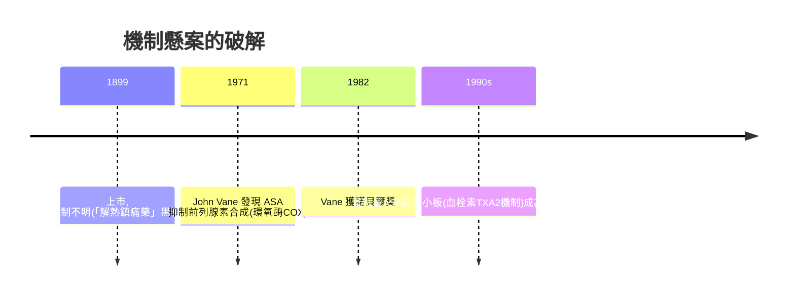

## 1897 - 阿斯匹林與拜耳的專利之爭（最暢銷藥物的偵探卷宗）

## 案件摘要

**本案偵破的是史上最有名藥物的「發明權」懸案。** 1897 年 8 月 10 日，拜耳年輕化學家 Felix Hoffmann 在實驗室日記寫下：他以乙醯化法製得純淨穩定的乙醯水楊酸（acetylsalicylic acid, ASA）。1899 年拜耳以 **Aspirin** 商標上市。謎題：柳樹皮退熱的知識已有兩千年（見 `-1550-埃伯斯紙草與埃及藥典.md`），水楊酸 1838 年就被分離、1853 年就有人乙醯化過——那麼，**阿斯匹林到底「發明」了什麼？誰才是真正的父親？**

## 前因 -- 為什麼會有這個案子

- **水楊酸的工業化**。1828 年 Buchner 從柳皮分離水楊苷、1838 年 Raffaele Piria 製得水楊酸；1874 年起可從石炭酸大量合成——便宜，但**苦到吐、傷胃到病人拒服**。
- **家族病史的傳說**。Hoffmann 的父親患風濕，服水楊酸嘔吐——據拜耳官方敘事，他為父親改良此藥；此敘事被 20 世紀末的檔案研究證實為**行銷神話**。
- **拜耳的「新藥流水線」**。染料起家的拜耳（見 `1856-珀金苯胺紫與染料藥廠.md`）1880s 設立半合成研究部，同時在改造嗎啡（做出海洛因）與水楊酸——**同一批化學家、同一套乙醯化思維**。

## 線索與推理 -- 數學式、程式、理論

**線索一：誰先乙醯化？檔案偵查結果。** 1853 年法國化學家 Charles Gerhardt 已製得粗製乙醯水楊酸；1897 年之前拜耳化學家 Arthur Eichengrün 主導乙醯化製劑研發計畫。**1949 年 Eichengrün 發文自稱阿斯匹林真正發明人，Hoffmann 只是動手的實驗員**；他當時是猶太裔、納粹時期被監禁，無法申辯。2000 年代英國醫史學家 Walter Sneader 重查拜耳檔案，**裁定 Eichengrün 的陳述成立**——本案的真相直到藥物上市百年後才翻案。

**線索二：ASA 究竟改良了什麼？** 化學上，乙醯化掩蔽了水楊酸的酚羥基：

$$ \text{水楊酸} \xrightarrow{(\text{CH}_3\text{CO})_2\text{O}} \text{乙醯水楊酸} $$

苦味大減、對胃刺激降低、結晶純淨可壓片——**改良的是藥物動力學與順從性，不是適應症**。這是「分子修飾（prodrug 思維）」時代的開端：不改藥理、只改口感與耐受。

**線索三：專利與商標的偵探價值。** ASA 本身在德國無法申請化合物專利（已知物質），拜耳因此護住的是**商標 Aspirin＋製法專利（在美國等）**——這解釋了為什麼一戰後協約國沒收商標（美國 1921 年判 Aspirin 為通用名）成為拜耳的最大傷痛。**藥物史的政治經濟學：名字比分子值錢。**

**線索四：作用機制的終極補案。** 為什麼 ASA 退熱止痛？此案懸置 74 年：

## 結案 -- 後果與影響

- **化學修飾範式的確立**。從母體分子出發做半合成衍生物，成為 20 世紀製藥業的主引擎（嗎啡→海洛因、奎寧→氯奎、睪固酮→口服避孕藥）。
- **非處方藥與自我藥療的誕生**。阿斯匹林讓「吃藥」成為日常消費行為——藥物從藥師的櫃台走進家庭抽屜，也為 1937 年磺胺酏劑惨案後的藥事法（見 `1906-美國純食品與藥物法案.md`、`1962-科夫沃修正案與臨床試驗的法典化.md`）埋下監管張力。
- **一句話結案**：阿斯匹林案的真相——**它發明的不是分子，而是「把已知藥物變好賣」的整條工業方法**；至於功勞歸誰，偵查結論是：Eichengrün 出主意，Hoffmann 出力氣，拜耳出商標，柳樹出了兩千年的老底。

## 關鍵人物與文獻

- **Felix Hoffmann（1868–1946）**——拜耳化學家；官方敘事的「阿斯匹林之父」。
- **Arthur Eichengrün（1867–1950）**——拜耳研發主管、ASA 計畫領導人；1949 年發文主張發明權；其猶太裔身份使本案長期塵封。
- **John Vane（1927–2004）**——1971 年闡明 ASA 抑制 PG 合成；1982 諾獎（與 Bergström、Samuelsson）。
- 原始文獻——Sneader, W., "The discovery of aspirin: a reappraisal", *BMJ*, 2000；Vane, J. R., *Nature New Biology*, 1971。
- 現代註腳——2020 年代對 ASA 一級預防的再評估（出血風險 vs 獲益）顯示：連最老的明星藥，劑量—人群—終點的三角關係仍在被重新偵辦——**結案不等於結束**。
