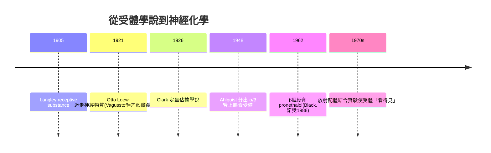

## 1905 - 蘭利受體學說（藥物為什麼會「認得」身體？）

## 案件摘要

**本案偵破的是現代藥理學的哲學基石。** 1905 年，劍橋生理學家 John Newport Langley 在研究菸鹼與箭毒對肌肉的作用後，提出「**接受性物質**（receptive substance）」概念：藥物不瀰漫性地改變整個細胞，而是與細胞上**特定的分子位點**結合，由此觸發反應。謎題：在沒有電子顯微鏡、不知道膜蛋白的年代，他憑什麼斷定身體裡有「專門等著被藥物咬的鎖」？

## 前因 -- 為什麼會有這個案子

- **Ehrlich 的側鏈理論（1897）**。免疫學家 Ehrlich 提出細胞表面的「側鏈」與毒素特異結合（見 `../性病的歷史/1910-埃爾利希洒爾佛散606.md`）；醫藥界已有「鎖與鑰匙」的語言，但證據在免疫血清裡。
- **自主神經的化學傳遞之謎**。1890s 已知電刺激迷走神經減慢心跳、刺激交感神經加速，但**訊號如何跨過突觸**不明；Sherrington 已造出「突觸」一詞。
- **競爭性拮抗的現象學**。菸鹼使肌肉收縮、箭毒使肌肉麻痺，且兩者互相干擾——**「搶座位」的跡象早就擺在桌上**。

## 線索與推理 -- 數學式、程式、理論

**線索一：關鍵實驗——鳥類去神經肌肉。** Langley 將雞的肌肉去神經後，菸鹼仍能使其收縮、箭毒仍能阻斷——**作用部位不在神經，而在肌肉本身的一小塊區域**。他由此推論：肌肉上存在「接受性物質」，它**既接受神經末梢的化學訊號，也接受藥物的冒充**。這一步推理是雙重的：受體既是生理分子的位點，也是藥理學的位點——**生理與藥理在 1905 年共用同一把鎖**。

**線索二：定量語言的誕生。** 受體概念使「藥效」可寫成佔據函數。設受體總量 $[R]_T$，藥物 $[D]$，解離常數 $K_D$：

$$ \text{佔據率} = \frac{[D]}{[D] + K_D} \qquad \text{（A. J. Clark, 1926，將其定量化）} $$

Clark 的「佔據學說」＋Gaddum 的拮抗方程（Schild 作圖, 1947–57）＋Stephenson 的「內在活性」（1956）——**受體藥理學的整座數學大廈，地基是 1905 年那塊**。

**線索三：化學傳遞的證實接力。**

**線索四：反對派的遺產。** 生理學家（如 Henry Dale 早期）懷疑受體是「虛構分子」；Dale 後來成為化學傳遞的諾獎得主——**反對者最終成為最強驗證者**，這是科學辯論的理想結局。

## 結案 -- 後果與影響

- **藥物設計有了靶點**。藥物從「什麼東西能治」變成「什麼分子能結合什麼位點」——今日藥物資料庫按靶點（GPCR、離子通道、酶、核受體）分類的整個架構，都是 1905 年的直系後代。
- **選擇性成為工程目標**。β1 vs β2 選擇性阻斷劑、SSRI 選擇性血清素再攝取抑制劑、見 `2001-基利克與標靶藥物時代.md` 的酪胺酸激酶抑制劑——**「選擇性」三字是 1905 年造的字**。
- **一句話結案**：蘭利案的真相——**受體在被「看見」之前 70 年就被推理出來了**；這是藥物史上推理先於觀察的最佳示範：好的模型可以領先儀器一個世代。

## 關鍵人物與文獻

- **John Newport Langley（1852–1925）**——劍橋生理學教授、*Journal of Physiology* 主編；Michael Foster 的接班人，Sherrington 的同事。
- **Alfred Joseph Clark（1885–1941）**——倫敦大學藥理教授；1933 年《*Mode of Action of Drugs*》把受體寫成方程式。
- **Raymond Ahlquist（1914–1983）**——1948 年提出 α/β 分型，起初被嘲，十年後成為 β 阻斷劑的理論地圖。
- 原始文獻——Langley, J. N., "On the reaction of cells and of nerve-endings to certain poisons", *J. Physiol.*, 1905；A. J. Clark, *J. Physiol.*, 1926。
- 現代註腳——2000 年代 GPCR 晶體結構（Kobilka, 2012 諾獎）終於把受體「拍下照片」——**1905 年的推理，等到 107 年後的顯微鏡**；本案是藥物史上結案最晚、證據最硬的懸案之一。
