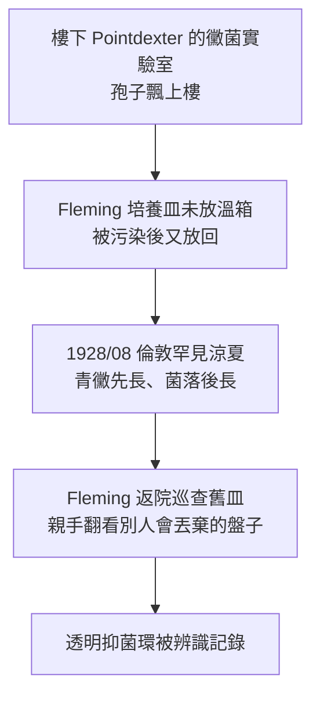

## 1928 - 弗萊明發現青黴素（被弄髒的培養皿與抗生素紀元）

## 案件摘要

**本案偵破的是藥物史上最著名的「意外」案。** 1928 年 9 月 3 日，倫敦 St Mary's 醫院的細菌學家 Alexander Fleming 度假歸來，發現一枚被黴菌污染的葡萄球菌培養皿裡，黴菌周圍出現一圈**細菌被溶解的透明環**。他鑑定黴菌為青黴屬，命名其抗菌物質為 penicillin，1929 年發表論文。謎題：倫敦的空氣裡到處是黴菌孢子，無數培養皿被污染過——為什麼是這一枚改變世界？而為什麼 Fleming 自己把青黴素「留在了實驗室」整整十年？

## 前因 -- 為什麼會有這個案子

- **Fleming 是「抗菌戰」的老兵**。一戰期間他在法國戰地實驗室目睹傷兵死於敗血症、石炭酸沖洗反而損傷組織——**他要找的是「不傷人體的殺菌物」**，這一心結是本案的犯罪動機。
- **溶菌酶（1922）的先導**。Fleming 曾在淚水中發現溶菌酶——天然抗菌物存在於「非毒性」世界的第一個證據；他對「黴菌抑菌」現象保持高度敏感。
- **化療時代的氛圍**。Ehrlich 的 Salvarsan（見 `../性病的歷史/1910-埃爾利希洒爾佛散606.md`）與染料篩選傳統使「微生物殺微生物」不再是異想——缺的只是那個正確的樣本。

## 線索與推理 -- 數學式、程式、理論

**線索一：案發的因果鏈——四個巧合的疊加。**

偵探判決：**這不是運氣，而是「運氣 × 準備」的乘積**——每一環都是可複製的實驗室常態，只有最後一環（辨識與追查）是 Fleming 獨有的素養。

**線索二：為什麼 Fleming 沒做成藥？** 他做到 1930 年代初即止：青黴素化學性質不穩（水中易失活）、他無化學資源提純、且他誤判其為「酶」，並認為它只適合表面敷用。**本案最重要的教訓：發現 ≠ 發明**——把黴菌汁變成藥物，需要的是化學工程與戰爭動員，不是生物學。

**線索三：真正的藥物化（1938–1943）。** 牛津的 Florey、Chain、Heatley 團隊接手：冷凍乾燥、逆流萃取、小鼠保護試驗（1940，8 隻感染小鼠 4 隻給藥全活）、1941 年首例病人（警察 Albert Alexander，被玫瑰刺傷感染，藥盡人亡）、1943 年起美國戰爭生產局動員深槽發酵——**青黴素產量：1940 年全英僅夠治一人，1944 年諾曼地登陸前已儲 230 萬劑**。

**線索四：理論層——選擇性毒性的終極驗證。** 青黴素抑制細菌細胞壁肽聚醣交聯（轉肽酶），人體細胞無細胞壁——**治療指數天然極高**：

$$ TI = \frac{LD_{50}(\text{人})}{ED_{50}(\text{菌})} \gg 100 $$

這一機制 1957 年由 Strominger 闡明；Ehrlich 的魔法子彈（見 `../性病的歷史/1910-埃爾利希洒爾佛散606.md`）至此有了最完美的彈道。耐藥性隨之登場：1940 年 Chain 已分離青黴素酶——**抗生素與耐藥性的軍備競賽，從發現的第一年就開始了**。

## 結案 -- 後果與影響

- **抗生素紀元**。外科大手術、器官移植、化療都建立在「感染可控」的假設上；梅毒一針治癒（見性病史 `../性病的歷史/1943-青黴素治癒梅毒.md`）是其中最戲劇性的應用。
- **諾貝爾 1945**。Fleming–Florey–Chain 同獲生理學或醫學獎；Fleming 名言：「我沒有發明青黴素，是大自然發明的。我只是偶然發現了它。」
- **一句話結案**：青黴素案的真相——**污染是常態，看見污染裡的線索才是例外**；而從培養皿到戰場藥箱之間隔著一場世界大戰——藥物的誕生需要科學家，藥物的問世需要國家。

## 關鍵人物與文獻

- **Alexander Fleming（1881–1955）**——蘇格蘭人、St Mary's 細菌學教授；為人木訥、實驗室凌亂成為傳奇的一部分。
- **Howard Florey（1898–1968）與 Ernst Chain（1906–1979）**——牛津團隊正副手；Norman Heatley（1911–2004）解決萃取工程問題，長期被諾獎遺漏，2004 年牛津以其名命名大樓致意。
- 原始文獻——Fleming, "On the antibacterial action of cultures of a penicillium", *Br. J. Exp. Pathol.*, 1929；Chain et al., *Lancet*, 1940。
- 現代註腳——2010 年代牛津對 Heatley 筆記的再研究顯示：真正的瓶頸是「深槽發酵＋冷凍乾燥」的化工規模化——**抗生素史的下半場是工程史**；今日則輪到耐藥性把劇本改寫回生物學。
