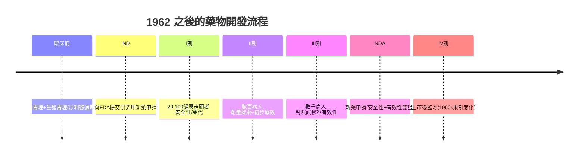

## 1962 - 科夫沃修正案與臨床試驗的法典化（「有效」成為法定義務的那一天）

## 案件摘要

**本案偵破的是現代臨床試驗制度的立法現場。** 1962 年 10 月 10 日，甘迺迪總統簽署《科夫沃–哈里斯修正案》（Kefauver–Harris Drug Amendments）：**藥品上市前必須向 FDA 證明「有效性」而不僅是「安全性」，且必須基於「充分且對照良好的研究」**；知情同意寫入法律；廣告納入監管。謎題：一場沙利竇邁悲劇（見 `1961-沙利竇邁與孕婦藥物安全.md`）在美國僅造成二十餘例畸形，為什麼卻促成美國藥事法最深刻的一次革命？「有效」憑什麼從醫學判斷變成法律義務？

## 前因 -- 為什麼會有這個案子

- **參議員的長期戰爭**。田納西參議員 Estes Kefauver 自 1950s 起調查藥價與專利壟斷（抗生素專利、成藥暴利），屢屢受挫——他等一個足夠悲慘的新聞事件。
- **沙利竇邁的及時震撼**。1962 年 7 月 Merck/Morton-Nash 關於沙利竇邁的證詞與 Kelsey 的事蹟使國會輿論逆轉；Kefauver 的草案被大幅強化通過。
- **法學與統計學的匯流**。同時期 Fisher 的實驗設計（1935）與 Hill 的隨機對照試驗傳統（1948 鏈黴素試驗，見 `1943-瓦克斯曼與鏈黴素.md`）已證明「對照」可行——法律只需把科學實踐轉為法定語言。

## 線索與推理 -- 數學式、程式、理論

**線索一：「有效」如何變成可稽核的定義。** 修正案把有效性委託給一套證據標準，可整理為：

$$ \text{有效} \iff \exists\ \text{充分且對照良好的試驗},\ E_{\text{治療組}} - E_{\text{對照組}} > 0\ (\text{統計顯著}) $$

配合 **Hill 因果準則（1965）**：時序性、強度、一致性、特異性、生物合理性……——**流行病學與臨床試驗的方法論被寫進行政法規**，這是 20 世紀醫學史上「科學方法論 → 法典」的關鍵轉譯。

**線索二：回溯清查的骨牌。** FDA 要求 1938–1962 年間核准的 4000 餘種藥物在限期內補交有效性證據（Drug Efficacy Study, NAS 主持）；**約 1/3 被撤市、1/3 需改標示**——包括數百種「復方感冒糖漿」。本案的偵查價值：**用新標準回溯審判舊藥，是監管制度自我修正的第一次大規模演練**。

**線索三：DeInvoke 與「試驗即倫理」**。修正案配套要求知情同意；1964 年世界醫學會《赫爾辛基宣言》進一步立規（1972 年塔斯基吉醜聞曝光後全面強化，見性病史 `../性病的歷史/1932-塔斯基吉梅毒實驗.md`）——**「受試者權利」與「數據有效性」成為同一部法律下的雙支柱**。

**線索四：藥物開發時間線的重構。**

**一顆新藥從此平均要 10–15 年、數億美元**——「證明有效」的成本結構，直接塑造了此後製藥業的規模化與壟斷格局。

## 結案 -- 後果與影響

- **臨床試驗產業化**。CRO（受託研究機構）、GCP 準則、倫理委員會（IRB）逐級制度化；ICH 1990 年代使美日歐標準趨同。
- **藥價與創新的永恆拉鋸**。批評者指審批延誤使病人「死在等藥的路上」（1980s 愛滋運動即以此反擊，見 `1987-AZT與病人權利運動.md`）；辯護者指 1950s 未經試驗的沙利竇邁正是「快」的代價——**審批制度的每一個齒輪，都在這兩極之間定位**。
- **一句話結案**：科夫沃案的真相——**1962 年之前，「有效」是醫師的印象；之後，是國家的裁定**；這是藥物史上權力最大的一次轉移：把「什麼算證據」從市場與權威手中，移交給隨機對照試驗。

## 關鍵人物與文獻

- **Estes Kefauver（1903–1963）**——田納西參議員、反壟斷鬥士；1963 年病逝，未能見修正案全面施行。
- **Frances Kelsey（1914–2015）**——修正案的活證人；其沙利竇邁審查檔案為國會聽證的關鍵證據。
- **Austin Bradford Hill（1897–1991）**——流行病學家；1948 鏈黴素 RCT 設計者、1965 因果準則作者——臨床試驗方法的「立法顧問」。
- 原始文獻——*Federal Food, Drug, and Cosmetic Act amendments*, Pub. L. 87-781 (1962)；FDA Drug Efficacy Study Implementation notices (1970s)；Hill, "The environment and disease: association or causation?", *Proc. R. Soc. Med.*, 1965。
- 現代註腳——2020 年 COVID 疫苗以「緊急使用授權」繞過完整 III 期時間線，引發 1962 精神 vs 2020 現實的全球辯論——**六十年後，本案的證據標準仍在被壓力測試**。
