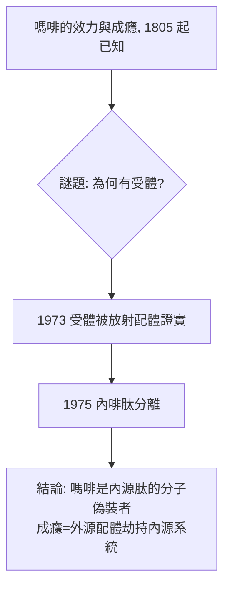

## 1975 - 內啡肽與鴉片受體的發現（身體裡本來就有鴉片）

## 案件摘要

**本案偵破的是一個哲學級的謎題。** 1973 年，約翰霍普金斯的 Candace Pert 與 Solomon Snyder 以放射配體結合實驗，首次直接證實**腦組織中存在鴉片受體**；1975 年，蘇格蘭阿伯丁的 John Hughes 與 Hans Kosterlitz 分離出腦內自身的鴉片樣物質——**腦啡肽（enkephalin）**，次年證明其結構為五肽，並由 1977 年名的「內啡肽（endorphin）」統稱。謎題：身體為什麼會演化出**專門接住嗎啡分子的鎖**？難道大腦天生就「期待」鴉片？本案的答案是：不是身體等待鴉片，而是鴉片冒充了身體自己的訊號。

## 前因 -- 為什麼會有這個案子

- **受體學說的成熟**。Langley 的「接受性物質」（見 `1905-蘭利受體學說.md`）與 Clark 的定量佔據理論已確立「特異結合」的範式——剩下的是把受體「拍下來」。
- **藥理學的層級之謎**。1954 年 Beckett 與 Casy 由嗎啡系列衍生物的立體選擇性推測受體具**手性口袋**；1960s 也有人（如 Goldstein, 1971）嘗試用放射性標記鴉片找結合位點，卻因非特異結合噪音太大而失敗。
- **針灸與電刺激的旁證**。1970s 中國針刺麻醉報告使西方科學家困惑：疼痛抑制若非鴉片所致，必有內源機制——**內源性鎮痛系統的假說在空中漂浮**。

## 線索與推理 -- 數學式、程式、理論

**線索一：Pert–Snyder 的方法突破。** 關鍵是**降低非特異結合**：用高親和力的拮抗劑 $[^3H]$naloxone 做配體，並以過量未標記 naloxone 定義非特異背景：

$$ \text{特異結合} = \text{總結合} - \text{非特異結合（過量冷配體自競爭）} $$

配體結合呈飽和、可被鴉片藥按效力排序競爭、分布於邊緣系統與脊髓——**受體的藥理「指紋」與臨床鴉片完全一致**。此案證明：受體學說可以直接用同位素驗證——**放射配體結合技術從此成為藥理學的標準顯微鏡**。

**線索二：反向偵查——「受體存在 → 配體必然存在」。** 偵探式推理：演化不會保存一把沒有鑰匙的鎖。Snyder 團隊與 Hughes 團隊分工：Hughes 以生物檢定（小鼠輸精管收縮抑制）追蹤腦提取物，1975 年取得兩個五肽：

$$ \text{Tyr–Gly–Gly–Phe–Leu / Tyr–Gly–Gly–Phe–Met（Leu/Met-enkephalin）} $$

**N 端 Tyr 是「鴉片鑰匙齒」**——與嗎啡的酪胺酸樣部分對應，結構偵查至此閉環。1976 年 Li 與 1979 年大鼠前腦啡肽原基因克隆，內啡肽家族（β-endorphin、dynorphin）陸續歸案。

**線索三：三種受體亞型的分類。** Martin（1976）與 Kosterlitz（1977）以藥理譜分出 μ（嗎啡樣）、κ、δ——**內源系統的「語法」比想像複雜**，此分類直接指導此後五十年的止痛藥設計（芬太尼家族、部分激動劑 buprenorphine）。

**線索四：全案的地質學解釋。**

## 結案 -- 後果與影響

- **藥物受體學的黃金時代**。放射配體技術瞬間擴散：組織胺受體 H2（Black 的西咪替丁，1972–76）、苯二氮䓬受體（1977）——**「先找受體再找藥」成為主流**，逆轉了「先有藥後知機制」的百年傳統。
- **疼痛與成癮的科學重寫**。成癮被重新定義為「內源獎賞系統的劫持」，直接啟發 1990s 多巴胺獎賞迴路研究與成癮醫學；針刺鎮痛的部分效應被歸因於內啡肽釋放（拮抗劑 naloxone 可部分阻斷）。
- **一句話結案**：1975 年案的真相——**嗎啡六千年的統治是一場冒名頂替**；身體的鴉片受體是為腦啡肽與內啡肽打造的，外源鴉片的高效力與高成癮性，正是「偽造品比真鈔更強」的藥理學版本。

## 關鍵人物與文獻

- **Candace Pert（1946–2013）**——博士生，放射配體實驗的實際執行者；因未列入 1978 年 Lasker 獎而與 Snyder 公開決裂——**榮譽分配的又一懸案**（呼應 `1943-瓦克斯曼與鏈黴素.md`）。
- **Solomon Snyder（1938–）**——Hopkins 藥理與精神科教授；其實驗室此後成為神經藥理學重鎮。
- **John Hughes（1942–）與 Hans Kosterlitz（1903–1996）**——阿伯丁鴉片肽研究組；Kosterlitz 70 歲高齡完成腦啡肽分離。
- 原始文獻——Pert & Snyder, "Opiate receptor: demonstration in nervous tissue", *Science*, 1973；Hughes et al., "Identification of two related pentapeptides...", *Nature*, 1975。
- 現代註腳——2020 年代結構生物學解析 μ 受體–Gi 複合物結構（2012 諾獎 GPCR 研究的延伸），設計「避開 β-arrestin 通路」的成癮更低的止痛藥（如 oliceridine）——**五十年後，科學家仍在根據本案的「鎖」打造更安全的鑰匙**。
