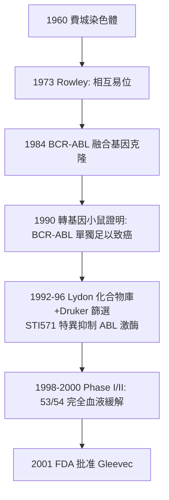

## 2001 - 基利克與標靶藥物時代（從「殺死快速分裂的細胞」到「關掉致癌開關」）

## 案件摘要

**本案偵破的是抗癌藥物的範式轉移案。** 2001 年 5 月 10 日，FDA 核准 **imatinib（Gleevec，基利克/格列衛）**治療慢性髓性白血病（CML）——它不是細胞毒藥，而是針對 CML 病因（BCR-ABL 融合蛋白的酪胺酸激酶活性）的**特異性抑制劑**；臨床試驗中 53/54 名干擾素失效病人的血象完全緩解。謎題：從 1960 年費城染色體被發現到 2001 年一顆「智能炸彈」上市，這 41 年的偵查鏈每一環是誰接的？標靶藥物真的告別了化療時代嗎？

## 前因 -- 為什麼會有這個案子

- **1960 年費城染色體**。賓大 Peter Nowell 與 David Hungerford 在 CML 病人細胞中發現一條異常縮短的第 22 號染色體——**第一個與人類癌症明確關聯的染色體異常**（當時沒人知道為什麼）。
- **1973 年 Janet Rowley 的翻案**。芝加哥的 Rowley 以染色體分帶技術證明：費城染色體不是缺失，而是 **9 與 22 號染色體的相互易位**——「易位產生融合基因」的假說，在致癌基因概念（1976 Bishop–Varmus）確立後成為主角。
- **1984–85 年融合基因現形**。Heisterkamp、Groffen 等克隆 ABL/BCR 融合點，證明其蛋白具**持續開啟的酪胺酸激酶活性**——致癌開關找到了，可它是藥物可及的靶點嗎？
- **化工的即戰力**。Ciba-Geigy 的化學家尼古拉斯・萊登（Nick Lydon）正在合成**蛋白激酶抑制劑庫**（源自染料化學的又一條血脈——見 `1856-珀金苯胺紫與染料藥廠.md`）；Druker 以細胞試驗從中挑出 STI571。

## 線索與推理 -- 數學式、程式、理論

**線索一：因果鏈的完整閉環。**

**這是醫學史上第一條「從病因分子到特效藥」的完整證據鏈**——此前所有藥物都沒有走完這條路。

**線索二：選擇性的結構基礎。** ABL 激酶有活/無活兩種構象；imatinib 結合於**非活化構象**的 ATP 位點，靠氫鍵與 DFG-out 口袋特異錨定：

$$ \Delta G_{\text{bind}}^{ABL} \ll \Delta G_{\text{bind}}^{\text{其他激酶}} \quad \Rightarrow \quad \text{選擇性 } \sim 1000\times $$

**「只咬壞開關、不碰好開關」**——受體學說（見 `1905-蘭利受體學說.md`）與 Ehrlich 選擇性毒性的極致版本。

**線索三：耐藥性的回馬槍與偵查再起。** 2001 年起 CML 病人出現 T315I 等點突變（蘇氨酸→異亮氨酸，堵住藥物結合）；結構生物學逐一破案，第二代（dasatinib, nilotinib）、第三代（ponatinib）接力——**標靶藥物的商業模式因此重寫：不是「一藥治終身」，而是「靶點管理＋迭代抑制劑」**。

**線索四：經濟學的深水區。** Gleevec 年費從 2001 年約 $26,000 漲至 2020 年代 $120,000+（仿製藥 2016 年進場）；印度仿製藥使全球 CML 病人獲益、也引爆專利與可及性大論戰——**「標靶=高價」的公式自此成為醫療經濟學的核心戰場**。

## 結案 -- 後果與影響

- **標靶治療的時代地圖**。EGFR 抑制劑（肺癌）、HER2（乳癌 trastuzumab）、BTK（ CLL）、ALK、RET……「驅動基因突變→匹配抑制劑」成為腫瘤學主軸；免疫檢查點抑制劑（見 `2018-免疫檢查點抑制劑與諾貝爾獎.md`）是同一邏輯在免疫系統的翻版。
- **伴隨診斷（companion diagnostics）誕生**。用藥前先測基因型——藥物與診斷捆綁銷售的制度化，重塑了藥廠—檢測公司的商業關係。
- **一句話結案**：2001 年案的真相——**Gleevec 的發明者名單上有染色體、有分帶技術、有轉基因小鼠、有化合物庫，唯獨不是「靈感」**；標靶時代的本質是把腫瘤學從戰場炸射改為工程除雷——每一顆雷都先標記、再拆除。

## 關鍵人物與文獻

- **Brian Druker（1955–）**——奧勒岡健康與科學大學血液學家；堅持把「化學家的激酶抑制劑」推向臨床的核心推手。
- **Nicholas Lydon（1957–）**——Ciba-Geigy 化學家，STI571 合成者；2009 年與 Druker、Lasker 獲 Lasker-DeBakey 獎。
- **Janet Rowley（1925–2013）**——芝加哥細胞遺傳學家；1973 年易位發現起初被期刊懷疑，「醫師的副業研究」改寫了腫瘤學。
- **Charles Sawyers**——耐藥機制與第二代藥物的關鍵研究者。
- 原始文獻——Druker et al., "Efficacy and safety of a specific inhibitor of the BCR-ABL tyrosine kinase in chronic myeloid leukemia", *NEJM*, 2001；Nowell & Hungerford, *J. Natl. Cancer Inst.*, 1960；Rowley, *Ann. Genet.*, 1973。
- 現代註腳——2010 年代深測序使「耐藥克隆早期偵測」成為 CML 管理標準；**本案的偵查模式（病因分子→抑制劑→耐藥→迭代）已成為腫瘤藥物開發的標準劇本**，正在 KN2C、KRAS G12C 等新靶點上重演。
