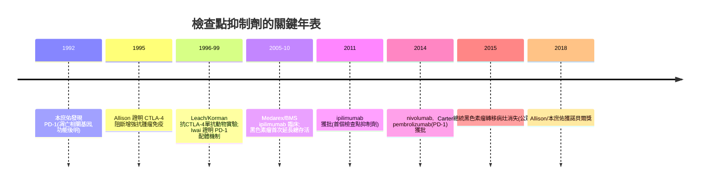

## 2018 - 免疫檢查點抑制劑與諾貝爾獎（讓免疫系統自己破案的藥）

## 案件摘要

**本案偵破的是抗癌藥物史最反直覺的一案。** 2018 年 10 月 1 日，諾貝爾生理學或醫學獎頒給 **James Allison** 與 **本庶佑（Tasuku Honjo）**——表彰他們分別發現 **CTLA-4（1995）與 PD-1（1992）** 是免疫系統的「剎車」，並證明**鬆開剎車**而非「踩油門」，就能讓病人自己的免疫細胞消滅腫瘤。2011 年 ipilimumab、2014 年 nivolumab/pembrolizumab 相繼上市；黑色素瘤的五年存活率從不足 10% 躍升至 40% 以上。謎題：一百年的癌症免疫治療（Coleys 毒素、干擾素、IL-2）屢屢失敗，為什麼這一次的答案是「不要幫免疫系統，只要放開它」？

## 前因 -- 為什麼會有這個案子

- **百年失败的墓碑群**。1891 年 Coley 毒素（以細菌毒素激發免疫）被輻射療法埋葬；1970s 干擾素、1980s 高劑量 IL-2 僅對少數黑色素瘤有效——**免疫系統顯然「看得見」腫瘤卻不動手**，這是本案最大的謎面。
- **T 細胞生物學的成熟**。1980s–90s：T 細胞受體克隆、共刺激分子 CD28 發現——免疫反應需要「第二信號」的兩信號模型確立；Allison 提出疑問：**那麼有沒有「負向第二信號」？**
- **B7/CTLA-4 的拼圖**。1987 年 CTLA-4 基因被克隆（法國 Golstein 組），功能不明；1995 年 Allison 小鼠實驗證明 CTLA-4 是抑制性受體、阻斷它可增強抗腫瘤免疫。

## 線索與推理 -- 數學式、程式、理論

**線索一：剎車模型的邏輯形式。** T 細胞活化＝油門−剎車：

$$ \text{活化} = S_1(\text{TCR 信號}) + S_2^+(\text{CD28}) - S_2^- (\text{CTLA-4, PD-1}) $$

傳統免疫治療在 $S_1$/$S_2^+$ 上加油（白介素、疫苗）；Allison 與本庶佑的策略是**移除負項**——藥理學上這是「拮抗劑」的免疫學應用，呼應受體學說（見 `1905-蘭利受體學說.md`）的雙向性：**同一分子家族，既能用激動劑治、也能用拮抗劑治**。

**線索二：為什麼腫瘤「偷配」剎車？** 進化壓力解釋：PD-1/PD-L1 本是周邊耐受的防自免裝置（本庶佑 1992 的原始發現）；腫瘤上調 PD-L1 偽裝「自我」。病理偵查的證據：腫瘤 PD-L1 表達量與免疫治療反應率相關——**伴隨診斷**再次登場（見 `2001-基利克與標靶藥物時代.md`）。

**線索三：從分子到藥的工程接力。**

**線索四：單株抗體的技術前提。** 1975 年 Köhler 與 Milstein 的融合瘤技術（1984 諾獎）＋1990s 人源化／全人抗體平台（噬菌體展示，2018 同獎的一半給了 Winter）——**沒有抗體工程，就沒有可用的檢查點藥物**；本案是「基礎免疫學＋抗體工程＋臨床試驗」三線會師。

## 結案 -- 後果與影響

- **腫瘤學的第四支柱**。手術、放療、化療、標靶之後，免疫治療成為第五選項；適應症從黑色素瘤擴張到肺癌、腎癌、肝癌、MSI-H 通用適應症（2017，FDA 首個按生物標誌物而非器官批准）。
- **新問題的清單**。免疫相關不良事件（irAE，自免副作用）、超進展、原發耐藥、應答率僅 20–40%——**「放開剎車」不等於「都會前進」**；組合療法（PD-1+CTLA-4、PD-1+化療）成為新戰場。
- **一句話結案**：2018 年案的真相——**百年來人類都在問「怎樣幫免疫系統殺癌」，Allison 與本庶佑問的是「誰按住了它」**；藥物史上最大的範式之一，來自一個負號的重新定價。

## 關鍵人物與文獻

- **James P. Allison（1948–）**——德州人、MD Anderson 免疫學家；熱愛 blues 吉他；其妻 is免疫腫瘤學家 Padmanee Sharma。
- **本庶佑（1942–）**——京都大學教授、PD-1 發現者；曾以發明人身份參與小野藥品工業與 BMS/Merck 的專利收益。
- **Arlene Sharpe & Gordon Freeman**——PD-L1/PD-L2 機制闡明的哈佛雙人組。
- 原始文獻——Leach, Krummel & Allison, "Enhancement of antitumor immunity by CTLA-4 blockade", *Science*, 1996；Ishida, Kinashi, Okazaki & Honjo, *EMBO J.*, 1992；Hodi et al., *NEJM*, 2010。
- 現代註腳——2020 年代「next-gen checkpoint」研究（LAG-3、TIGIT、雙特異抗體）多數在 III 期折戟——**松開第二把剎車沒有重現奇蹟**；本案的最終教訓：免疫系統的邏輯不是線性的開關疊加，而是網絡——下一場偵查正在細胞治療（CAR-T）與腫瘤疫苗的戰場上展開。
