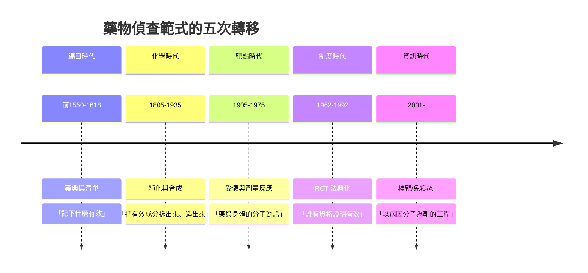

# 藥物的歷史：從史前草藥、神廟藥典、化學革命到標靶與免疫治療

> 本書以「推理探案」的體例，為人類藥物史上的每個關鍵事件寫一篇 wiki：
> 謎題是什麼？線索在哪裡？誰在辦案（薩滿、藥師、化學家、微生物學家、監管者、病人）？
> 每篇檔名以年份開頭（4 位數，負年以 `-` 開頭），如 `0023-神農本草經與中國第一部藥典.md`。

## 四條主線

| 線 | 演變 |
|---|---|
| **知識論線** | 試錯口傳 → 編目清單 → 體液理論 → 化學純化 → 實驗藥理與劑量反應 → 受體學說 → 基因靶點與網絡藥理 |
| **物質線** | 草藥與礦物 → 蒸餾與金屬製劑 → 植物鹼 → 全合成 → 抗生素 → 半合成與前藥 → 單株抗體、核苷類似物、激酶抑制劑 |
| **制度線** | 神廟與薩滿 → 行會執照 → 官定藥典 → 專利與藥廠 → 藥事法與 FDA → 臨床試驗法典化 → 病人權利與加速審批 |
| **偵查方法線** | 觀察與格言 → 排除法與解剖 → 對照試驗 → 隨機對照 → 動力學建模 → 結構生物學 → 基因組與 AI 篩選 |

---

## 年表（非常詳細版）

### 第一篇：草藥、泥板與紙草——文字之前的藥與最早的藥典

| 年份 | 事件 | 意義 | wiki |
|---|---|---|---|
| 距今約 6 萬年 | 山尼達洞穴尼安德塔墓葬中的藥用植物花粉與整束花莖 | 人類最早的「用藥」考古證據 | [-6000-史前草藥與山尼達洞穴的紫菀](-6000-史前草藥與山尼達洞穴的紫菀.md) |
| 約前 6000 起 | 新石器遺址的罌粟種子；止痛進入人類史 | 植物鹼與內源性鎮痛系統的第一場相遇 | 同上 |
| 約前 2100–前 1750 | 尼普爾泥板藥方；漢謨拉比法典對醫療的計價與刑罰 | 最早的藥方檔案與醫療法規 | [-0175-漢謨拉比泥板與美索不達米亞藥方](-0175-漢謨拉比泥板與美索不達米亞藥方.md) |
| 約前 1550 | 《埃伯斯紙草》：700 種藥物、800 多個藥方、七種劑型 | 最完整的古代藥方總匯；以 $ro$ 定量 | [-1550-埃伯斯紙草與埃及藥典](-1550-埃伯斯紙草與埃及藥典.md) |

### 第二篇：理論的誕生與兩大帝國——希臘羅馬與漢唐本草

| 年份 | 事件 | 意義 | wiki |
|---|---|---|---|
| 約前 400 | 希波克拉底學派：四體液說、藥物性質向量、《誓言》倫理 | 藥物第一次擁有理論座標系 | [-0400-希波克拉底與四體液學說](-0400-希波克拉底與四體液學說.md) |
| 約公元 23 | 《神農本草經》：365 藥、三品分類、君臣佐使、七情配伍 | 東方第一部藥典；毒性風險分級 | [0023-神農本草經與中國第一部藥典](0023-神農本草經與中國第一部藥典.md) |
| 約 65–70 | 狄奧斯科里德斯《藥物志》五卷 600 藥 | 西方工具書統治 1500 年；劑型與辨偽的百科 | [0070-狄奧斯科里德斯藥物志](0070-狄奧斯科里德斯藥物志.md) |
| 129 | 蓋倫誕生；其藥性度數與蓋倫製劑統治中世紀 | 劑型工藝的千年帝國與權威壟斷 | [0130-蓋倫與蓋倫製劑的千年帝國](0130-蓋倫與蓋倫製劑的千年帝國.md) |

### 第三篇：阿拉伯盛世與歐洲行會——藥師職業的制度化

| 年份 | 事件 | 意義 | wiki |
|---|---|---|---|
| 8–9 世紀 | 巴格達藥鋪、$hisba$ 督察、Sabur 藥典、蒸餾技術 | 藥師執照＋抽檢＋執罰的三件套 | [0850-阿拉伯藥學與最早的藥妝店](0850-阿拉伯藥學與最早的藥妝店.md) |
| 1025 | 伊本・西那《醫典》：試藥七則、臟器親和性 | 臨床試驗方法論的第一次完整陳述 | [1025-伊本西那醫典與阿拉伯藥學盛世](1025-伊本西那醫典與阿拉伯藥學盛世.md) |
| 1231 | 腓特烈二世《梅爾菲憲章》：醫藥分業、藥師考試、藥價公約 | 歐洲藥事法治的開端 | [1231-腓特烈二世藥師法規](1231-腓特烈二世藥師法規.md) |
| 1498 | 佛羅倫斯《Nuovo Receptario》：第一部官定城市藥典 | 品質標準與城市信譽的商業工程 | [1498-佛羅倫斯藥典](1498-佛羅倫斯藥典.md) |
| 1527 | 帕拉塞爾蘇斯焚燒蓋倫教科書；「劑量決定毒」 | 化學醫學革命與毒理學哲學地基 | [1527-帕拉塞爾蘇斯與化學醫學革命](1527-帕拉塞爾蘇斯與化學醫學革命.md) |
| 1618 | 倫敦藥典頒布；醫師學會與藥師行會的版本鬥爭 | 藥典=品質工具＋職業權力工具 | [1618-倫敦藥典與藥師行會的品質戰爭](1618-倫敦藥典與藥師行會的品質戰爭.md) |

### 第四篇：化學紀元——從植物鹼到染料帝國

| 年份 | 事件 | 意義 | wiki |
|---|---|---|---|
| 1805 | 塞爾特納分離嗎啡，以毫克為單位試於人體 | 「藥=純物質」範式確立；劑量成為變數 | [1805-塞爾特納分離嗎啡](1805-塞爾特納分離嗎啡.md) |
| 1828 | 維勒由氰酸銨合成尿素 | 活力論崩塌；合成藥物的哲學入場券 | [1828-維勒合成尿素與活力論的崩塌](1828-維勒合成尿素與活力論的崩塌.md) |
| 1847 | 布赫海姆建世界首個藥理學研究所 | ADME 綱領與劑量反應曲線的誕生 | [1847-布赫海姆與實驗藥理學的誕生](1847-布赫海姆與實驗藥理學的誕生.md) |
| 1856 | 珀金合成苯胺紫（本想合成奎寧） | 染料工業成為日後藥廠的軍火庫 | [1856-珀金苯胺紫與染料藥廠](1856-珀金苯胺紫與染料藥廠.md) |
| 1897 | 拜耳乙醯水楊酸上市（Aspirin）；Eichengrün/Hoffmann 發明權懸案 | 分子修飾（半合成）時代與商標帝國 | [1897-阿斯匹林與拜耳的專利之爭](1897-阿斯匹林與拜耳的專利之爭.md) |

### 第五篇：靶點、監管與抗生素——現代製藥業成型

| 年份 | 事件 | 意義 | wiki |
|---|---|---|---|
| 1905 | 蘭利提出「接受性物質」（受體） | 藥物設計有了靶點；佔據學說的哲學基石 | [1905-蘭利受體學說](1905-蘭利受體學說.md) |
| 1906 | 美國《純食品與藥物法案》（Wiley 毒物隊＋《屠場》） | 藥物監管國家誕生（標示法階段） | [1906-美國純食品與藥物法案](1906-美國純食品與藥物法案.md) |
| 1909–1910 | Ehrlich–Hata 606（Salvarsan）：首個化療藥 | 篩選方法論、治療指數（參見性病史卷） | （見「性病的歷史」冊 1910 篇） |
| 1928 | 弗萊明發現青黴素；1940s 牛津團隊與戰時量產 | 抗生素紀元；發現≠發明 | [1928-弗萊明發現青黴素](1928-弗萊明發現青黴素.md) |
| 1935 | 多馬克 Prontosil→磺胺；Tréfouël 揭示活性形式 | 前藥概念、抗代謝物學說、藥物大爆炸 | [1935-多馬克磺胺與魔法子彈量產](1935-多馬克磺胺與魔法子彈量產.md) |
| 1937 | 磺胺酏劑（二甘醇）慘案 | 1938 年《聯邦食品藥品化妝品法》：上市前安全審查 | 同上 |
| 1943–44 | 瓦克斯曼/Schatz 鏈黴素；「篩土壤」平台 | 抗生素黃金年代；聯合療法先聲；師生榮譽訴訟 | [1943-瓦克斯曼與鏈黴素](1943-瓦克斯曼與鏈黴素.md) |

### 第六篇：危機與法典化——沙利竇邁之後的試驗制度

| 年份 | 事件 | 意義 | wiki |
|---|---|---|---|
| 1961 | 沙利竇邁召回；上萬海豹肢畸兒；Kelsey 擋下美國核准 | 致畸學誕生；監管者的「說不」成為英雄事蹟 | [1961-沙利竇邁與孕婦藥物安全](1961-沙利竇邁與孕婦藥物安全.md) |
| 1962 | 科夫沃–哈里斯修正案：有效性成為法定義務 | RCT 寫入法律；IND/NDA 流程定型；藥物開發 10–15 年化 | [1962-科夫沃修正案與臨床試驗的法典化](1962-科夫沃修正案與臨床試驗的法典化.md) |
| 1964 | 《赫爾辛基宣言》 | 受試者權利與數據有效性的雙支柱 | 同上 |

### 第七篇：受體、病毒與病人權利——神經藥理與愛滋時代

| 年份 | 事件 | 意義 | wiki |
|---|---|---|---|
| 1973 | Pert/Snyder 放射配體證實鴉片受體 | 受體從推理變成可測量 | [1975-內啡肽與鴉片受體的發現](1975-內啡肽與鴉片受體的發現.md) |
| 1975 | Hughes/Kosterlitz 分離腦啡肽 | 內源鎮痛系統；嗎啡=冒名頂替者 | 同上 |
| 1987 | AZT 加速核准；ACT UP 成立 | 病人從受試者變談判者；審批制度被改寫 | [1987-AZT與病人權利運動](1987-AZT與病人權利運動.md) |
| 1988 | ACT UP 佔領 FDA；病人代表進入諮詢委員會 | 參與式審批的制度化 | 同上 |
| 1995 | 何大一/Perelson 病毒動力學模型（日產 100 億） | 耐藥性的數學必然；雞尾酒原理 | [1995-何大一與雞尾酒療法](1995-何大一與雞尾酒療法.md) |
| 1996 | HAART 問世；愛滋死亡率斷崖式下降 | 病毒動力學寫進處方原則 | 同上 |

### 第八篇：標靶、免疫與未來——藥物成為資訊工程

| 年份 | 事件 | 意義 | wiki |
|---|---|---|---|
| 1960→2001 | 費城染色體→BCR-ABL→STI571；2001 年 Gleevec 獲批 | 第一條「病因分子→特效藥」完整證據鏈；伴隨診斷誕生 | [2001-基利克與標靶藥物時代](2001-基利克與標靶藥物時代.md) |
| 2011–2015 | ipilimumab→nivolumab/pembrolizumab | 檢查點抑制劑：放開免疫剎車 | [2018-免疫檢查點抑制劑與諾貝爾獎](2018-免疫檢查點抑制劑與諾貝爾獎.md) |
| 2017 | FDA 以 MSI-H 生物標誌物（非器官）批准 pembrolizumab | 「腫瘤不見了，只剩分子分型」的監管革命 | 同上 |
| 2018 | 諾獎頒給 Allison 與本庶佑 | 負號的重新定價：免疫治療的範式確立 | 同上 |
| 2020s | 沙利竇邁分子化身 lenalidomide；CAR-T、mRNA 疫苗、GLP-1 | 同一分子可罪可功；藥物開發進入資訊工程時代 | 各相關篇 |

---

## 核心線索：藥物史的五次「偵查範式」轉移

## 貫穿全書的三個理論

1. **選擇性毒性與治療指數**：$TI = LD_{50}/ED_{50} \gg 1$——從帕拉塞爾蘇斯的劑量格言、Ehrlich 的魔法子彈，到青黴素與基利克，都是這一不等式的歷史解。
2. **受體學說與劑量—反應**：$E = E_{max}[D]^n/(EC_{50}^n+[D]^n)$——蘭利的推理、Clark 的方程、放射配體的驗證，構成現代藥理學的語法。
3. **動力學建模**：從病毒指數衰減到群體藥代動力學，**微積分第一次成為處方原則**（何大一/Perelson 1995）。

---

## 閱讀路線建議

- **想看「偵探故事」**：從 `-6000-史前草藥與山尼達洞穴的紫菀.md`、`1910`（性病史卷）、`1961-沙利竇邁與孕婦藥物安全.md` 開始。
- **想看「理論演化」**：`-0400` → `1527` → `1847` → `1905` → `1975` → `2001`。
- **想看「制度博弈」**：`-0175` → `1231` → `1498` → `1906` → `1962` → `1987`。
- **想看「經濟與權力」**：`1856` → `1897` → `1943` → `2001`。

> 本書與「性病的歷史」卷互有引註：Salvarsan（1910）、青黴素治梅毒（1943）等案件兩卷合偵。
