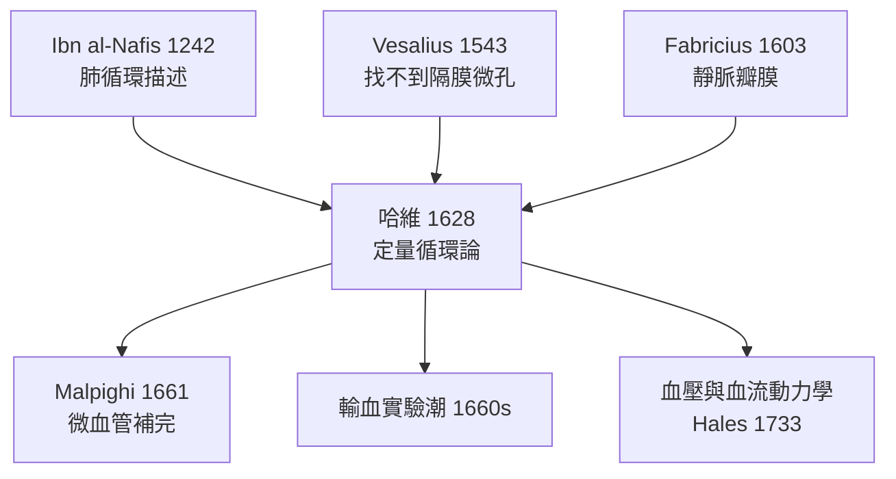

## 1628 - 哈維《心血運動論》（血液循環的發現，放血帝國的地基被抽走）

## 案件摘要

**本案偵破的是人體最深的一樁「懸案」：血離開心臟之後，去了哪裡？**

蓋倫（見 `0150-蓋倫放血療法與體液學說.md`）說血像潮水來回漲落。1628 年，英國醫生 William Harvey 出版《心血運動論》（*Exercitatio Anatomica de Motu Cordis et Sanguinis in Animalibus*），用一條簡單得近乎羞辱的算術證明：血液必然是**循環的**。這是醫學史上第一次用定量推理推翻千年權威——血液科的一切（輸血、血壓、血流動力學）都蓋在這塊基石上。

## 前因 -- 為什麼會有這個案子

- **蓋倫模型的內傷**：潮汐模型要求血液在肝臟無限生成、在組織無限蒸發，但從未有人計算過「流量」。
- **肺循環的前哨**：13 世紀 Ibn al-Nafis 已描述血經肺從右心到左心（推翻蓋倫的「隔膜微孔」）；1553 年 Michael Serveto（塞爾維特）在神學著作中重述肺循環——他因此被加爾文燒死，證詞差點陪葬。
- **Valve 的線索**：1543 年 Vesalius 指出找不到隔膜微孔；1603 年 Fabricius（哈維的老師）發現靜脈瓣膜——但瓣膜方向朝心臟，與潮汐模型矛盾，Fabricius 本人卻不敢推出結論。
- **帕多瓦大學**：伽利略任教的同一所大學，也是哈維的母校；這裡的數學—機械空氣，浸染了這位醫生偵探。

## 線索與推理 -- 數學式、程式、理論

**線索一：致命的算術（本案的核心推理）。** 哈維做了別人從沒做過的事——計算：

$$ V = \text{心室容積} \times \text{每次搏出} \times \text{心率} \times \text{時間} $$

他實測：左心室舒張時約容 2 英兩血，每搏至少射出 1/8（他故意取最保守值），心率每分鐘 72 次：

```text
每小時射出血量 ≥ (2 oz × 1/8) × 72 × 60 ≈ 1080 oz ≈ 30.8 kg
```

**每小時三個成人的體重那麼多的血**。肝臟不可能每小時重新釀造 30 公斤血，組織也不可能吸收 30 公斤——唯一的解：血液被**重複使用**，即循環。一個簡單的不等式，殺死了一千五年的理論。

**線索二：瓣膜的指紋比對。** 哈維用繃帶壓住手臂靜脈，指推血液——血只能推向心臟方向，反推則瓣膜關閉、靜脈鼓起。靜脈瓣是單向閘門，證明靜脈血**定向流回心臟**。潮汐模型的「逆流」選項被現場排除。

**線索三：活體動物實驗。** 哈維解剖了 80 多種動物：結紮腔靜脈，心臟立即排空變白；鬆開後心臟再次充盈——因果方向是「靜脈→心臟」，與蓋倫「心臟→靜脈」相反。

**線索四：虛線的補全——微血管的預言。** 哈維的模型有一個缺口：動脈末端與靜脈起點之間的「通路」他看不到，只能以邏輯斷言「必有孔隙相通」。這是偵探留下的懸賞令——1661 年，Malpighi 用顯微鏡在蛙肺中找到**微血管**，全案閉環。



## 結案 -- 後果與影響

- **生理學成為定量科學**：「測量勝於引經據典」從此是醫學偵探的職業倫理；Descartes 與舊學派起初抵制，但 1650 年代循環論已席捲歐洲。
- **放血療法失去理論地基**：血是循環再用的資源而非可任意傾倒的潮水——放血量的「無限供應」前提崩塌，放血帝國開始倒數（雖然苟延到 19 世紀）。
- **輸血之門開啟**：既然血是循環的液體，理論上就可以「補充」——1665 年 Richard Lower 的狗對狗輸血、1667 年 Denis 的人體輸血（見 `1667-丹尼斯羊輸血事件.md`）直接踏進這扇門。
- **一句話結案**：哈維案的破案工具不是顯微鏡，而是小學算術——**遇到千年懸案，先算數**。

## 關鍵人物與文獻

- **William Harvey（1578–1657）**——帕多瓦大學醫學博士、英王詹姆士一世與查理一世的御醫；名句：「一切以親眼解剖與實驗為證，不信任何作者的空談。」
- 原始文獻——Harvey, *Exercitatio Anatomica de Motu Cordis et Sanguinis in Animalibus*, Frankfurt, 1628。
- **Michael Serveto（約 1511–1553）**——肺循環的殉道者；1553 年被以異端罪燒死於日內瓦，幾乎所有著作陪葬，僅存三本倖免於火。
- **Marcello Malpighi（1628–1694）**——與《心血運動論》同年出生；1661 年以顯微鏡補上微血管，替哈維關掉了最後一扇未解之門。
- 現代註腳——哈維同時是皇家醫師與「疑案迷」：他還檢驗過「女妖」與巫術案件，以病理學證據為被告辯護——醫學鑑識的早期身影。

