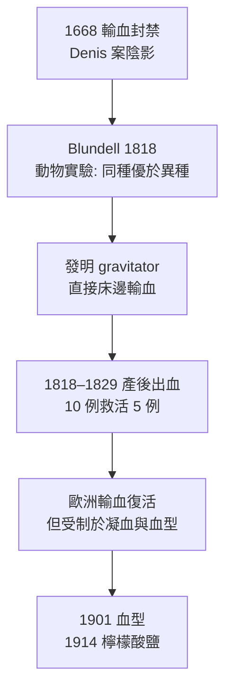

## 1818 - 布倫德爾人對人輸血（產後出血的第一道防線，輸血科學的重新開案）

## 案件摘要

**本案偵破的是一個被法院封存 150 年的技術：輸血，但這次只用人的血。**

1818 年 9 月 26 日，倫敦蓋伊醫院（Guy's Hospital）的生理學講師 James Blundell 為一名瀕死的產後出血產婦輸入丈夫的血液——病人獲救。他在 1829 年匯報的 10 例中救活 5 例，在那個沒有血型、沒有抗凝劑、沒有血庫的年代，這個 50% 的成功率已足以重新開案（見 `1667-丹尼斯羊輸血事件.md` 的封卷）。Blundell 案的偵探價值在於：他先用**動物實驗證明「同種輸血優於異種」**，再上臨床——兩百年前就示範了正確的偵查順序。

## 前因 -- 為什麼會有這個案子

- **產後出血的死亡籠罩**：18–19 世紀產褥出血是產科頭號死因；助產士與醫生眼看病人「血流乾」而束手無策。
- **Denis 陰影**：1668 年的法國禁令與異種輸血的恐怖傳說（受血者長出羊角之類的坊間流言），讓輸血成為職業自殺。
- **生理學的復興**：18 世紀後半英國生理學家（John Hunter 之後的倫敦學派）重新以動物實驗研究失血與休克；失血致死的機制漸被理解為「循環容量不足」。
- **Blundell 的臨床現場**：他在產房目睹產婦流血至死，憤而寫下：「幾乎可以斷言，若血能補充，本可挽回。」——動機證詞明確。

## 線索與推理 -- 數學式、程式、理論

**線索一：狗的交叉實驗（動物證據先行）。** Blundell 在蓋伊醫院的地下室系統化失血—回輸實驗：

```text
犬 A 放血至休克 → 犬 B 的動脈血輸入 A
同種回輸: A 存活
異種(以靜脈血/變質血)輸入: A 出現溶血樣症狀、死亡
```

結論：**血源與血質決定成敗**——異種血與變質血是兇手，輸血概念本身無罪。

**線索二：器械發明——假名 Gravitator。** 為對抗凝血與空氣栓塞，Blundell 發明 **impellator／gravitator**：以注射器或重力把供血者的血在數分鐘內直接轉移給受血者，全程不加化學抗凝劑（當時無檸檬酸鹽，見 `1914-血庫與檸檬酸鹽抗凝.md`）。這是第一套專為輸血設計的醫療器械。

**線索三：血液「必須新鮮」的經驗法則。** 他以失敗案例歸納：

$$ \text{輸血安全} \approx \text{直接供受} \ \land\ \text{血離體時間} \to 0 $$

這條經驗在抗凝劑問世前一直是鐵律——它解釋了為何 Blundell 式輸血必須「床邊抽、床邊輸」。

**線索四：適應症的嚴格化。** Blundell 明言：輸血只該用在「除了輸血無論如何都會死」的出血病人——這是**風險—效益比**的最早臨床表述，也替自己留了後路：即使半數失敗，對照組是 100% 死亡。



## 結案 -- 後果與影響

- **輸血技術解封**：19 世紀後半歐美重新開展人對人輸血，產科出血成為標準適應症；Blundell 的 gravitator 被仿製流通。
- **「先動物後人」的偵查範式**：他的實驗順序成為日後臨床研究的模板——也是後世動物實驗倫理分級的隱性起點。
- **未解之謎留給後人**：倖存 5 例、死亡 5 例的原因（血型不相容）當時無人能解；這條線索要等 1901 年蘭德施泰納（見 `1901-蘭德施泰納ABO血型.md`）用凝集實驗接手。
- **一句話結案**：Blundell 之後，輸血從巫術變成手術——雖然仍是一場盲射，但至少槍口對準了正確的方向。

## 關鍵人物與文獻

- **James Blundell（1790–1878）**——蓋伊醫院 obstetric 醫師與生理學講師；輸血史上第一位系統化的實驗者—發明家—臨床家三位一體。
- 原始文獻——Blundell, "Experiments on the Transfusion of Blood by the Syringe," *Medico-Chirurgical Transactions*, 1818；"Observations on Transfusion of Blood," *The Lancet*, 1828–29。
- 現代註腳——Blundell 終其一生不知道血型的存在；他 50% 的成功率，事後估算正是隨機供受配對下「不發生致命 ABO 不相容」的大致機率——歷史用統計替他補寫了破案報告。

