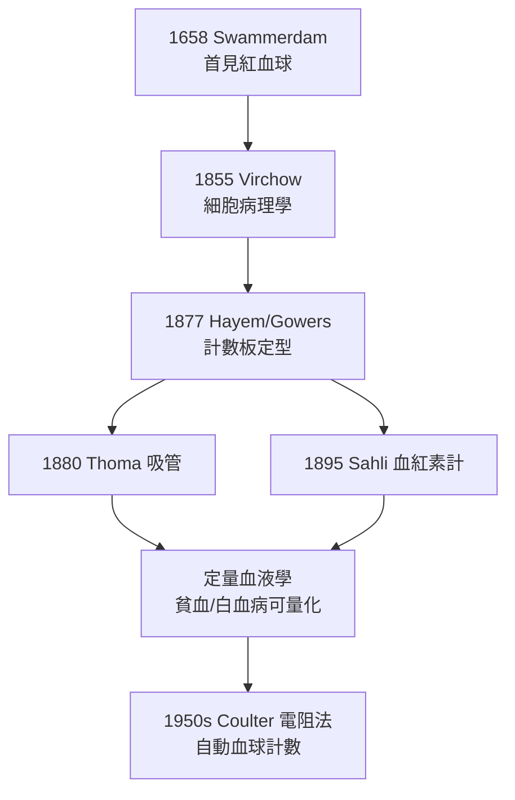

## 1877 - 血球計數與血球計數板（把血液變成數字，血液學的「指紋採集」）

## 案件摘要

**本案偵破的是一個取證技術問題：血裡面到底有多少顆細胞？**

顯微鏡在 17 世紀就看到了紅血球（Swammerdam、Leeuwenhoek），但「看到」不等於「數清」。19 世紀中後期，一連串德國與英國發明家把稀釋—格線—計數標準化：1874 年 Gowers 的稀釋吸管、1877 年起 Hayem、Gowers 等改良的**血球計數板（hemocytometer）**問世，「紅血球每立方毫米 500 萬」這類數字第一次成為可重現的醫學證據。血液學從敘述症狀（面色蒼白）升級為定量科學——貧血、白血病、紫斑症的診斷全繫於此。

## 前因 -- 為什麼會有這個案子

- **Virchow 的細胞病理學（1855）**：「疾病是細胞的疾病」——既然如此，血液病的診斷就必須回答「細胞的數量與型態」。
- **Virchow 1845 年描述白血病**：他以「白血（weißes Blut）」命名 leukemia，但只能定性不能定量——「血為什麼白了？」需要數字才能回答。
- **19 世紀顯微鏡與光學革命**：消色差鏡頭普及，血球形態（雙凹盤狀、核的分葉）清晰可辨。
- **臨床需求的推力**：貧血的鑑別（缺鐵？失血？惡性貧血？）需要紅血球計數與血色素值兩條獨立證據線。

## 線索與推理 -- 數學式、程式、理論

**線索一：稀釋—抽樣—外推的統計本質。** 血球太密（每 $\mathrm{mm^3}$ 約 500 萬），直接數不可能。計數板的本質是一個**體積已知的抽樣框**：

```text
稀釋 200 倍 → 取 0.1 µL 格線體積 → 數得 N 顆
紅血球濃度 = N × 200 × 10⁴ /mm³
```

抽樣誤差服從 Poisson 分佈：

$$ \sigma/N \approx \frac{1}{\sqrt{N}} $$

——數 500 顆誤差約 4.5%：計數板時代血液學的「測不準原理」。

**線索二：Hayem–Gowers 計數板的工程結晶**：玻璃刻線（Neubauer 格線，1877 年 Hayem 定型並推廣）＋ 定量稀釋吸管（Thoma, 1880）＋ 蓋玻片深度標準化（0.1 mm）。三件套讓倫敦與維也納的化驗室得到**同一個數字**——可重現性，是證據成為證據的門檻。

**線索三：血色素定量並行發展**：Hoppe-Seyler（1854）提出 spectroscope 測氧化血紅素吸收帶；1895 年 Sahli 血紅素計以標準色柱比色。紅血球數 × 血色素 → 推出 **MCH（平均紅血球血紅素含量）**——「紅血球是色淡還是色深」成為貧血鑑別的第一把分岔鑰匙（缺鐵性：小而淡；惡性貧血：大而深，見 `1926-米諾特與墨菲肝臟療法.md`）。

**線索四：白血球分類計數。** Ehrlich（1879–91，見 `1891-羅曼諾斯基染色與血球形態學.md`）以染料把白血球分化為嗜中性、嗜酸性、嗜鹼性、淋巴球，並發明**手工分類 100 顆**的 protocol——「白血球像差」（differential count）成為感染、白血病、過敏的通用指紋卡。



## 結案 -- 後果與影響

- **貧血的鑑別診斷體系建立**：計數＋血色素＋血片型態，構成今天每一張 CBC（全血球計數）報告的考古原型。
- **白血病有了病程指標**：白血球總數從「描述」變成「追蹤」，療效評估（後來的化療反應，見 `1948-法伯氨蝶呤治療兒童白血病.md`）有了刻度。
- **1956 年 Coulter 電阻法**：Wallace Coulter 以細胞通過微孔時的電阻脈衝計數，血球計數進入自動化時代——今日檢驗科每秒處理的 CBC，源頭就是 1877 年那塊玻璃格線。
- **一句話結案**：1877 年案的破案工具是一塊刻了格線的玻璃——**當你能數，你才能比較；當你能比較，你才能偵查**。

## 關鍵人物與文獻

- **Georges Hayem（1841–1933）**——巴黎聖安東尼醫院教授，血液學的法國學派奠基者；計數板與血小板描述（1872）的關鍵人物。
- **William Gowers（1845–1915）**——倫敦神經科與血液學家；1874 年設計稀釋吸管與改良計數板，血液學英語世界的技術標準制定者。
- **Wallace Coulter（1913–1998）**——自學出身的電機工程師，1953 年取得電阻法計數專利，1956 年發表；Coulter 至今仍是血液分析儀的代名詞。
- 原始文獻——Hayem, *Du sang et de ses altérations anatomiques*, Paris, 1889；Coulter, *High speed automatic blood cell analyzer*, 1956。

