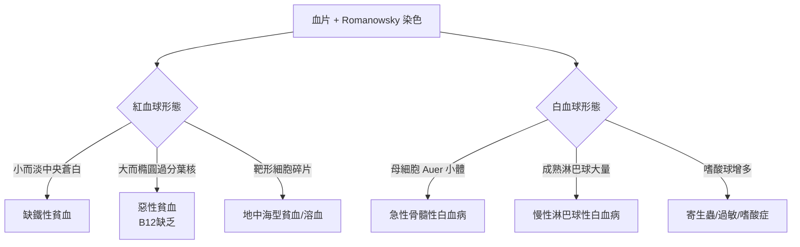

## 1891 - 羅曼諾斯基染色與血球形態學（白血球的「彩色指紋卡」，與鐵劑為貧血平反）

## 案件摘要

**本案偵破的是血球的「身分辨識」問題：在白血球都長得差不多的年代，怎麼認出誰是誰？**

1891 年，俄國軍醫 Dmitri Leonidovich Romanowsky 發表以**伊紅（酸性）＋亞甲藍（鹼性）**混合液染瘧疾血片的方法，意外發現：中性球顆粒染成紫紅、嗜鹼顆粒染成深藍、瘧原蟲染成寶石紅——「羅曼諾斯基效應」。德國與英國學者（Nocht、Leishman、Giemsa，1902–04）把它標準化，血片染色從此是血液科的入門法證技術。本案同時收錄一樁平行懸案：1832 年 Blaud 以鐵鹽治好「萎黃病」貧血——放血時代（見 `0150-蓋倫放血療法與體液學說.md`）的反案，就此翻案成功。

## 前因 -- 為什麼會有這個案子

- **苯胺染料工業**：Perkin 1856 年合成 mauveine 後，德國化學工業供應數百種染料——顯微鏡學家發現不同組織「偏好」不同染料（Ehrlich 的側鏈理論即源於此，見 `1910` 案的姊妹篇）。
- **瘧疾診斷需求**：Laveran 1880 年在阿爾及利亞發現瘧原蟲，需要一種能同時染蟲與血球的染色法——羅曼諾斯基的原動力。
- **白血球的困惑**：Ehrlich 已用「中性／嗜酸／嗜鹼」描述顆粒對染料的親和性，但混合染色常出現沉澱、雜訊，結果不穩定。
- **鐵之謎的線索**：1825 年法國化學家已驗出血液含鐵；Blaud 1832 年給「蒼白虛弱」的年輕女性服用碳酸亞鐵丸，貧血好轉——但機制不明，且被放血正統派斥為江湖術士。

## 線索與推理 -- 數學式、程式、理論

**線索一：羅曼諾斯基效應的化學本質。** 關鍵發現：亞甲藍與伊紅**單獨使用**效果平庸，**氧化後的混合物**（生成亞甲天藍 azure B 等天藍染料）才有奇效——紫紅色出現在「天藍＋伊紅形成複合物」之處。用化學語言：

$$ \text{可見色} \iff \text{eosin} \cdot \text{azure complex} \quad (\lambda_{\max} \approx 540\,\mathrm{nm}) $$

核酸與嗜鹼顆粒吸引天藍（陽離子），血紅素與嗜酸顆粒吸引伊紅（陰離子）——**一分子的酸鹼選擇性，換來一整套細胞身分證**。

**線索二：標準化的接力**：Nocht（1899）控制鹼性 pH；Leishman（1901）以甲醇固定＋一步染色；Giemsa（1902–04）以甘油—甲醇穩定配方——今日檢驗室的 Wright–Giemsa 染色是其直系後代，瘧疾、血液寄生蟲、白血病形態學全部依賴。

**線索三：形態學鑑別體系的誕生。** 染色之後，血片成為「指紋卡」：

注意 C 與 D 分支：正是 Blaud 案與 B12 案（見 `1926-米諾特與墨菲肝臟療法.md`）的形態學入口——「小而淡」指回缺鐵，「大而深」指向 B12。

**線索四：鐵劑翻案的正名。** 1890 年代 Stockman 以動物實驗與臨床對照證明：缺鐵性貧血病人對亞鐵鹽的反應是**劑量相關、專一性**的，其他「補血劑」（砷、番木鱉）無效——治療指數式的證據鏈（參見藥物偵查的模板），讓鐵劑從偏方升格為特異療法。分子層面的最終定讞在 20 世紀：鐵是血紅素 heme 輔基的核心

$$ \mathrm{Fe^{2+} + O_2 \rightleftharpoons Fe^{2+}O_2} $$

——缺鐵＝血紅素工廠缺原料＝小而淡的紅血球，全案證據閉環。

## 結案 -- 後果與影響

- **形態學血液學的黃金百年**：從 1891 到流式細胞儀普及，Wright–Giemsa 血片是全世界血液科醫師的「第一現場」；白血病分類（含 1976 年 FAB 分類，見 `1976-FAB白血病分類.md`）的文字定義都以此染色寫成。
- **瘧疾診斷平民化**：一張血片＋一套染液，讓熱帶地區的瘧疾診斷成本趨近於零。
- **貧血治療的正名運動**：鐵劑特異療法的確立，是「補充缺乏因子」醫學模式的勝利——B12（1926）、葉酸（1940s）沿著同一條路走來。
- **一句話結案**：染料的酸鹼偏心，替每顆血球蓋了身分章——**法證科學的進步，常常來自化工廠的廢液**。

## 關鍵人物與文獻

- **Dmitri Romanowsky（1861–1921）**——俄國軍醫，1891 年發表混合染色法；「羅曼諾斯基效應」以他命名。
- **Paul Ehrlich（1854–1915）**——白血球顆粒染色分類（1879–91）的開創者；血液染色與化療（魔法子彈）共享同一套「選擇性結合」哲學。
- **Gustav Giemsa（1867–1948）**——漢堡熱帶病研究所化學家，配方穩定化者；Giemsa 染液至今仍是瘧疾與血片診斷的世界標準。
- **Pierre Blaud（1774–1858）**——法國內科醫師，1832 年以碳酸亞鐵治萎黃病；貧血鐵劑療法的第一位目擊證人。
- 原始文獻——Romanowsky, *Diagnostische Bedeutung der Malariaplasmen*, St. Petersburg, 1891；Stockman, "On the treatment of anaemia by iron," *BMJ*, 1893–94。

