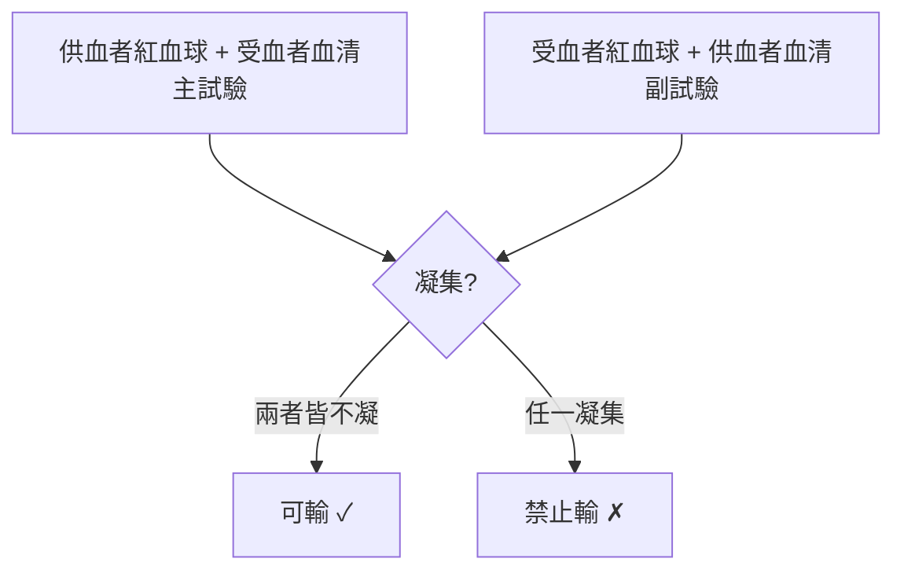

## 1901 - 蘭德施泰納發現 ABO 血型（免疫學指紋，輸血從盲射變成精準射擊）

## 案件摘要

**本案偵破的是輸血醫學最核心的謎題：為什麼有時救人、有時殺人？**

1901 年，維也納大學病理學研究所的年輕研究員 Karl Landsteiner 把同事與自己的血清和紅血球兩兩混合，發現紅血球有時凝集成團、有時相安無事——他據此把人類血液分為 A、B、C（後稱 O）三型，翌年學生 Sturli 與 Decastello 補上 AB 型。**血型**的發現讓 Denis 案（1667）與 Blundell 案（1818）的成功與失敗同時獲得解釋：殺死 Mauroy 的兇手，等了 234 年終於到案——它叫**同種免疫凝集**。

## 前因 -- 為什麼會有這個案子

- **輸血的成敗撲朔迷離**：Blundell 之後的輸血時靈時不靈，外科醫師只能祈禱；「黑尿—痙攣—死亡」的溶血反應反覆出現卻無人能預測。
- **凝集現象早有記錄**：1874 年 Landois 報告**異種**（動物血＋人血）混合必凝集——但他誤判為「異種血破壞人血球」，沒想到**人與人之間**也會。
- **細菌血清學的榜樣**：1890 年代 Behring 的白喉抗毒素與 Gruber–Durham 的凝集反應（1896）樹立了「抗原—抗體」的思考框架。
- **Landsteiner 的個人特質**：化學家出身（有機染料訓練）＋病理解剖例行——他在做屍檢時注意到：因溶血反應死亡的病人，其血管中的血塊與一般死後凝血**不同**。

## 線索與推理 -- 數學式、程式、理論

**線索一：交叉混合作業（本案的實驗核心）。** Landsteiner 分離 22 位健康人的血清與紅血球，進行 5×5 交叉混合，發現反應不是隨機的，而是**聚類**的：

```text
        血清→   O        A        B
紅血球↓
  O             不凝      不凝      不凝
  A             凝集      不凝      凝集
  B             凝集      凝集      不凝
```

他用窮舉法證明這個矩陣自洽：只需**兩個抗原（A、B）與兩種對應抗體（抗 A、抗 B）**，即可解釋全部反應模式——這是典型的「最小假說推理」。

**線索二：機制假說——「自體毒」的排除。** 當時主流猜測凝集因子是細菌汙染或「自體毒素」。Landsteiner 用三個反例破案：(1) 同一個人的血清與自己的紅血球**永不相凝**（否則人人自毀）；(2) 凝集在 37°C 也發生、對熱穩定，行為像特定物質而非細菌毒素；(3) 反應模式在個體間可遺傳聚類——於是他提出：血清中的凝集素（抗體）與血球上的凝集原（抗原）呈**互斥分佈**，即今日的規則：

$$ \text{不凝集} \iff \text{受血者血清中無供血者抗原的對應抗體} $$

**線索三：分布的孟德爾式解讀。** 紐約的 Bernstein（1924）證明 ABO 由單一基因座的三個對偶基因 $A, B, O$ 決定（O 為隱性），符合孟德爾遺傳——血型從臨床現象升格為遺傳標記，也成為 20 世紀人類遺傳學與法醫親子鑑定的第一把尺。

**線索四：交叉試驗的制度化。** 臨床落地的關鍵是「主側＋副側」交叉配合試驗：



O 型因紅血球無 A、B 抗原，早期被當「萬用供血者」——但受血者血漿中的抗 A／抗 B 仍可能攻擊輸入的 O 型血漿，這個漏洞要到大量輸血時代才被重視。

## 結案 -- 後果與影響

- **輸血從賭博變成手術**：血型檢查＋交叉試驗成為輸血前的強制程序；一戰中血型檢驗大規模應用，戰場輸血救活大量傷兵。
- **1930 年諾貝爾獎**：Landsteiner 獲 1930 年生理學或醫學獎；1940 年他又與 Wiener 發現 Rh 血型（見 `1940-Rh血型與新生兒溶血.md`），補上血型系統的第二塊拼圖。
- **血庫的理論前提**：有了血型配對，庫存血才有意義——1937 年 Cook County 醫院 Bernard Fantus 創建「blood bank」（血庫），輸血進入工業時代（見 `1914-血庫與檸檬酸鹽抗凝.md`）。
- **免疫血液學誕生**：血型是「抗體識別自身／非自身」的第一個醫學示範，直接影響器官移植的組織配型思想。
- **一句話結案**：Landsteiner 只做了一件事——把「人的血」當成「很多種東西」來看——**承認個體差異，是精準醫學的第一課**。

## 關鍵人物與文獻

- **Karl Landsteiner（1868–1943）**——維也納出身、後任職紐約洛克菲勒研究所；ABO（1901）與 Rh 因子（1940）的發現者，1930 年諾貝爾獎得主；被稱為「輸血醫學之父」。
- **Alfred von Decastello 與 Adriano Sturli**——Landsteiner 的學生，1902 年發現第四型 AB。
- **Ludwik Hirszfeld 與 Emil von Dungern（1910）**——確立 ABO 的遺傳學解釋與國際命名（A/B/AB/O）。
- 原始文獻——Landsteiner, "Über Agglutinationserscheinungen normalen menschlichen Blutes," *Wiener Klinische Wochenschrift*, 1901。

