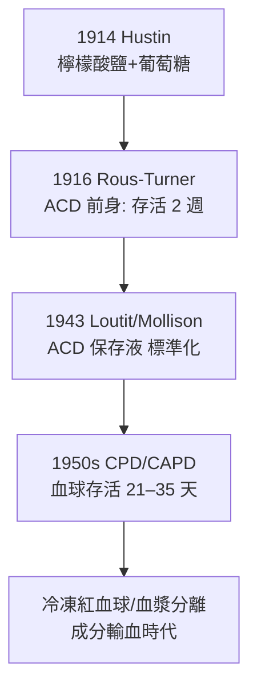

## 1914 - 檸檬酸鹽抗凝與血庫的誕生（把血液變成「可庫存的資源」）

## 案件摘要

**本案偵破的是一個物流難題：血離開血管幾分鐘就凝固，輸血如何等到戰場與深夜？**

1914 年 11 月，布魯塞爾的 Albert Hustin 以檸檬酸鈉溶液採血並成功輸入病人；1915 年紐約的 Richard Lewisohn 算出**安全濃度**（0.2% 檸檬酸鈉即可抗凝、對人無毒）——血液第一次可以被抽出、存放、延遲輸入。1937 年芝加哥 Cook County 醫院的 Bernard Fantus 開設世界第一家正式「血庫（blood bank）」，1940 年代二戰將血漿凍乾送往前線——血液從「床邊的鮮活禮物」變成「現代醫療的工業原料」。

## 前因 -- 為什麼會有這個案子

- **Blundell 模式的天花板**：直接床邊抽輸（見 `1818-布倫德爾人對人輸血.md`）要求供血者躺在病人旁邊，血離體僅數分鐘——完全無法規模化。
- **凝血機制的早期線索**：1880 年代已知血鈣與凝固相關（Arthus & Pagès, 1890 證明移除鈣離子可阻止凝血）——「螯合鈣」成為最明顯的破口。
- **1901 年血型發現**（見 `1901-蘭德施泰納ABO血型.md`）：配對問題解決後，剩下的最大瓶頸正是抗凝與保存。
- **一戰的戰場需求**：1914–18 年西線每日數千名出血傷兵，直接輸血在戰壕裡不可行——戰爭成為最殘酷的驗收場。

## 線索與推理 -- 數學式、程式、理論

**線索一：鈣離子是凝血第 X 因子的化學閘門。** 凝血級聯（完整版見 `1964-凝血瀑布學說.md`）的多個步驟需要 $\mathrm{Ca^{2+}}$ 把凝血因子錨定在血小板磷脂膜上。檸檬酸根螯合鈣：

$$ 3\,\mathrm{Na_3Cit} + 2\,\mathrm{Ca^{2+}} \rightarrow 2\,\mathrm{Ca_3(Cit)_2^{3-}}\ (\text{可溶性螯合物}) + 6\,\mathrm{Na^+} $$

體外血失去鈣離子即不凝；輸入體內後檸檬酸被肝臟代謝，鈣回到生理濃度——**「體外可逆封印」是本案的破案關鍵**。

**線索二：Lewisohn 的劑量—毒性曲線。** 檸檬酸鹽並非無毒：過量會螯合受血者自身的鈣，導致低鈣血症、心臟驟停。Lewisohn 1915 年以犬實驗畫出第一條抗凝—毒性曲線，定出 0.2% 的安全濃度——這是輸血史上第一次用**治療指數思維**（參見 Ehrlich 模板）處理採血管路。

**線索三：保存液的進化競賽。**

紅血球的代謝（2,3-DPG 下降、ATP 耗竭、鉀漏出）決定保存期限——「血不是簡單的液體，是活著的組織」成為血庫醫學的核心命題。

**線索四：制度發明——血庫。** Fantus 1937 年在芝加哥創設醫院血庫，把「血液銀行」的金融比喻制度化：招募、檢驗、配型、庫存、效期管理。1940 年代美國「Blood for Britain」計畫（Drew 主導）以血漿出口支援英國，證明血液可跨洋物流——Charles Drew 對血漿保存的貢獻，也讓他成為血庫制度的世界級推手。

## 結案 -- 後果與影響

- **輸血從個人行為變成公共衛生體系**：戰後各國建立國家輸血服務與志願無償捐血制度（如英國 NBS、紅十字會系統），血源的倫理（有償 vs 無償）成為持續百年的辯論——有償血的血源性感染率顯著較高，最終推動無償捐血成為世界標準。
- **成分輸血的基石**：血漿、紅血球、血小板可分開儲存與使用（1960s–70s 成熟），「一血多用」提升效率十倍。
- **新的懸案接踵而來**：庫存血帶來肝炎（1970s B 型肝炎篩檢）與後來 HIV 汙染血品悲劇（1980s，見愛滋史相關卷）——「輸血安全」從此是永不下班的崗哨。
- **一句話結案**：檸檬酸鹽案的真相是——**醫學的進步，一半靠機制理解，一半靠物流與制度設計**。

## 關鍵人物與文獻

- **Albert Hustin（1882–1967）**——布魯塞爾聖彼得醫院外科醫師，1914 年首例檸檬酸鹽間接輸血。
- **Richard Lewisohn（1875–1961）**——紐約 Mount Sinai 外科醫師，1915 年確立檸檬酸鹽安全濃度，間接輸血法的普及者。
- **Bernard Fantus（1874–1940）**——匈牙利裔芝加哥藥理—內科教授，1937 年創建世界第一家醫院血庫並創詞 "blood bank"。
- **Charles R. Drew（1904–1950）**——非裔美國外科醫師與血漿保存專家，「Blood for Britain」與美國紅十字血庫的技術總監；血庫制度的靈魂人物。
- 原始文獻——Hustin, *Le Sang*, Brussels, 1914；Lewisohn, "The importance of the proper dosage of sodium citrate," *JAMA*, 1915；Fantus, "The therapy of the Cook County Hospital: blood bank," *JAMA*, 1937。

