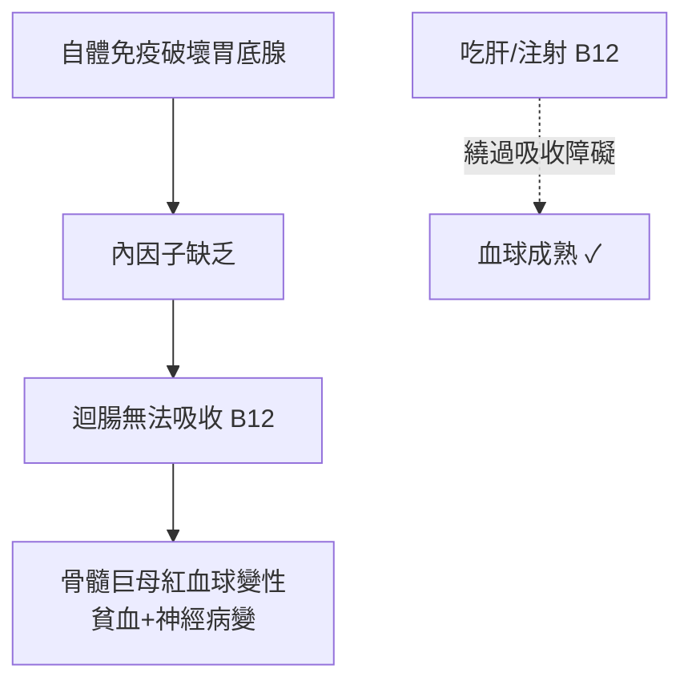

## 1926 - 米諾特與墨菲的肝臟療法（惡性貧血之謎：從「絕症」到「吃肝救命」）

## 案件摘要

**本案偵破的是 1920 年代最著名的一樁營養偵探案：惡性貧血（pernicious anemia）病人的骨髓為何造出血而不造血紅素？**

惡性貧血自 1849 年由 Addision 描述以來，診斷即等同死刑：病人面色檸檬黃、舌頭光滑、神經逐漸麻痺，平均存活 1–3 年。1926 年，波士頓的 George Minot 與 William Murphy 發表：每日進食**半公斤半生肝臟**，可使惡性貧血病人血中網織紅血球暴增、病情逆轉——45 位病人全數改善。1948 年化學家從肝臟中分離出維生素 B12（氰鈷胺），全案真相大白：兇手是 B12 吸收障礙，解藥是「體外的肝」替病人當胃。本案是血液學史上「缺乏因子—特異療法」模式的最高傑作。

## 前因 -- 為什麼會有這個案子

- **Addison（1849）與 Biermer（1872）**：描述並命名「progressive pernicious anemia」；特徵為巨紅血球（大而深的血球，見 `1891-羅曼諾斯基染色與血球形態學.md`）、胃酸缺乏、脊髓亞急性聯合變性。
- **「惡性」的絕望**：1900 年代惡性貧血在美國每年奪去數千條人命，無一倖免——只有死路，沒有對照組。
- **Whipple 的前哨線索（1920–25）**：喬治·惠普爾以放血造成犬貧血，系統比較食物療效，發現**肝臟**是促進紅血球再生的最強食物——線索直接指向廚房。
- **血液學的「因子」思潮**：1912 年 Funk 提出「維他命」概念；腳氣病（B1）、壞血病（C）的特異療法勝利，讓 Minot 相信惡性貧血也是某種「缺乏症」。

## 線索與推理 -- 數學式、程式、理論

**線索一：網繭紅血球是「破案進度條」。** 惡性貧血的骨髓並非壞死，而是「造不出成熟紅血球」——細胞在骨髓裡越長越大卻無法分化（megaloblast）。給予有效治療後 5–10 天，**網織紅血球（reticulocyte，紅血球的青少年期）計數會暴漲 5–10 倍**：

$$ \text{有效治療} \iff \text{第 7 天網織球峰值} \uparrow \uparrow \ \land\ \text{血色素回升} $$

Minot 以這個可量化指標代替「病人看起來好些」，1926 年論文的證據強度因此遠超同時代的營養報告。

**線索二：肝臟療法的劑量—反應。** Minot–Murphy 以每日 120–240 g 肝臟（後濃縮為肝萃取注射劑）維持緩解；停藥即復發——劑量相關性證明「肝中有特異因子」而非安慰劑。

**線索三：機制的最終偵破——內因子。** 1929 年 Castle 提出「兩因素假說」：胃液中的**內因子（intrinsic factor）**與食物中的**外因子（extrinsic factor）**在腸道結合才能吸收。1948 年 Merck 的 Rickes 與英國 Smith 分離出紅色結晶維生素 B12（含鈷的咕啉環，分子量 1355）；1955 年 Hodgkin 以 X 光繞射解出結構（1964 諾貝爾化學獎）；1960 年代確認惡性貧血的免疫學病因——自體抗體破壞胃壁細胞 → 內因子缺乏 → B12 無法吸收。全案鏈條：

**線索四：為什麼是肝？** 肝臟是 B12 的儲存庫（人體 B12 的 90% 存於肝）——「吃肝救命」本質是**口服一整個器官的維生素濃縮劑**；半生肝的口感犧牲，換來每日劑量的穩定。

## 結案 -- 後果與影響

- **1934 年諾貝爾獎**：Minot、Murphy 與 Whipple 同獲生理學或醫學獎——從動物餵食實驗（Whipple）到臨床驗證（Minot–Murphy）的完整偵查鏈。
- **「缺乏因子」醫學模式封頂**：鐵（1891 案）、B12（本案）、葉酸（1945 年分離）構成造血三大營養素——貧血從「病」被拆解成「不同原因的缺乏」。
- **產前葉酸與神經管缺陷**（1990s 證實）、孕婦 B12 需求等公共衛生政策，都在此偵查框架內展開。
- **惡性貧血的當代面貌**：終身肌肉注射 B12（繞過胃）或高劑量口服——每月一針，把 1925 年的死刑改判為終身緩刑。
- **一句話結案**：本案的破案工具是廚房與顯微鏡——**當一種病「全軍覆沒」而治療卻簡單得可疑時，先懷疑缺了什麼**。

## 關鍵人物與文獻

- **George R. Minot（1885–1950）**——哈佛醫學院與布里根醫院血液學家，本人患糖尿病（1921 年胰島素救活），深知「絕症被治好」的雙重身分。
- **William P. Murphy（1892–1987）**——Minot 的合作者，執行 45 例臨床試驗的主刀者。
- **George H. Whipple（1878–1976）**——羅徹斯特大學病理學家，犬放血—肝臟再生實驗的設計者。
- **Dorothy Hodgkin（1910–1994）**——X 光晶體學家，1955 年解出 B12 立體結構，本案的「法醫化學家」。
- 原始文獻——Minot & Murphy, "Treatment of pernicious anemia by a special diet," *JAMA*, 1926；Castle, "Observations on the etiologic relationship of achylia gastrica to pernicious anemia," *Am J Med Sci*, 1929。

