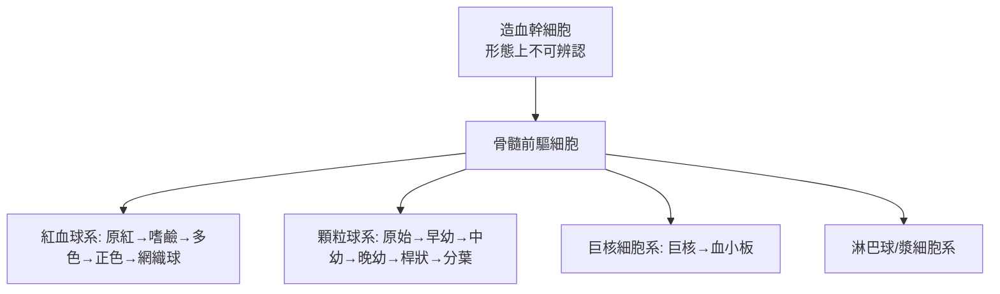

## 1929 - 阿林金骨髓穿刺（打開造血工廠的大門）

## 案件摘要

**本案偵破的是血液學的最後一塊盲區：血球是從哪裡造出來的？病變發生在「血」還是在「工廠」？**

1929 年，蘇聯列寧格勒軍醫學院的 Mikhail Arinkin 發表以普通針頭**穿刺胸骨**抽取骨髓液、製作塗片直接檢查造血組織的方法。在此之前，要看骨髓只能靠屍檢或劇烈的外科開窗；Arinkin 的「一根針」讓白血病、再生不良性貧血、骨髓瘤、骨髓纖維化的診斷進入活體時代——血液科的「活體組織切片」從此齊備。本案的偵探意義在於：**把取證現場從血液（產品）推進到骨髓（生產線）**。

## 前因 -- 為什麼會有這個案子

- **血球的出生地之謎**：19 世紀末 Neumann 與 Bizzozero 證明血球源自骨髓（髓外造血爭議落幕），但活人骨髓無法取得。
- **白血病的診斷瓶頸**：Virchow（1845）以來，白血病只能靠周邊血片診斷；急性與慢性、淋巴性與骨髓性之間常無法確定，分類爭論不休。
- **先驅技術的鋪墊**：1903 年義大利 Pianese 嘗試胸骨穿刺；1908–27 年德國 Seyfarth、法國 Emile-Weil 與 Pagniez 各自改良骨髓活檢——技術已近成熟，只差「簡單到能普及」的版本。
- **Arinkin 的現場**：他同時是內科醫師與血液形態學家，目標明確——診斷要服務治療，取證必須床邊可做。

## 線索與推理 -- 數學式、程式、理論

**線索一：穿刺點的解剖選址。** Arinkin 選擇胸骨體——皮膚到骨髓腔僅約 1–1.5 cm、無大血管、定位容易。安全邊距的計算：

$$ \text{安全} \iff \text{針長} < \text{胸骨後板厚度餘量} \approx 1\,\mathrm{cm} $$

——胸骨柄後方有主動脈與氣管，胸骨體則相對寬鬆；「在第二肋間平面、胸骨體中部、15° 角度進針」成為百年不變的操作規範。

**線索二：骨髓像成為「工廠現場照片」。** 骨髓塗片經羅曼諾斯基染色（見 `1891-羅曼諾斯基染色與血球形態學.md`）後，可看到造血的完整世代譜系：



診斷規則自此量化：急性白血病的定義從「血中出現母細胞」變成「骨髓母細胞比例」，1976 年 FAB 分類（見 `1976-FAB白血病分類.md`）正是建立在此指標上。

**線索三：比例數字的鑑識力。** 正常骨髓中，粒球：紅球比值（M:E ratio）約 3:1；母細胞 < 5%；漿細胞 < 2%。各種疾病的「現場痕跡」：

```text
急性白血病      母細胞 ≥ 20%，正常造血被擠壓
再生不良性貧血  全系造血細胞稀疏，脂肪化
多發性骨髓瘤    漿細胞 ≥ 10% 且形態異常（見 1999 案）
骨髓纖維化      「乾抽」——抽不出骨髓本身就是診斷線索
```

**線索四：乾抽（dry tap）的偵探價值。** 針進了骨髓腔卻抽不出液體——不是失敗，而是證據：骨髓纖維化或癌細胞緊密浸潤使骨髓「凝固成砂」。這教會血液科醫師：**取證失敗本身也是法證報告的一部分**。

## 結案 -- 後果與影響

- **血液病診斷的金標準確立**：至今骨髓穿刺＋切片仍是白血病、淋巴瘤分期、骨髓瘤、貧血不明原因的核心檢查；「骨穿」成為血液科醫師的基本手技。
- **1956 年骨髓移植的前提**：Donnall Thomas 的移植實驗（見 `1956-湯瑪斯骨髓移植.md`）必須先能評估「捐髓者的骨髓像是否健康、受髓者的造血是否重建」——穿刺術是移植的前置科技。
- **現代延伸**：骨髓切片環鑽活檢（Philocolor/Klima 針，1950s–70s）補上「組織結構」維度；今日流式細胞儀、細胞遺傳學、次世代定序都以穿刺取得的骨髓液為檢體——一根 1929 年的針，接上了基因時代的取樣管。
- **一句話結案**：Arinkin 案教會醫學——**要破血液的案子，別只問產品，要突襲工廠**。

## 關鍵人物與文獻

- **Mikhail Arinkin（1877–1948）**——列寧格勒軍醫學院內科教授，蘇聯血液學奠基者；1929 年胸骨穿刺法的發明者。
- **Maxwell Wintrobe（1901–1986）**——把包括骨穿在內的血液學檢查標準化為教科書體系（《Clinical Hematology》1942 初版），「血液科專科」的建制者。
- 原始文獻——Arinkin, "Die intravitale Untersuchungsmethode des Knochenmarks," *Folia Haematologica*, 1929。
- 現代註腳——今日骨髓穿刺多用後上髂骨（更安全、可同時做切片活檢），胸骨穿刺僅保留給特殊情況——Arinkin 的解剖選址被工程學改寫，但「一根針打開造血工廠」的概念原封不動。

