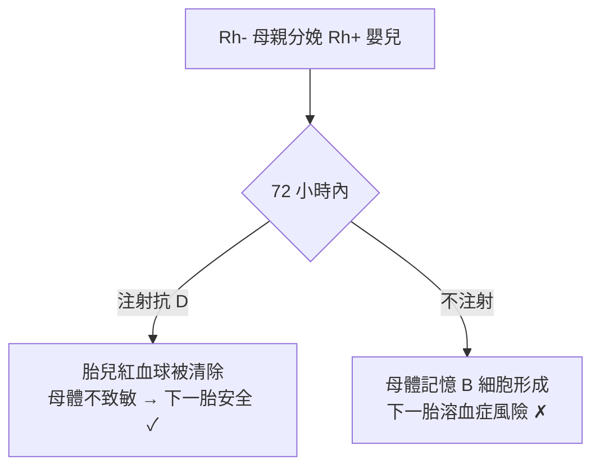

## 1940 - Rh 血型與新生兒溶血症（第二把免疫鑰匙，與「子體血攻擊母體」的逆轉懸案）

## 案件摘要

**本案偵破的是 ABO 之後輸血與產科的最大懸案：為什麼有些輸血反應查不出 ABO 問題？為什麼有些嬰兒一出生就全身金黃、貧血瀕死？**

1940 年，已在紐約洛克菲勒研究所的 Karl Landsteiner（見 `1901-蘭德施泰納ABO血型.md`）與學生 Alexander Wiener 以恆河猴（rhesus macaque）紅血球免疫兔子，所得抗體能凝集約 85% 白種人的紅血球——他們把這個抗原命名為 **Rh 因子**。翌年 Phillip Levine 等人證明：新生兒溶血症（當時死亡率約 50%）的兇手正是**母親對胎兒 Rh 抗原產生的抗體**。本案的特殊之處在於方向反轉：不是病人被外源血傷害，而是**母親被自己的孩子「免疫」**——免疫學史上最悲傷的偵探故事。

## 前因 -- 為什麼會有這個案子

- **新生兒溶血症（erythroblastosis fetalis）**：1930 年代已確認由「母體抗體經胎盤攻擊胎兒紅血球」引起（Levine 與 Stetson 1939 年首報產婦血清凝集丈夫紅血球的案例），但抗原本體不明——兇手有名無形。
- **殘餘的輸血反應**：ABO 配對後仍有 1–2% 的受血者發生溶血反應，說明存在第二套血型系統。
- **猴子的意外角色**：Landsteiner 用恆河猴免疫本是為製備血型研究用抗血清——實驗動物成為指紋的來源。
- **溶血反應的病理特徵**：胎兒紅血球大量代償性增生（骨髓外造血）、肝脾腫大、核殘留紅血球（erythroblast）——病理學早已拍下案發現場照片。

## 線索與推理 -- 數學式、程式、理論

**線索一：Rh 的分佈統計。** Rh+ 約 85%、Rh− 約 15%（白種人）。新生兒溶血症幾乎只發生在 **Rh− 母親 × Rh+ 胎兒**的組合——遺傳學立即給出解釋：胎兒的 Rh+ 來自父親。Levine 進一步發現，生過溶血症嬰兒的母親，其血清能長期凝集丈夫與孩子的紅血球——**證據鏈閉合**。

**線索二：「為什麼第一胎常常沒事」的時間邏輯。** 免疫需要時間：第一胎懷孕中，胎兒血少量進入母體（多在分娩時），母親初次免疫產生抗體（IgM 為主，且效價低）；第二胎再遇 Rh+ 血時，記憶性免疫反應產生大量 IgG——而 IgG 能通過胎盤：

$$ \text{病情} \propto \text{懷孕次數} \times \text{抗原暴露量} \times \text{抗體為 IgG} $$

這解釋了臨床觀察「第一胎輕、之後越來越重」的規律。

**線索三：預防的推理——「趕在免疫記憶形成之前」。** 1960 年代利物浦的 Finn 與 Clarke、紐約的 Freda 提出天才假說：在 Rh− 母親分娩 Rh+ 嬰兒後 **72 小時內**注射抗 D 免疫球蛋白（RhoGAM, 1968 上市），以外源抗體在母親免疫系統「記住」胎兒抗原之前把 Rh+ 紅血球清除——用「借來的免疫力」誘導免疫耐受。這是被動免疫預防自體致敏的教科書案例：

此舉使已開發國家的新生兒溶血症發病率下降 90% 以上——**預防勝於治療的最漂亮示範**。

**線索四：治療端的發明——子宮內輸血與換血。** 1963 年 Liley 以腹腔內輸血救治宮內溶血胎兒；產房換血輸療法（Diamond, 1940s）用 Rh− 血替換嬰兒血——治療工具沿著病理機制逐環補齊。

## 結案 -- 後果與影響

- **血型系統爆炸性擴張**：Rh 系統（D、C、c、E、e 五主要抗原）之後，Kell、Duffy、Kidd 等系統陸續發現；人類紅血球抗原已超過 300 種——「血型」從選擇題變成全景圖。
- **輸血安全升級**：Rh 配型成為輸血前常規；Rh− 孕婦輸血必須用 Rh− 血——產科與輸血科從此綁定。
- **免疫耐受理論的臨床教材**：抗 D 預防是「用抗體誘導耐受」的經典案例，直接啟發移植免疫的耐受誘導研究。
- **一句話結案**：Rh 案的破案公式是——**當兇手以免疫記憶的形式存在，就在記憶寫入之前把它攔截**。

## 關鍵人物與文獻

- **Karl Landsteiner（1868–1943）與 Alexander Wiener（1907–1976）**——1940 年 Rh 因子的發現者。
- **Philip Levine（1900–1987）**——1939 年首報產婦血清凝集案例、1941 年確立 Rh 母兒不相容機制；新生兒溶血症的機制偵破者。
- **Ronald Finn、Cyril Clarke 與 Vincent Freda**——1960 年代抗 D 預防策略的提出與驗證者。
- 原始文獻——Landsteiner & Wiener, "An agglutinable factor in human blood recognized by anti-rhesus sera," *PNAS*, 1940；Levine et al., *JAMA*, 1941。

