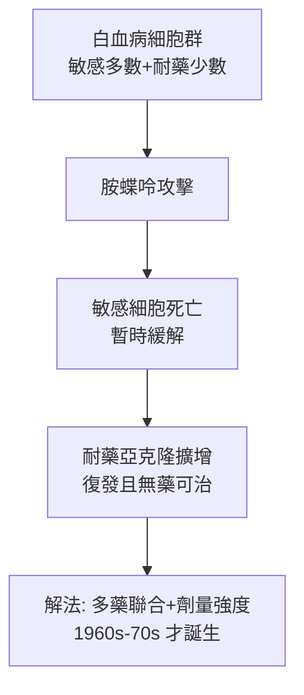

## 1948 - 法伯以胺蝶呤治療兒童白血病（化療時代的「第一滴血」）

## 案件摘要

**本案偵破的是癌症治療史上最著名的一次賭注：能用毒死細胞的藥，救活白血病的孩子嗎？**

1947–48 年，波士頓兒童醫院的 Sidney Farber 以葉酸拮抗劑**胺蝶呤（aminopterin）**治療 16 名急性淋巴性白血病（ALL）兒童：部分患兒的白血球計數短暫下降、骨髓母細胞減少、症狀改善——史上第一次，白血病對藥物「回應」了。雖然緩解短暫、且無一治癒，但本案證明了化療的可行性，是從「白血病＝死刑」到「兒童 ALL 治癒率 90%」（見 `1968-兒童ALL總體治療策略.md`）長征的第一步。

## 前因 -- 為什麼會有這個案子

- **白血病的絕望現場**：1940 年代兒童 ALL 從診斷到死亡平均數週至數月，脾切除、輸血、砷劑全部無效。
- **葉酸之謎的線索**：1930 年代 Lucy Wills 發現酵母萃取物可治印度孕婦的巨母紅血球貧血（葉酸的前身線索）；1943 年葉酸（folic acid）被純化——它促進骨髓細胞增生。
- **關鍵的病理觀察**：Farber 注意到一個反直覺的線索——給白血病兒童打葉酸，白血病反而**加速惡化**。「如果葉酸餵養白血病，那麼**斷絕葉酸**呢？」——這是本案的偵探式逆推。
- **Yellapragada Subbarao 的化學武器庫**：Lederle 藥廠的印度裔生化學家 Subbarao 合成了一系列葉酸類似物（aminopterin、methotrexate 前身）——「拮抗劑」概念（Fildes 的 "wedding ring" 假說）已就位。

## 線索與推理 -- 數學式、程式、理論

**線索一：抗代謝物的化學邏輯。** 葉酸是 dTMP（胸苷酸）合成的輔酶，經二氫葉酸還原酶（DHFR）再生。胺蝶呤以假底物身份搶佔 DHFR：

$$ \text{胺蝶呤} + \text{DHFR} \rightarrow \text{共價緊密結合（抑制常數極小）} \Rightarrow \text{dTMP} \downarrow \Rightarrow \text{DNA 合成中止} $$

分裂越快的細胞受害越深——白血病母細胞正是體內分裂最快的細胞之一。「以代謝詐騙攻擊增生」成為抗代謝化療的通用公式（1950s 的 6-MP、arabinoside 皆循此路）。

**線索二：Farber 的「分期推理」。** 他先以葉酸加速惡化的觀察建立因果假說，再以拮抗劑做「抑制實驗」驗證：若惡化因葉酸而生，抑制後應退轉——16 例中 10 例出現暫時緩解。這是**藥理學上的正反對照實驗**，在隨機對照試驗問世（1948 年 Bradford Hill 的鏈黴素試驗幾乎同期）之前，已具備現代試驗的推理結構。

**線索三：為什麼緩解短暫？——耐藥性的首次亮相。** 緩解維持數週至數月後復發，且再治無效。今天的解釋是腫瘤異質性＋選擇壓力：白血病細胞群中本就存在 DHFR 擴增、藥物外流泵增強的亞克隆，化療像篩子，把耐藥亞克隆篩了出來：

——本案的「失敗尾巴」其實寫下了 20 年後治癒策略（聯合化療）的劇本。

**線索四：倫理與資助的隱形戰線。** Farber 的試驗由瑪麗·拉斯克（Mary Lasker）資助；1948 年論文發表後，他把「化療可行」的故事推向國會，催生 1953 年美國國家癌症研究所升格與後來的「抗癌戰爭」——科學案件同時改寫了醫學的政治地圖。

## 結案 -- 後果與影響

- **化療成為癌症治療支柱**：methotrexate（1949 上臨床）至今仍用於白血病、淋巴瘤、絨毛膜癌與風濕病；抗代謝物家族成為血液腫瘤化療的主力。
- **兒童腫瘤學誕生**：Farber 被尊為「兒童癌症化療之父」，波士頓 Dana-Farber 癌症研究所以他命名。
- **緩解≠治癒的教訓**：本案確立了「完全緩解（CR）」的概念與標準（骨髓母細胞 < 5%、血球恢復），也確立了「緩解後仍需後續治療」的戰略問題——直接催生 1960s 的 VAMP 等聯合化療（見 `1968-兒童ALL總體治療策略.md`）。
- **一句話結案**：Farber 案的推理核心是反證法——**它靠葉酸加速，那就斷它的糧**；癌症化療的第一槍，是用營養學的邏輯打響的。

## 關鍵人物與文獻

- **Sidney Farber（1903–1973）**——波士頓兒童醫院病理學家，轉向臨床化療；「化療的哥倫布」。
- **Yellapragada Subbarao（1895–1948）**——Lederle 生化學家，合成胺蝶呤與 methotrexate 前身；生前因種族與國籍未被美國正名，死後被稱為「美國最被遺忘的偉大科學家」。
- **Mary Lasker（1900–1994）**——醫學研究資助的政治推手，把本案變成國家政策。
- 原始文獻——Farber, Diamond, Mercer, Sylvester & Wolff, "Temporary remissions in acute leukemia in children produced by folic acid antagonist, 4-aminopteroyl-glutamic acid (aminopterin)," *NEJM*, 1948。

