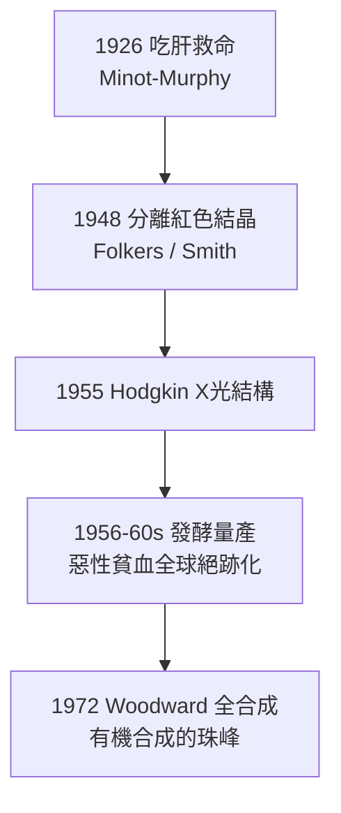

## 1948 - 維生素 B12 的分離與全合成（從半公斤肝到一顆紅色結晶）

## 案件摘要

**本案偵破的是 1926 年肝臟療法留下的化學懸案：肝臟裡那個「造血因子」，究竟是什麼？**

1926 年 Minot–Murphy 證明吃肝能救惡性貧血（見 `1926-米諾特與墨菲肝臟療法.md`），但「有效因子」的真身未明——追捕持續 22 年。1948 年 4 月，美國 Merck 實驗室的 Karl Folkers 團隊與英國 Glaxo 的 E. Lester Smith 幾乎同時從肝臟中分離出**維生素 B12（氰鈷胺，cyanocobalamin）**：一個含鈷原子的紅色結晶，是當時結構最複雜的非聚合物天然物。1955 年 Dorothy Hodgkin 以 X 光繞射解出其立體結構，1972 年 Woodward 完成全合成——本案是化學與臨床聯合偵辦的教科書範例。

## 前因 -- 為什麼會有這個案子

- **「肝因子」的通緝令**：1930 年代以「每公斤肝能救多少病人天」為單位追蹤效價，Cohn 的肝萃取分級把活性步步濃縮，但純物質始現身不了——病人太多、肝太貴、效價太稀。
- **動物實驗的替身**：1940 年代確立以乳酸桿菌（*Lactobacillus lactis* Dorner 株）生長試驗作為「肝因子」活性的快速生物檢定——微量分析的地基。
- **「動物蛋白因子」的平行線**：家禽營養學發現某種「animal protein factor」能促進生長——事後證明就是 B12；兩條偵查線最後合流。
- **放射追蹤的機運**：1940 年代末，放射性鈷 $^{60}\mathrm{Co}$ 剛可用——Shemin 與合作者以 $^{60}\mathrm{Co}$ 標記示蹤，直接把鈷與造血活性掛鉤。

## 線索與推理 -- 數學式、程式、理論

**線索一：效價追蹤的「濃縮偵查」。** 從每公斤肝到毫克結晶，活性回收率是本案的進度條：

```text
1 kg 肝臟（含 B12 約 1 mg）→ 分級萃取 → 活性柱層析
→ 紅色結晶：0.0001 g 即可維持惡性貧血病人一個月的緩解
濃縮倍數 ≈ 百萬倍量級
```

紅色本身就是指紋——咕啉（corrin）環共軛系統吸收綠光而呈紅，「看顏色就知道抓對了人」。

**線索二：分子結構的解剖。** B12 的化學身分證：

$$ \mathrm{C_{63}H_{88}CoN_{14}O_{14}P} \quad \text{——中心鈷離子，咕啉環，上軸配體（氰/甲基/腺苷），下軸核苷酸環} $$

- **咕啉環**：與血紅素的卟啉環是表親——兩大「金屬載氧／載基團」分子在進化上同源，本案與鐵劑案（`1891`）在此重逢。
- **兩種活性型態**：甲基鈷胺（同型半胱氨酸→甲硫胺酸的甲基轉移）與腺苷鈷胺（甲基丙二酰 CoA 變位酶的輔酶）——B12 缺乏同時導致**巨母紅血球貧血**（葉酸陷阱：甲基四氫葉酸無法回收）與**神經病變**（髓鞘脂代謝異常）——1926 年觀察到的「貧血＋神經症狀」一併獲得解釋。

**線索三：結構的「照片」。** Hodgkin 以 X 光繞射處理當時最大的晶體結構之一，1955 年定案、1964 年獲諾貝爾化學獎——這是計算結構生物學時代之前，純晶體學的最輝煌偵辦之一。

**線索四：工業化的收尾。** 1950 年代發現**發酵副產物**（汙泥、放線菌培養液）富含 B12，於是化學合成讓位給微生物發酵生產；Woodward–Eschenmoser 的全合成（1972，111 步、百人團隊）則成為有機合成的里程碑而非商業路線。



## 結案 -- 後果與影響

- **惡性貧血的終結**：每年數微克的結晶即可終身控制——1925 年的死刑犯，1948 年後只需定期打針或含片。
- **輔酶化學與酶學的新大陸**：B12 是自然界唯一含金屬—碳鍵的維生素，其自由基化學（腺苷鈷胺的均裂）開創了「輔酶機制」研究，Lenhert、Barker 等人接力破案。
- **公共衛生**：全胃切除、萎縮性胃炎、素食人口的 B12 補充成為標準照護；食品強化（早餐穀片、配方奶）讓缺乏症趨於罕見。
- **一句話結案**：本案證明——**臨床發現（吃肝有效）畫出通緝令，化學把兇手押上法庭**；血液學與化學的聯合偵辦模式，自此成為醫學的標準作業。

## 關鍵人物與文獻

- **Karl Folkers（1906–1997）**——Merck 生化學家，B12 分離主持人，後來又解出輔酶 Q10；「微量營養素獵人」。
- **E. Lester Smith（1904–1992）**——Glaxo 化學家，英國方面幾乎同時分離成功；競爭最終以「共同發現」入史。
- **Dorothy Crowfoot Hodgkin（1910–1994）**——X 光晶體學家，1964 年諾貝爾化學獎；也解出青黴素與胰島素結構。
- **Robert B. Woodward（1917–1979）**——哈佛合成大師，B12 全合成（與 Eschenmoser 合作）被譽為有機合成的藝術品；1965 年諾貝爾化學獎得主。
- 原始文獻——Rickes, Brink, Koniuszy, Wood & Folkers, "Crystalline vitamin B12," *Science*, 1948；Smith & Parker, *Biochem J*, 1948；Hodgkin et al., *Nature*, 1955–56。

