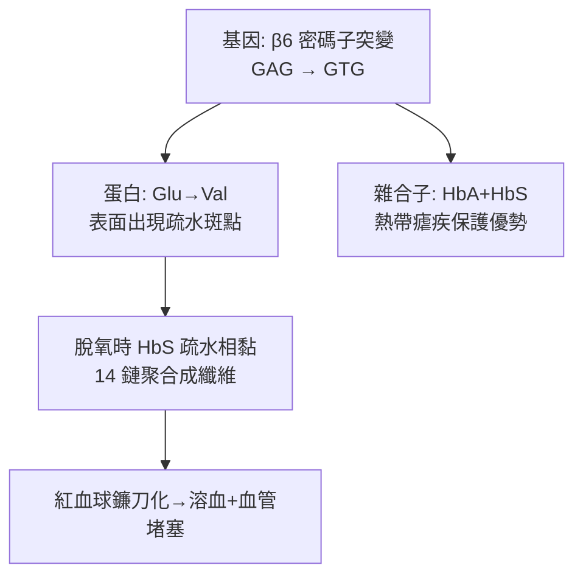

## 1949 - 鮑林「鐮刀型紅血球是一種分子病」（遺傳病第一次被解剖到分子層級）

## 案件摘要

**本案偵破的是一個「為什麼」的雙重謎題：為什麼鐮刀型貧血的紅血球會變成鐮刀？為什麼它只在缺氧時變？**

1949 年 11 月，化學家 Linus Pauling 在 *Science* 發表〈Sickle Cell Anemia, a Molecular Disease〉：以電泳比較正常人、病人與其父母（帶因者）的血紅素，發現病人的血紅素**電荷不同**——是一種化學上不同的分子。這篇論文創造了「molecular disease（分子病）」這個詞：疾病的本因不在器官、不在細胞，而在一個蛋白質的胺基酸序列上。八年後（1957），Ingram 定出那個差異——β 鏈第 6 位的麩胺酸換成了纈胺酸，**一個胺基酸的差異**。本案是「基因→蛋白→臨床表現」推理鏈的第一個完整樣本。

## 前因 -- 為什麼會有這個案子

- **1910 年 Herrick 的案發報告**：芝加哥內科醫師 James Herrick 在一名牙買加學生的血片中看到「新月形、鐮刀狀」紅血球——案發現場照片留存，但兇手身分成謎。
- **1917–27 年的流行病學**：明明是「遺傳病」，卻以隱性遺傳、非孟德爾式的怪異家譜出現；1940 年代已確認帶因者（sickle trait）平時無症狀、缺氧時血片才現形。
- **Pauling 的方法論**：他以結構化學與免疫學的「分子相似性」思路聞名（抗體—抗原互補），1945 年由哈佛醫學生 William Castle 的演講聽到鐮刀紅血球「缺氧誘發、可逆」的特性，立即判定：「**這是血紅素分子本身的問題**。」
- **電泳技術的就位**：Tiselius 1937 年發明移動界面電泳；1940 年代後期紙上電泳已能分離血清蛋白——偵查工具剛好趕上。

## 線索與推理 -- 數學式、程式、理論

**線索一：電泳的「電荷指紋」。** Pauling 與 Itano 以碳氧血紅素形式做自由電泳：

```text
HbA（正常人）   電泳速度 vA
HbS（病人）     電泳速度 vS，比 HbA 更「慢」（正電荷略多）
帶因者          兩條帶都有（HbA + HbS）
```

帶因者同時出現兩種血紅素——這正是雜合子的分子肖像。**遺傳學（孟德爾）與化學（電泳）第一次在同一張圖上互相指認。**

**線索二：聚沉的物理化學——為什麼是鐮刀？** 1950 年代 Perutz 與 Huisman 進一步證明：脫氧 HbS 的溶解度驟降，分子在紅血球內聚合成長纖維：

$$ \text{脫氧 HbS} \rightleftharpoons \text{纖維狀聚合物} \quad (\text{臨界濃度效應}) $$

纖維把柔軟的雙凹紅血球撐成鐮刀形→ 堵塞微血管 → 組織缺氧 → 更紅血球脫氧 → 更多聚合——正回饋的「惡性循環閘門」。而带氧 HbS 溶解正常，所以「輸氧可逆」。

**線索三：一個胺基酸的定讞（1957–58）。** Vernon Ingram 以「指紋法」（胰蛋白酶水解＋紙層析/電泳二維分離）比較 HbA 與 HbS 的胜肽斑點，發現**只有一個斑點位移**，定序後確認：β 鏈第 6 位 Glu（帶負電）→ Val（疏水）：



E→V 的化學細節完美解釋電泳結果（少一個負電荷）與聚合行為（疏水補丁互相嵌合）——**兩條獨立證據線在同一點會合**，全案定讞。

**線索四：為什麼這種病在非洲常見？——分子病與瘧疾的共舞。** 雜合子對惡性瘧有保護優勢（寄生蟲感染的細胞易被清除）： $w_{AA} < w_{AS} > w_{SS}$ 的**雜種優勢平衡選擇**（Allison, 1954）——「病人」基因的存在，是瘧疾千萬年選擇的結果。分子病概念在此升級為演化醫學的第一課。

## 結案 -- 後果與影響

- **「分子病」概念誕生**：囊腫性纖維化、苯酮尿症、地中海型貧血（見 `1978-地中海型貧血產前基因診斷.md`）等上千種遺傳病，從此都沿「基因→蛋白→臨床」的路徑偵辦。
- **血紅素成為分子生物學的果蠅**：Hb 結構（Perutz 1959–68）、氧親和力調控（2,3-BPG 效應、Bohr 效應）、球蛋白基因簇演化，成為蛋白科學最完整的教材系統。
- **1970s 產前診斷與 1990s 基因治療**：1978 年 Kan 以 RFLP 對鐮刀貧血做產前診斷；2017 年 FDA 核准羥基尿素後，2023 年 CRISPR 基因編輯療法（Casgevy）治療鐮刀型貧血獲批——74 年的偵查長跑，終點是編輯掉那個密碼子。
- **1954/1962 年諾貝爾獎的注腳**：Pauling 因化學鍵（非本案）獲 1954 化學獎；Perutz 因血紅素結構獲 1962 化學獎——本案沿線的獎項密度，記錄了分子生物學的世紀。
- **一句話結案**：Pauling 案宣告——**病歷表上的每一行症狀，最終都能追溯到一串字母的改寫**。

## 關鍵人物與文獻

- **Linus Pauling（1901–1994）**——加州理工化學家，兩度諾貝爾獎（1954 化學、1962 和平）；「分子病」概念的締造者。
- **Vernon Ingram（1924–2006）**——MIT 生物化學家，指紋法與單一胺基酸差異的定讞者；被稱為「分子醫學之父」。
- **James Herrick（1861–1954）**——1910 年首例描述者；他的血片報告在檔案中沉睡 39 年才被 Pauling 的電泳喚醒。
- **Anthony Allison（1925–）**——1954 年證明雜合子在非洲的瘧疾保護與族群遺傳學解釋。
- 原始文獻——Pauling, Itano, Singer & Wells, *Science*, 1949；Ingram, *Nature*, 1956–57（指紋法與定序）。

