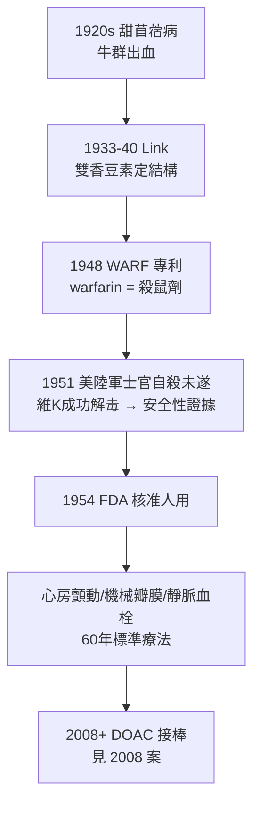

## 1954 - 華法林從鼠藥到處方藥（凝血研究的勝利，與「毒物劑量」的辯證）

## 案件摘要

**本案偵破的是醫學史上最反直覺的一樁翻案：一種曾讓牛群流血致死的殺鼠劑，如何成為每年救活數百萬人的抗凝處方藥？**

warfarin 的身世是一條完整的偵探鏈：1920 年代加拿大牛群爆發「甜苜蓿病」（敗血性出血）；1933–40 年 Link 在威斯康辛追出毒物是**雙香豆素**（腐敗草木犀中的陳化產物）；1948 年合成更強的衍生物 warfarin（Wisconsin Alumni Research Foundation + ARin = WARF-ARIN）成為王牌殺鼠劑；1954 年通過臨床審查成為口服抗凝藥。本案的主題是：**藥與毒的界線，是劑量與監測寫出來的**。

## 前因 -- 為什麼會有這個案子

- **血栓性疾病的龐大死因**：心肌梗塞、中風、靜脈血栓栓塞——20 世紀中葉已知多數與血管內凝血有關，急需「讓血不那麼容易凝」的藥。
- **肝素的限制**：1935 年起肝素（見 `1937-肝素的臨床問世.md`）靜脈注射有效但必須住院輸注——**口服**抗凝藥是未竟的懸賞。
- **甜苜蓿病的流行病學線索**：牛隻只在餵食**腐敗**的草木犀（sweet clover）後出血——「陳化產生毒物」指向可萃取的化學分子。
- **凝血機制的半成品地圖**：Quick 1935 年發明凝血酶原時間（PT）——本案的藥效監測工具比藥物早到 13 年。

## 線索與推理 -- 數學式、程式、理論

**線索一：Link 的化學追捕（1933–40）。** Karl Paul Link 的威斯康辛實驗室以「出血牛血清 + 兔子存活試驗」為效價指標，從數噸腐草中逐步純化出雙香豆素（dicoumarol，1940 定結構）。機制要到 1974 年才由 Stenflo 與 Nelsestuen 同時破案：

$$ \text{維生素 K 環氧化物循環被抑制} \Rightarrow \text{凝血因子 II, VII, IX, X 無法進行 }\gamma\text{-羧基化} \Rightarrow \text{僅含 9–12 個殘基的「脫羧前體」無法結合 Ca}^{2+}\text{與磷脂膜} $$

——凝血因子造出來了，卻「抓不住」膜表面，級聯（見 `1964-凝血瀑布學說.md`）無法啟動。

**線索二：為什麼毒老鼠特別有效？** 香豆素衍生物半衰期的化學工程：雙香豆素 $t_{1/2}$ 約 1–2 天，warfarin 達 36–42 小時且效價更高——對只需偷吃一兩次誘餌的老鼠，慢效反而致命（血慢慢流不完）；對人類，長半衰期卻意味著**可預測、可每日一次**的穩定抗凝。

**線索三：劑量與監測的雙保險。** warfarin 的治療窗極窄：

$$ \text{出血} \iff INR > 4.5 \qquad \text{血栓} \iff INR < 2.0 \qquad \text{目標: } INR \in [2.0, 3.0] $$

1950 年代的臨床試驗以 PT/INR 監測建立劑量調整規則——「窄治療窗藥物的精準劑量學」成為藥理學教材；1990 年代更發現 CYP2C9 與 VKORC1 基因多型性決定劑量需求（藥物基因體學的經典案例）。

**線索四：解毒劑的設計。** 維生素 K1（phytomenadione）重啟環氧化物循環、逆轉 warfarin——毒與解在同一條代謝迴路上對峙，本案的「案情」本身就是一幅酶學圖。

**線索五：1951 年的意外證詞。** 美國陸軍士官企圖以「極強效老鼠藥」自殺，送到醫院後以維生素 K 治癒——這起未遂案件意外提供了人體毒理學的完整數據，成為 FDA 1954 年核准的重要安全證據。**有時關鍵證人來得毫無道理。**

## 結案 -- 後果與影響

- **口服抗凝的六十年王朝**：機械瓣膜、心房顫動、DVT/PE 的標準療法；數十億人年經驗、成本極低——至今在資源匱乏地區仍是主力。
- **抗凝監測體系誕生**：INR（國際標準化比值）標準化全球 PT 試劑差異，是實驗室品質管理的典範。
- **農藥→藥物的模式**：從殺鼠劑到人用藥的反向翻案，是「治療指數」（見 Ehrlich 模板）概念的活教材——同分子、不同劑量、不同物種、不同結局。
- **一句話結案**：warfarin 案告訴我們——**沒有天生是毒的分子，只有還沒算清劑量的藥**；以及相反地，沒有天生是藥的分子，只有還沒設好監測的毒。

## 關鍵人物與文獻

- **Karl Paul Link（1899–1978）**——威斯康辛大學生化學家，雙香豆素與 warfarin 之父；他本人終生保留著 warfarin 作殺鼠劑的第一份專利文件。
- **Henrik Dam 與 Edward Doisy**——維生素 K 的發現者（1929）與純化者（1939），1943 年諾貝爾生理學或醫學獎；本案的上游線索供應商。
- 原始文獻——Link, "The anticoagulant from spoiled sweet clover hay," *Harvey Lectures*, 1943–44；Shapiro, "Administration of dicumarol/warfarin in man," *JAMA*, 1950s 系列。
- 現代註腳——warfarin 同時是偵探小說與真實謀殺案的常客（1965 年朝鮮情報員對南韓間諜使用的「超級殺鼠劑」即超強 warfarin 衍生物 brodifacoum）——藥史與罪案史在這條化學鏈上共享檔案。

