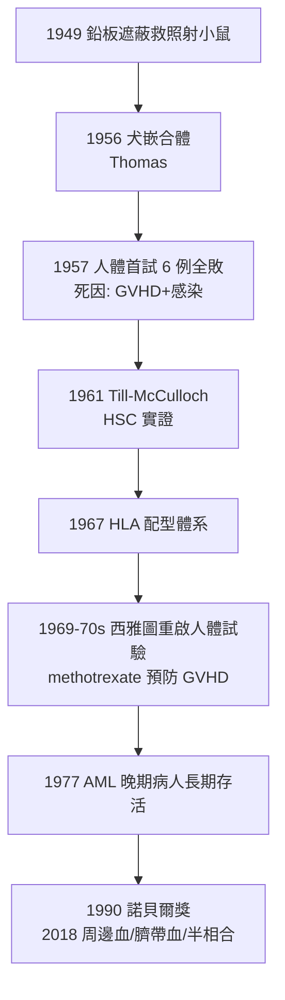

## 1956 - 唐納爾·湯瑪斯的骨髓移植實驗（造血幹細胞概念的第一場實戰）

## 案件摘要

**本案偵破的是 20 世紀血液學最大膽的問題：全身骨髓被放射線摧毀的動物，能靠輸入別人的骨髓「重新造血」嗎？**

1956–57 年，紐約 Columbia 大學的 E. Donnall Thomas 以致死劑量放射線照射犬隻後輸入供髓犬的骨髓，部分受髓犬長期存活並**永久轉為供髓犬的血型**——首次證明「造血系統可以整體移植」。他隨即於 1957 年在人體嘗試（6 例急性白血病，全部失敗），但已種下種子；經過 1960–70 年代對移植免疫與 GVHD 的長期偵辦，1970 年代末西雅圖的異基因骨髓移植成功率突破，1990 年 Thomas 獲諾貝爾生理學或醫學獎。今天每年數萬名白血病、淋巴瘤、重度再生不良性貧血病人因這場「造血的重生」而活。

## 前因 -- 為什麼會有這個案子

- **核時代的殘酷餽贈**：廣島與長崎的死亡名單中，大批死因是「骨髓衰竭」——放射線選擇性摧毀造血細胞。1949 年 Jacobson 報告：把小鼠**脾臟遮蔽**於鉛板後再全身照射，動物可存活——「某種造血組織能救活照射動物」。
- **1951–54 年小鼠移植實驗**：Lorenz 與 Barnes 以骨髓懸液救活照射小鼠；但 1955 年後發現部分存活動物後死於「secondary disease」（慢性惡病質）——當時無人知道這是**移植物抗宿主病（GVHD）**。
- **1956 年的雙線突破**：芝加哥的 Ford、Trentin 等人以**染色體標記**證明照射小鼠體內的造血細胞來自**供髓者**——「骨髓可以移植」獲得細胞遺傳學實錘。
- **造血幹細胞的猜想**：直至 1961 年 Till 與 McCulloch 以脾結落（CFU-S）實驗證明造血幹細胞的存在，移植的「移植物」才有了明確的科學身分（見後文）。

## 線索與推理 -- 數學式、程式、理論

**線索一：血型轉換是「成功」的鐵證。** Thomas 的犬實驗中，受髓犬康復後其紅血球抗原永久轉為供髓犬型——血液的「身分證」被整本換掉，證明造血器官已被供者細胞接替：

$$ \text{嵌合體（chimerism）成立} \iff \text{受體血球抗原} = \text{供體型} \ \land\ \text{長期存活} $$

**線索二：GVHD 的身份確認。** 1957 年人體首試全軍覆沒的死因，1960 年代被拆解為兩個兇手：(1) **移植物中的成熟 T 細胞**攻擊宿主（GVHD）；(2) 組織相容性不合導致排斥。解法是**去掉移植物中的 T 細胞來源衝突＋嚴格 HLA 配型**——1964 年 Dausset 確立 HLA 系統（1980 諾獎）後，配型成為移植的「身份核對」。

**線索三：造血幹細胞的實驗定義。** 1961 年 Till & McCulloch：輸入定量骨髓細胞給照射小鼠，脾臟上形成的結落數與輸入細胞數成正比，且每個結落源自單一細胞（含紅、粒、巨核多系）——**單一細胞重建整個造血系統**的證明：

$$ \text{HSC 定義} = \text{自我更新} \ \cap\ \text{多系分化} \ \cap\ \text{長期重建} $$

這定義至今仍是幹細胞生物學的公理，也讓「移植」從技術變成科學。

**線索四：策略的迭代。**

**線索五：兩種「移植物」的哲學分歧。** 自體移植（救自己的冷凍骨髓再回輸）與異基因移植（供者的免疫細胞順便攻擊殘留白血病——**移植物抗白血病效應 GVL**）——後者的副作用（GVHD）與療效（GVL）本是同一把刀的兩面，這個悖論直至今日仍是移植醫學的核心張力。

## 結案 -- 後果與影響

- **1990 年諾貝爾獎**：Thomas 與腎移植先驅 Joseph Murray 共獲——移植醫學的雙峰。
- **造血幹細胞移植成為血液腫瘤支柱**：AML、ALL 高危、CML（TKI 前時代）、骨髓瘤、淋巴瘤、再生不良性貧血、重度地中海貧血（見 `1978-地中海型貧血產前基因診斷.md`）的治療版圖重繪。
- **1991 年起的世界骨髓捐贈庫**：數千萬登記者的 HLA 資料庫，讓「陌生人救陌生人」成為全球物流系統。
- **CAR-T 與基因編輯時代的底座**：2017 年 CAR-T（見 `2017-CAR-T細胞療法.md`）與造血幹細胞基因治療，全部以「清髓＋輸入新細胞」的 Thomas 框架為地基。
- **一句話結案**：Thomas 案的偵探精神是——**第一次臨床失敗後不封卷，而是回到動物實驗室把每個死因逐一拆解**；二十年後重啟人體試驗，這是醫學史上最有耐心的重案組。

## 關鍵人物與文獻

- **E. Donnall Thomas（1920–2012）**——從 Cooperstown 到西雅圖 Fred Hutchinson 癌症中心，用 40 年把骨髓移植從異想變成常規；1990 年諾貝爾獎。
- **James Till 與 Ernest McCulloch**——多倫多搭檔，1961 年脾結落實驗的設計者；加拿大幹細胞科學的開國者。
- **Jean Dausset（1916–2009）**——HLA 系統的確立者，1980 年諾貝爾獎；移植配型的語言發明人。
- 原始文獻——Thomas et al., "Intravenous infusion of bone marrow in patients receiving radiation and chemotherapy," *NEJM*, 1957；Till & McCulloch, *Radiat Res*, 1961；Thomas et al., *NEJM*, 1975/1977（西雅圖系列）。

