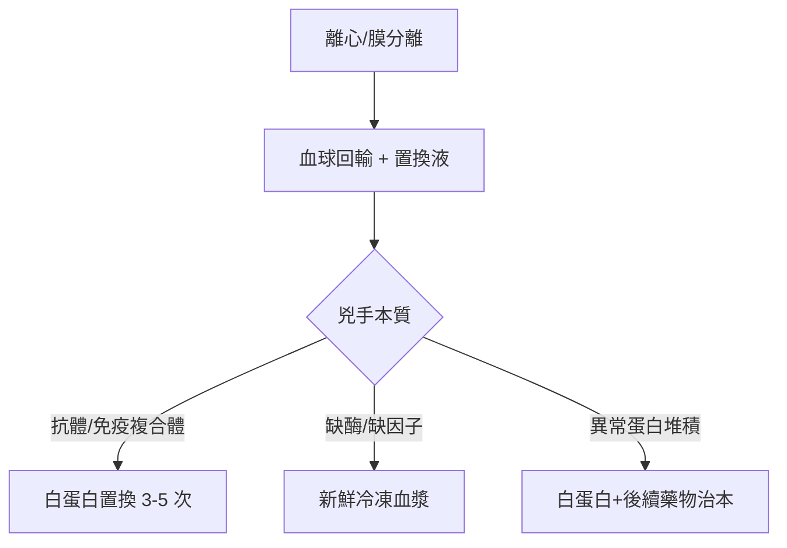

## 1960 - 血漿置換的臨床應用（把「壞血」整鍋換掉的重症偵查術）

## 案件摘要

**本案偵破的是一個「大掃除」問題：當致病的兇手不是細胞、而是血漿裡的物質（抗體、免疫複合體、異常蛋白）時，怎麼把它們移除？**

血漿分離術（plasmapheresis）由美國生理學家 John Abel 於 1914 年發明（與檸檬酸鹽抗凝同期，見 `1914-血庫與檸檬酸鹽抗凝.md`），但長期只是實驗技術。1960 年代起，Skeggs 與 Lennane 改良離心式分離機，Solomon 與 Klemperer 等人以血漿置換治療多發性骨髓瘤的高黏滯血症、1975 年 Lockwood 以之治療 Goodpasture 症候群——「置換血漿」成為自體免疫與異常蛋白疾病的重症武器。本案的偵探價值在於：**換一個取證對象——血液的液體成分——就能破細胞病理學破不了的案子**。

## 前因 -- 為什麼會有這個案子

- **血漿病的臨床困境**：骨髓瘤的 M 蛋白（見 `1999-沙利竇邁復活治療骨髓瘤.md`）讓血液黏如糖漿；重症肌無力、Guillain-Barré、 Goodpasture 的兇手都是循環抗體——藥物起效太慢，抗體正在殺人。
- **Abel 的原始發明**：1914 年以「離心＋回輸血球」為狗做血漿去除——概念完整，但無臨床動機。
- **離心與膜分離技術的成熟**：1950–60 年代血庫離心機、人工腎臟（透析膜）技術外溢——血漿與血球的物理分離變得工程可行。
- **免疫病理學的助力**：1950–60 年代確認多種神經與腎臟病的血清抗體本質——「知道兇手在血漿裡」是置換療法的前置證據。

## 線索與推理 -- 數學式、程式、理論

**線索一：血漿的動力學——置換能除掉多少？** 血漿中蛋白質分布在血管內與組織間，單次置換一個血漿容量（約 40–50 mL/kg）的清除效率遞減：

$$ C_n = C_0 \cdot (1 - P)^n, \qquad P = \text{每次置換的血漿容量比例} \approx 0.6 $$

置換 1 次約剩 40%、3 次約剩 6%——這就是「為什麼總是連做 3–5 次」的數學根據。但**血管外pool**（IgG 一半以上在組織間）會回滲，所以真正清除的是「以血管內為主」的兇手（IgM、免疫複合體）。

**線索二：按兇手特性選案。** 血漿置換不是萬用掃把，它的「管轄權」有明確的物理化學標準：

```text
兇手在血漿中、半衰期長、藥物難以速效清除、可逆性損傷
→ 高黏滯血症（骨髓瘤 IgM/Waldenström）
→ 抗 GBM 抗體（Goodpasture, 1975 Lockwood）
→ 抗乙醯膽鹼受體抗體（重症肌無力危象）
→ Guillain-Barré（1978 PTA 試驗證實有效，見後）
→ TTP（血栓性血小板低下紫斑症, 1977 Bukowski; 1991 Rock 確認血漿置換死亡率 91%→22%）
```

TTP 案尤其精采：1982 年 Moake 發現兇手是「超大分子 vWF 多聚體」、1990 年代末確認 ADAMTS13 酶缺乏——**血漿置換恰好補進了病人缺的酶與稀釋了壞抗體**，機制與療法在不知情下互相指認。

**線索三：1978 年的隨機對照定讞。** Guillain-Barré 症候群在 1976 年美國豬流感疫苗事件後病例暴增；1978 年法國多中心試驗與後續北美試驗證實血漿置換縮短病程——重病「以物理方法移除抗體」勝過等待免疫抑制劑起效，RCT 時代（參見 1948 Farber 案的試驗精神）為此技術蓋章。

**線索四：置換液的選擇悖論。** 換出的血漿以白蛋白＋生理食鹽水補回最安全；但 TTP 必須補**新鮮冷凍血漿**（要補 ADAMTS13）——「補什麼」本身就是機制推理的一部分：



## 結案 -- 後果與影響

- **血漿置換成為重症血液學支柱**：TTP 的死亡率從 90% 降到 20% 以下是血液科 20 世紀後半最戲劇性的救命紀錄之一；美國血漿置換學會（ASFA）自 1980 年代起出版分類指引（I–IV 類適應症），把「何時該換血」變成條列法典。
- **技術家族擴張**：雙重過濾血漿置換（DFPP）、免疫吸附柱（蛋白 A、抗 IgG 柱）、LDL 單采——「選擇性移除」使治療更精準、置換液更省。
- **治本與治標的分工確立**：置換是「買時間」的治標術，後續必須以免疫抑制劑（或骨髓瘤化療）治本——本案確立了重症免疫病「急則治血漿、緩則治免疫」的雙階段偵查節奏。
- **一句話結案**：血漿置換案的偵探教訓——**當兇手是血裡的某種分子，最快的破案法不是繞路用藥，而是把血整鍋端走**。

## 關鍵人物與文獻

- **John J. Abel（1857–1938）**——約翰霍普金斯藥理學之父，1914 年發明 plasmapheresis；也是腎上腺素純化與胰島素結晶的參與者。
- **Anthony Skeggs（1918–2002）**——IBM 出身的工程師，1960 年代離心式血球分離機（Cobe、IBM cell separator）的設計者——本案的「工程偵探」。
- **Charles Lockwood（1948– ）**——倫敦 Hammersmith 醫院腎臟—免疫科醫師，1975 年以血漿置換救活 Goodpasture 病人，開啟抗體介導腎病的置換時代。
- **Paul Rock 與加拿大血漿置換研究群**——1991 年 NEJM 的 TTP 多中心試驗，把死亡率 91% 壓到 22%，是本案的定讞判決書。
- 原始文獻——Abel, Rowntree & Turner, "Plasma removal with return of corpuscles," *J Pharmacol Exp Ther*, 1914；Rock et al., "Comparison of plasma exchange with plasma infusion in the treatment of thrombotic thrombocytopenic purpura," *NEJM*, 1991。

