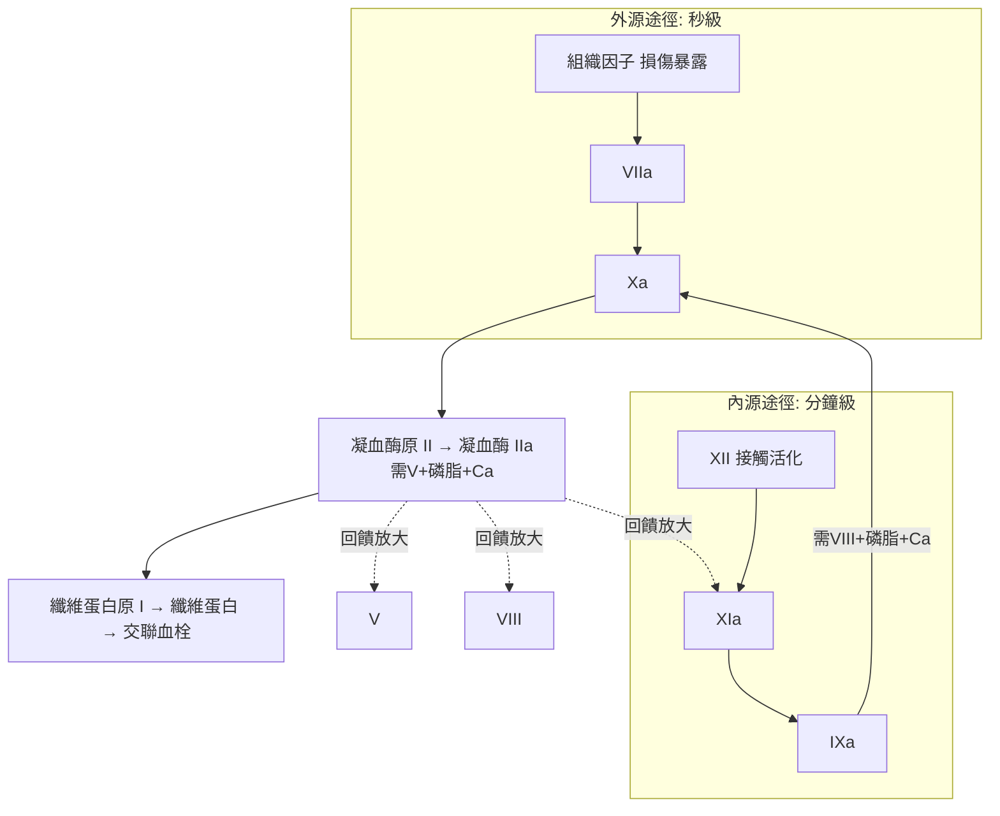

## 1964 - 凝血瀑布學說（把 60 種出血病的線索，整理成一張級聯圖）

## 案件摘要

**本案偵破的是血液學最龐大的一張案情圖：血液為什麼會在正確的時間、正確的地點、以正確的速度凝固？**

1964 年，兩組科學家——英國牛津的 R. G. MacFarlane 與美國聖路易斯的 Davie–Ratnoff——幾乎同時發表**凝血級聯（coagulation cascade）**模型：凝血是一系列酶原→活性酶的放大反應鏈，前一個酶切開下一個酶原，像瀑布逐級放大。這張圖把過去百年亂成一團的凝血因子（羅馬數字 I–XIII，其中 VI 後來被撤銷）整併成可預測的邏輯網，是血友病（見 `1966-血友病第八因子治療.md`）、抗凝藥物、DIC 的共同理論地基。

## 前因 -- 為什麼會有這個案子

- **因子命名的一團亂麻**：1940–50 年代各地實驗室發現了「加速素」「血清凝血酶原轉化因子」……同一分子多國多名（如 Factor X 有三個名字）。1954 年國際委員會以羅馬數字統一編號——**先給證物編號，再理案情**。
- **關鍵證人的名字**：血友病（VIII 缺乏）、Christmas 病（IX 缺乏，以首例病人 Stephen Christmas 命名）、副血友病（V 缺乏）、Hageman 因子（XII，以病人 John Hageman 命名）——每一例遺傳缺陷病人都是一張「單因子缺失」的天然實驗記錄。
- **酶學思想的成熟**：1940–50 年代蛋白酶活化級聯的先例（胰蛋白酶原、纖溶系統）讓「酶原逐級活化」成為可行的模型模板。
- **接觸活化的意外線索**：1953 年發現玻璃表面能啟動凝血（接觸活化）——體外試管與體內血管的差異，差點把整個模型帶偏。

## 線索與推理 -- 數學式、程式、理論

**線索一：天然基因敲除的歷史奇遇。** 凝血模型的偵辦方式，是讓罕見出血病人自己「做實驗」：每個缺陷因子在級聯中的位置，由「加了什麼血漿能矯正什麼缺陷」的交叉試驗推出。MacFarlane 的工作坊把數百份病人血漿兩兩混合、測再鈣化時間，排列出**互補矩陣**——級聯的拓撲結構，是用病人血漿拼出來的拼圖。

**線索二：級聯的數學本質——放大器。** 每級反應一個酶分子可催化多個下游分子：

$$ N_{\text{纖維蛋白}} \sim N_{\text{組織因子}} \times 10^{4\text{–}6} \quad (\text{四到六級的指數放大}) $$

放大解釋了為什麼凝血是「全或無」的開關（要么止血、要么大出血，很少半途而廢），也解釋了為什麼極少量的組織因子洩漏就足以讓一處傷口凝成一顆血栓。

**線索三：內源／外源雙路徑圖。** 1964 年的經典圖版：

兩條路在 X 匯流——PT（外源，見 `1954-華法林從鼠藥到抗凝藥.md`）與 aPTT（內源）兩項檢驗從此成為出血病人的「路徑指示燈」：PT 長＝外源路壞（VII/II/V/X）；aPTT 長＝內源路壞（VIII/IX/XI/XII）。

**線索四：模型的兩次重大修正。** 偵探圖不是終稿：(1) 1964 圖把 XII 接觸活化放在起點，但後來發現 XII 缺乏者**根本不出血**——體內真正的生理啟動者是組織因子途徑，XII 主要參與血栓與發炎（1990s Hoffman–Monroe「細胞為基礎的凝血模型」修正）；(2) 凝血酶不是終點，它回頭活化 V、VIII、XI 與血小板——**級聯是網狀的正回饋系統**，不是單向瀑布。本案展示了一流偵查的特徵：圖會被改，但骨架留存。

**線索五：與抗凝系統的對偶。** 同期發現的抗凝血酶 III（1965）、蛋白 C/S（1976）、組織因子途徑抑制劑（TFPI）——凝血與抗凝是同一張網上的攻防；肝素（`1937` 案）與 warfarin（`1954` 案）的作用點，在級聯圖上第一次有了坐標。

## 結案 -- 後果與影響

- **出血病診斷的作業系統**：PT/aPTT＋因子分析成為出血病人的標準偵查流程；血友病的替代治療（VIII 濃縮劑，1966 年代量產）直接按圖施工。
- **抗凝藥物開發的地圖**：低分子量肝素（1970s–80s，選定 Xa/IIa 為靶）、直接 Xa 抑制劑（rivaroxaban, 2008）、直接 IIa 抑制劑（dabigatran, 2008，見 `2008-直接口服抗凝劑DOAC.md`）——每個新藥都是在級聯圖上「圈一個節點」。
- **血栓與止血醫學的統一語言**：動脈粥樣硬化破裂、DIC、妊娠栓塞、手術止血——全部用同一套因子語言溝通。
- **一句話結案**：凝血瀑布案的偵辦手法是——**把每一個天然缺陷病人當作被拔掉一根線的燈串，燈在哪一段熄滅，線就在哪裡**。

## 關鍵人物與文獻

- **Robert Gwyn MacFarlane（1907–1987）**——牛津血液學教授，級聯模型的英方主筆，也是血友病權威《A Rose for Christmas》（Christmas 病人傳記）的作者。
- **Earl W. Davie 與 Oscar Ratnoff**——聖路易斯華盛頓大學與克利夫蘭的搭檔，美方級聯模型的發表者；Davie 後來成為凝血分子生物學的掌門人。
- **Armand Quick（1894–1978）**——1935 年發明 PT（凝血酶原時間），本案的工具先鋒。
- 原始文獻——Davie & Ratnoff, "Waterfall sequence for intrinsic blood clotting," *Science*, 1964；MacFarlane, "An enzyme cascade in the blood clotting mechanism, and its function as a biochemical amplifier," *Nature*, 1964——兩篇論文相隔僅數週，是科學史上著名的「同時破案」。

