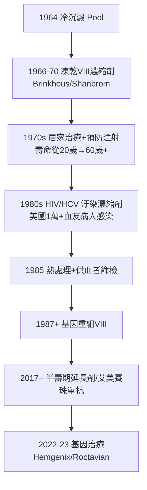

## 1966 - 第八因子濃縮劑與血友病的替代治療（讓「流血的王子」第一次活得像常人）

## 案件摘要

**本案偵破的是血友病治療史的分水嶺：如何把血友病人從「躺在床上等血止」變成「可以上學、運動、工作」？**

1950 年代前，血友病人只能靠反覆輸全血或新鮮血漿，但 VIII 因子需求量遠超血漿所能提供——關節出血照樣致殘。1964–66 年，兩項工程突破同時到位：Judith Pool 發明**冷沉澱（cryoprecipitate）**（血漿低溫解凍後的沉澱物富集 80% 的 VIII 因子），以及 Brinkhous 等人開發**VIII 濃縮劑**（可凍乾、居家注射）。1970 年代血友病進入「居家治療」時代——直到 1980 年代 HIV 汙染血品的世紀悲劇（見後文），本案的偵查弧線以「最偉大的勝利」與「最沉痛的反噬」雙面呈現。

## 前因 -- 為什麼會有這個案子

- **血友病的皇室陰影**：維多利亞女王的 X 染色體突變經聯姻散布至西班牙、俄羅斯皇室（Rasputin 案的政治背景）；19 世紀前，血友病男孩的平均壽命不到 20 歲。
- **機制的定位**：1937 年 Pohle–Brinkhous 證明血友病血漿缺乏「抗血友病因子」（VIII）；1952 年 Christmas 病（IX 缺乏）被分離出來——血友病分成 A、B 兩案（見 `1964-凝血瀑布學說.md`）。
- **劑量的數學困境**：輸血漿要提升 VIII 到止血水平，需血漿量接近循環總量——心臟受不了。「單位體積血漿含 VIII 太少」是本案的核心技術障礙。
- **凝血檢驗的成熟**：aPTT 與 VIII 活性定量（1950s）讓「輸多少、什麼時候輸」第一次可以按數字操作。

## 線索與推理 -- 數學式、程式、理論

**線索一：藥物動力學決定輸血策略。** VIII 的半衰期約 12 小時，止血所需最低濃度因出血類型而異：

$$ \text{VIII 濃度}(\mathrm{IU/dL}) = \frac{\text{輸注 IU} \times 2\%/\mathrm{IU/kg}}{} \ \text{、目標: 關節出血} \geq 30,\ \text{大手術} \geq 80\text{–}100 $$

全血/血漿無法達標，冷沉澱與濃縮劑把單位容量內的 VIII 濃度提高 5–100 倍——**「劑量學」從不可能變成處方**。

**線索二：冷沉澱的意外發現。** 1964 年 Judith Pool 與 Shannon 注意到：血漿解凍後的殘餘沉澱——本來是血庫的廢棄物——竟含大部分 VIII 因子與纖維蛋白原。冷沉澱的偵探教訓：**兇手（VIII）原來一直躲在冰箱的低溫死角裡**。

**線索三：居家治療的制度設計。** 1970 年代，凍乾濃縮劑＋居家靜脈注射訓練＋家庭自備劑量，使病人在出血初期（關節「發熱感」階段）即自行注射：

**線索四：1980 年代的至暗反轉。** 濃縮劑需要**數千名捐血者的血漿**匯集——「匯集」同時放大了任何一個帶病毒供者的風險。1982–85 年，美國與日本、法國等地約半數重度血友病人感染 HIV；法國血品醜聞更導致部長級官員被定罪。本案因此成為公共衛生倫理的世紀教材：**技術的放大器，同樣會放大系統的疏失**。

**線索五：基因治療的終局推理。** 血友病是單基因缺陷＋「只要 5–15% 正常表達即大幅改善」——理想的基因治療標靶。2022 年 Hemgenix（B 型血友病，AAV 載體）與 2023 年 Roctavian（A 型）獲批：一次輸注，數年內肝細胞自主生產因子——從輸血漿到編輯基因，偵查終點設在了 DNA 上。

## 結案 -- 後果與影響

- **血友病從絕症變成慢性病**：預防性注射讓關節破壞近乎消失，血友病男孩可以踢足球（有節制的）。
- **血品安全的全球性重建**：熱處理、供血者篩檢、無償捐血原則、病毒滅活、NAT 核酸檢測——1980 年代悲劇直接催生了現代血品安全體系。
- **患者組織的政治力量**：血友病團體在 1980s 的追責與立法，是病人權益運動（與愛滋運動同步）的重要戰線。
- **一句話結案**：第八因子案的完整弧線告訴我們——**醫學的偵查可以破案，但制度的偵查（誰該為汙染的血負責）往往來得更晚、也更貴**。

## 關鍵人物與文獻

- **Judith Graham Pool（1919–1975）**——史丹佛血液學家，1964 年冷沉澱法發明者；她的論文只有四頁，救的人數以十萬計。
- **Kenneth Brinkhous（1904–2000）**——北卡羅來納凝血實驗室的宗師，VIII 濃縮劑開發與國際凝血命名委員會的關鍵人物。
- **Stephen Christmas（1947–1993）**——B 型血友病首例命名人；他的名字進入了醫學辭典（Christmas disease / Christmas factor）。
- 原始文獻——Pool & Shannon, "Production of high-potency concentrates of antihemophilic factor in a closed-bag system," *NEJM*, 1965；Bennett, Brinkhous et al. 的 VIII 濃縮劑系列（1967–70）。

