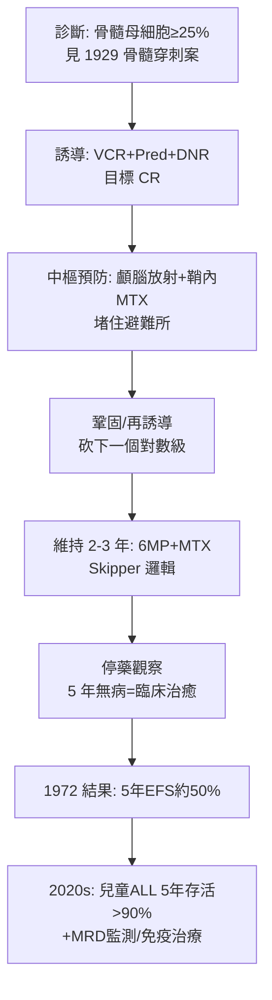

## 1968 - 兒童 ALL 的「總體治療」突破（從短暫緩解到 90% 治癒的多兵種作戰）

## 案件摘要

**本案偵破的是白血病治療的最大謎題：為什麼藥能讓 95% 的白血病兒童「完全緩解」，病人卻總在數月內復發、無一治癒？**

1961–68 年，田納西 St. Jude 兒童研究醫院的 Donald Pinkel 提出「total therapy（總體治療）」：誘導緩解→**中樞神經預防治療**（顱腦放射＋鞘內 methotrexate）→長期維持化療→停藥。1968–1972 年的第一批 41 名 ALL 兒童中，近半數獲得**五年以上無病存活**——人類第一次「治癒」了一種全身性癌症。本案的核心推理是一場偵查概念的革命：復發的兇手不是「殘存的血中白血病」，而是**藏匿在腦脊髓膜與骨髓深處、藥物到不了的微量殘存病灶（MRD）**。

## 前因 -- 為什麼會有這個案子

- **Farber 1948 年的開局**（見 `1948-法伯氨蝶呤治療兒童白血病.md`）：胺蝶呤帶來短暫緩解，但復發是宿命。
- **1950–60 年代的武器庫擴充**：6-mercaptopurine（Burchenal, 1953）、vincristine（Noble 與 Eli Lilly, 1961）、prednisone、cyclophosphamide、Daunorubicin（1963）——單藥各自能誘導緩解，各自都會復發。
- **Freireich 與 Frei 的聯合概念**：1960 年代初 NIH 的兩位 F（Emil Freireich、Emil Frei）以實驗腫瘤學證明「不同機制藥物聯合、足量、間隔」優於單藥——1965 年 VAMP 方案（vincristine+amethopterin+6MP+prednisone）使部分 ALL 長期緩解，但**腦白血病復發**成為新死因。
- **關鍵的屍檢線索**：緩解期死亡的 ALL 病童，腦脊髓膜浸潤極常見——化療藥（ methotrexate 等）**穿不透血腦屏障**，中樞神經成為白血病的避難所。

## 線索與推理 -- 數學式、程式、理論

**線索一：治癒的量化邏輯——殺滅到第幾個對數級？** 假設診斷時白血病細胞約 $10^{12}$ 個，化療每療程殺滅 2–3 個對數級：

$$ 10^{12} \xrightarrow{\text{誘導}} 10^{8}\ (\text{CR}) \xrightarrow{\text{鞏固}} 10^{4} \xrightarrow{\text{維持 2–3 年}} \to 0 \ (\text{免疫系統收尾}) $$

「完全緩解」只是把敵人從 1 兆砍到 1 億——**看不見不等於不存在**。Pinkel 的總體治療就是把對數級一路砍到底，並堵住每一個避難所。

**線索二：避難所推理（sanctuary）。** 血腦屏障讓藥物濃度不及血中的 1/10，中樞成為 MRD 的庇護城。Pinkel 的對策是三管齊下：鞘內注射 methotrexate（藥直接進脊髓液）＋顱腦照射（殺蔽匿細胞）＋全身加大劑量（methotrexate 高劑量衝擊可部分穿透）——這是**藥理學地理學**：把戰場上的「無主之地」一塊塊標出並清剿。

**線索三：維持治療的生態學邏輯。** 為什麼緩解後還要吃兩三年 6-MP＋MTX？1960 年代 Skipper 的 L1210 小鼠模型給出核心定律：

```text
Skipper 定律: 化療殺傷是「對數級」的（fixed fraction, not fixed number）
→ 殘存細胞越多，一個療程清得越多；細胞越少，越難清完
→ 以低強度長期用藥，壓住生長速率 > 殺滅速率的平衡，把耐藥突變的累積機率壓到最小
```

**線索四：St. Jude 總體治療的流程圖。**



**線索五：長期毒性的第二卷案卷。** 顱腦放射救了白血病，卻在倖存者身上留下神經認知與內分泌後遺症；1970 年代後以「高危者才照射＋劑量下調」取代全民照射——治癒率的勝利，同時開啟了「兒童癌症倖存者研究（CCSS, 1994）」這門全新的偵查學。

## 結案 -- 後果與影響

- **「癌症可以治癒」的第一次臨床實證**：兒童 ALL 從 1960 年代死亡率近乎 100%，到今日 5 年存活率逾 90%——醫學史上效益比最高的一場戰役。
- **多學科協作的模板**：兒科腫瘤學家、統計學家（分層與隨機）、實驗室（MRD 監測）共同作戰的「多中心試驗文化」（英國 UKALL、德國 BFM、美國 CCG/COG）成為全球兒癌的標準偵辦架構。
- **MRD 概念的現代化**：今日以流式細胞與 PCR 量測 $10^{-4}$ 以下的微量殘存病，直接決定治療強度分層——Pinkel 的「看不見的敵人」有了數位顯微鏡。
- **一句話結案**：總體治療案的破案關鍵是換掉問題本身——**不是「如何緩解」，而是「敵人還藏在哪裡」**；治癒，是偵查窮盡所有藏匿點之後的副產品。

## 關鍵人物與文獻

- **Donald Pinkel（1926–2022）**——St. Jude 首任院長，總體治療的總設計師；他的 41 例系列是兒癌治療史的第一份「治癒報告」。
- **Emil Freireich（1927–2021）與 Emil Frei（1924–2013）**——「the two Emils」，聯合化療概念的締造者；Freireich 也發明血小板輸注。
- **Howard Skipper（1915–2006）**——南加州癌症研究所的小鼠腫瘤學家，Skipper 對數殺滅定律的提出者。
- 原始文獻——Pinkel, "Five-year follow-up of 'total therapy' of childhood acute lymphocytic leukemia," *JAMA*, 1971；Pinkel et al., *Cancer*, 1968–72 系列；Frei & Freireich, *Adv Chemother*, 1964。

