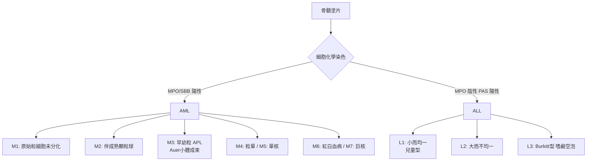

## 1976 - FAB 白血病分類（給血癌的嫌犯照片建立統一的檔案庫）

## 案件摘要

**本案偵破的是一個「命名混亂」的鑑識難題：急性白血病到底有幾種？兩位醫師的診斷，憑什麼是同一種病？**

1976 年，法、美、英三國血液學家組成的合作小組（French-American-British, FAB）在 *British Journal of Haematology* 發表急性白血病的形態學分類：急性淋巴性白血病分 L1–L3，急性骨髓性白血病分 M1–M7（M0 與 M8 後補）——以**骨髓母細胞的形態、顆粒、比例**與特殊染色為判準，附上嫌犯照片般的標準圖版。FAB 分類統治血液科近 30 年，直到 WHO 2001 年分類（融入細胞遺傳與分子）接班。本案的偵探價值：**當證據只有顯微鏡時，先把「怎麼看」標準化，比爭論「是什麼」更重要**。

## 前因 -- 為什麼會有這個案子

- **術語的巴別塔**：急性白血病在 1970 年代前有數十種分類方案（HAYH、Cooke、Bessis、Wintrobe……），法國人叫「急性髓母細胞白血病」、英國人叫「急性骨髓性白血病」、美國人用「急性粒細胞白血病」——跨國臨床試驗根本無法比較療效。
- **化療時代的需求**：1968 年總體治療（見 `1968-兒童ALL總體治療策略.md`）成功後，迫切需要「分型—分治」：不同亞型對藥物反應不同，分類直接決定治療處方。
- **形態學工具齊備**：羅曼諾斯基染色（見 `1891-羅曼諾斯基染色與血球形態學.md`）＋特殊細胞化學染色（myeloperoxidase、Sudan black、PAS、非特異性酯酶）已可區分粒系與淋巴系。
- **國際合作的先例**：Cancer and Leukemia Group B 等多中心試驗已證明「統一病理判讀」是試驗可比性的前提。

## 線索與推理 -- 數學式、程式、理論

**線索一：先定「門檻」，再分型。** FAB 的第一項發明是定量門檻：骨髓中原始細胞（blasts）比例

$$ \text{急性白血病} \iff \text{骨髓 blasts} \geq 30\% \quad (\text{WHO 2001 降至 } 20\%) $$

把「多少才算急性」從爭論變成數字——這是本案對診斷學最持久的貢獻（今日 MDS 與 AML 的 20% 分界線仍是 FAB 討論的遺產）。

**線索二：形態學的判準樹。** FAB 分類的核心決策流程：

**線索三：形態與預後的配對被迅速發現。** M3（急性前骨髓性白血病）有致命的 DIC 與 Auer 小體成束的獨特形態——這個「形態預報行為」的線索，在 1976 年還只是描述，到 1977 年 Rowley 發現其 t(15;17) 轉位、1990 年代砷劑與 ATRA 特異治療（見延伸）時成為完整案卷：**形態學是分子病變的剪影**。

**線索四：一致性的統計驗收。** FAB 小組做了一件前所未有的工程：多名病理醫師對同一組玻片獨立判讀，計算診斷一致性（kappa 統計）——發現部分亞型（M4 vs M5）一致性較低。**把「醫師意見」當成需要驗證的證據**，是鑑識科學化的標誌。

**線索五：分類的分子升級。** 1990–2000 年代，細胞遺傳學與分子異常的預後權重超越形態（t(8;21)、inv(16)、t(15;17)、11q23……），2001 年 WHO 分類把「克隆性細胞遺傳異常」寫入定義、把 blasts 門檻降到 20%、並承認 MDS 衍生 AML——FAB 的形態骨架被保留，身分證改由基因簽發。

## 結案 -- 後果與影響

- **全球白血病語言的統一**：1976–2001 年間幾乎所有白血病臨床試驗都以 FAB 分型入組——沒有 FAB，就沒有可比較的跨國療效數據。
- **治療分層的開端**：M3 用 ATRA/砷劑、L3（Burkitt 型）用高強度短程方案、L1 兒童型走總體治療——分型直接改寫處方。
- **鑑識分類學的方法論遺產**：FAB 之後，淋巴瘤（REAL→WHO）、MDS、骨髓增殖腫瘤全部走「形態→免疫表型→細胞遺傳→分子」的升級路徑——本案確立了血液腫瘤分類的「版本更新」文化。
- **一句話結案**：FAB 案的智慧是偵查學的基本功——**在案情不明時，先統一照相的角度與光線**；顯微鏡下的標準化，是分子時代的必要前傳。

## 關鍵人物與文獻

- **FAB 小組核心成員**——法國 Jeanne Bernard、Marcel Bessis；美國 Robert Peter（Pete）Dorfman、Bayard Clarkson；英國 D. A. G. Galton、John M. Bennett（後續版本主編）。
- **Marcel Bessis（1917–1994）**——血球形態學的攝影大師，掃描電鏡血球的先驅；FAB 圖版的視覺標準出自他的鏡頭。
- **Janet D. Rowley（1925–2013）**——芝加哥細胞遺傳學家，1972–77 年發現白血病特異轉位（含 APL 的 t(15;17)）；形態學案卷的分子續篇由她執筆。
- 原始文獻——Bennett, Galton, Gralnick, Sultan 等人, "Proposal for the classification of the acute leukaemias," *Br J Haematol*, 1976；WHO *Classification of Tumours of Haematopoietic and Lymphoid Tissues*, 2001（第一版）。

