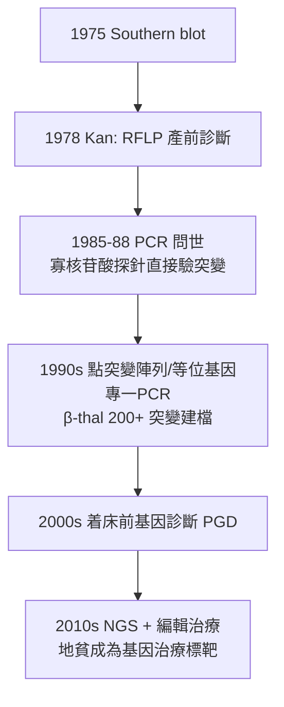

## 1978 - 地中海型貧血的產前基因診斷（從血片異常到編寫在 DNA 上的病歷）

## 案件摘要

**本案偵破的是分子醫學的開山案：如何在嬰兒出生之前，就讀出他血液病歷上的基因密碼？**

1978 年 12 月，加州大學舊金山分校的 Yuet Wai Kan（簡悌威）團隊發表以限制酶片段長度多型性（RFLP）對胎兒進行**鐮刀型貧血產前診斷**；同年 Kan 與 Dozy 又發現 α-球蛋白基因缺失可用於 α-地中海貧血的產前診斷——人類第一次在出生前偵破一種遺傳病的「基因案情」。地中海型貧血（thalassemia）——地中海與亞洲人群中最常見的單基因血液病——從此擁有對策：不是治已生病的嬰兒，而是**在案發前攔截**。

## 前因 -- 為什麼會有這個案子

- **重型地中海貧血的殘酷**：β-重型（Cooley 貧血，1925 年 Cooley 首述）患兒需終身每 2–4 週輸血＋去鐵治療，否則數歲即亡；輸血鐵沉積則毀壞心肝。唯一根治是骨髓移植（見 `1956-湯瑪斯骨髓移植.md`），但配型與風險受限。
- **分子病理的到位**：Pauling 的「分子病」概念（見 `1949-鮑林鐮刀型貧血分子病.md`）＋ Ingram 的單胺基酸定讞＋ 1977 年球蛋白基因被選殖定序——β-thalassemia 被確認絕大多數是**β-球蛋白基因的點突變或剪接異常**，基因缺失型（α-thal）亦已定位。
- **產科取證技術**：1970 年代羊膜穿刺與胎兒鏡取胎兒血已可用，但「取什麼證物、怎麼讀」仍是懸案。
- **重組 DNA 的工具革命**：1970 年代限制酶、質體選殖、南方墨點（Southern blot, 1975）齊備——讀基因的儀器剛好上線。

## 線索與推理 -- 數學式、程式、理論

**線索一：血紅素合成的化學計量失衡。** 血紅素是 $\alpha_2\beta_2$ 四聚體，鏈間必須 1:1 配對。β-thal 的數學後果：

$$ \alpha\text{ 鏈過量} \Rightarrow \alpha_4 \text{四聚體沉澱} \Rightarrow \text{紅血球前驅細胞在骨髓內早死（無效造血）} $$

——貧血不是「血紅素少了一點」，而是**工廠的失衡摧毀了整條生產線**。這解釋了為什麼地貧的骨髓異常遠比單純缺原料（如缺鐵，見 `1891-羅曼諾斯基染色與血球形態學.md`）嚴重。

**線索二：RFLP——「基因的指紋側寫」。** Kan–Dozy 的天才一步：不在胎兒身上直接找突變（當年做不到），而是找**與突變基因連鎖的限制酶切點差異**。以 HpaI 酶切 DNA：正常 β 基因座切出 7.6 kb 片段，含 βS 的染色體切出 13 kb——

```text
父母皆為 7.6/13 kb 雜合（帶因）→ 胎兒若為 13/13 kb 純合 → 患鐮刀型貧血
```

「看切點的影子，不讀字母本身」——指紋側寫式的推理，在 DNA 酵素上覆刻了 Landsteiner 血型凝集的思路（見 `1901-蘭德施泰納ABO血型.md`）。

**線索三：缺體型地貧的「失蹤人口」偵查。** α-thal 的多數型別是**基因缺失**而非點突變。Kan 以 Southern blot 直接「數人頭」：α 基因有兩個拷貝（每條 16 號染色體一個），雜合缺失者只有一條帶、純合缺失者帶完全消失——Hb Bart's 水腫胎（四個 α 基因全失）的產前診斷由此可行。東南亞（東南亞型缺失 --SEA）與地中海的族群頻率差異，讓族群篩檢的「預期受害者名單」可以事先計算。

**線索四：從側寫到直讀的技術演化。**



**線索五：篩檢的社會偵查。** 1970 年代起賽普勒斯、薩丁尼亞、泰國、廣東/香港、台灣推動帶因者婚前/產前篩檢：賽普勒斯重型 β-thal 出生數從每年 70 例降到**接近零**（1980s 起）——「攔截在出生前」的成功不是醫術單獨完成，而是篩檢制度＋諮詢倫理＋族群參與的社會工程。

## 結案 -- 後果與影響

- **產前診斷學科誕生**：Kan 案是所有人類遺傳病產前基因診斷的原型；今日 NGS 時代的單基因檢測，邏輯骨架仍是 1978 年的「連鎖＋突變建檔」。
- **血紅素病成為分子醫學教材**：α 與 β 基因簇的表達調控（LCR 位點控制區）、起龍與處女基因（δβ 融合、HPFH）——血紅素基因是基因調控研究的首選靶場。
- **治療終點的到來**：2000 年代起 HLA 相合移植治癒率 > 90%（兒童）；2018 年後 CRISPR 編輯 BCL11A 增強子重啟胎兒血紅素（Casgevy, 2023 核准）——「不替換壞基因，而是打開備用基因」的逆轉推理，讓地貧成為第一波可治癒的常見遺傳病。
- **一句話結案**：1978 年案宣告——**病歷可以有兩份，一份寫在紙上，一份寫在四個字母的字母表裡**；而偵探的職責，是學會讀第二份。

## 關鍵人物與文獻

- **Yuet Wai Kan（簡悌威，1936– ）**——香港出生、舊金山 UCSF 教授，產前基因診斷之父；華人血液學家在分子醫學史上的里程碑人物。
- **Andrée Dozy**——Kan 的長期合作者，α-球蛋白基因與 RFLP 工作的核心實驗者。
- **Thomas B. Cooley（1871–1945）**——1925 年描述兒童重型地貧（Cooley anemia）；本案最早的現場目擊者。
- 原始文獻——Kan & Dozy, "Antenatal diagnosis of sickle-cell anaemia by DNA analysis of amniotic-fluid cells," *Lancet*, 1978；Kan et al., "Deletion of α-globin genes in haemoglobin-H disease," *NEJM*, 1975–78 系列。

