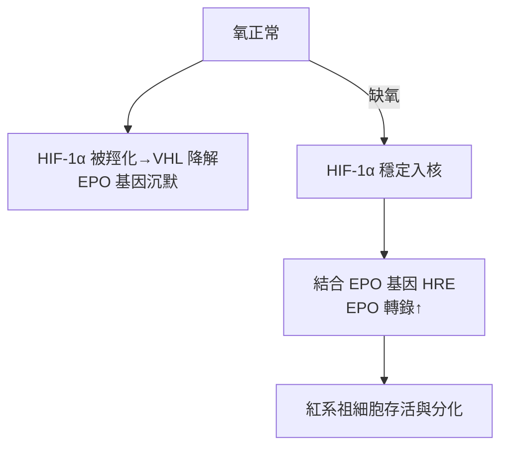

## 1985 - EPO 基因選殖與腎性貧血治療（用工程方法批量生產一種「血之激素」）

## 案件摘要

**本案偵破的是一個生理學懸案：身體如何知道「血不夠了」，又是誰在發號施令造出更多紅血球？**

答案是紅血球生成素（erythropoietin, EPO）——腎臟間質細胞分泌的造血激素。1906 年 Carnot 即提出「血清中有造血因子」的假說，1950 年代 Reissmann 與 Erslev 以缺氧實驗證實其存在，但從動物血漿純化 EPO 之難如大海撈針。1983–85 年，芝加哥 Linus Fu-Kuen Lin 等人在 Amgen 從人類基因組中選殖出 EPO 基因，1989 年重組 EPO（epoetin alfa）上市——洗腎病人的貧血第一次可以「一針一針」治療。本案是生物技術工業的第一場全壘打，也是血液學與生理學的一次世紀合流。

## 前因 -- 為什麼會有這個案子

- **腎性貧血的黑洞**：慢性腎衰竭病人幾乎人人重度貧血（Hb 常 < 8 g/dL），只能反覆輸血——既鐵過載又傳染病風險；1960 年代透析普及後，貧血成為洗腎品質的瓶頸。
- **「紅血球生成素」的證實**：1948 年 Bonsdorff 與 Jalavisto 命名 erythropoietin；1950 年代 Reissmann 以聯體大鼠實驗（缺氧一隻、另一隻也造血）證明是**循環體液因子**；1957 年 Jacobson 定位生產器官——腎臟。
- **純化的死胡同**：EPO 在血漿中濃度僅約 0.004–0.02 IU/mL（pM 級），且糖基化後才穩定——以天然血漿量產，工業上不可能。
- **細胞生物學的偵察工具**：1970 年代 Krantz、Goldwasser 建立胎鼠肝細胞/骨髓細胞的體外紅系集落（BFU-E/CFU-E）測定法——「EPO 活性」有了可量測的生物探針。

## 線索與推理 -- 數學式、程式、理論

**線索一：缺氧感應的回饋方程。** EPO 生理學的核心是一條負回饋：

$$ \text{EPO 速率} = f(\text{組織氧供}) \quad \xrightarrow{\ Hb\downarrow,\ pO_2\downarrow\ } \ \text{EPO} \uparrow \to \text{骨髓紅系增殖分化} \to Hb \uparrow $$

腎衰時腎間質成纖維細胞（1990 年代確認為 producing cells）被毀，回饋環斷裂——治療即「人工補上激素」。

**線索二：基因選殖的偵辦路線。** 1983–85 年 Amgen 的策略是「用探針撈基因」：以豬、猴基因組的保守序列做探針，篩選人類基因組文庫，找到單一拷貝的 EPO 基因（5 個外顯子、編碼 193 胺基酸前體）；再以 CHO 細胞表達——關鍵細節是 EPO 必須糖基化（40% 糖鏈）才有體內活性，**大腸桿菌產物無效**，哺乳細胞表達成為勝負手。分子身分證：

$$ \mathrm{EPO} = 165\ \text{胺基酸} + 3\ \text{N-糖鏈} + 1\ \text{O-糖鏈},\ MW \approx 30\,\mathrm{kDa} $$

**線索三：氧感應機制的最終破案（2019 諾貝爾獎的延伸）。** 為什麼缺氧會打開 EPO 基因？1992–2000 年代 Semenza 發現 HIF-1 轉錄因子、Ratcliffe 與 Kaelin 破解其氧依賴降解（VHL 泛素化路徑）：

這條路徑同時催生了口服 HIF 穩定劑（roxadustat 等，2018 年後於中國/日本/歐盟上市）——偵查的下游直接變成新藥。

**線索四：臨床的驗收與濫用的陰影。** 1989 年 FDA 核准 epoetin alfa：洗腎病人 Hb 從 8 提升至 10–11 g/dL，輸血需求下降 90%。但 1990 年代末 Normal Hematocrit 試驗顯示把 Hb 推到 14 g/dL 反而增加死亡與血栓——**劑量反應的 U 形曲線**成為終身教材；而運動界把 EPO 當禁藥（1990 年代自行車醜聞、2002 年 EPA 首次檢出陽性案）則是本案的灰暗副本——同一分子，救人的劑量與作弊的劑量只差幾個單位。

## 結案 -- 後果與影響

- **生物技術製藥的旗艦案例**：EPO 是 Amgen 躋身大藥廠的基石，也確立「哺乳細胞表達＋糖蛋白藥物」的工業範式；後續長效型（darbepoetin，糖鏈工程延長半衰期 3 倍）是蛋白工程的教科書。
- **腎臟—血液科共管的常態化**：貧血成為 CKD 管理的標準指標（KDIGO 2012 指引），血液科技術（鐵劑管理、網織球監測）進入洗腎室。
- **造血生長因子的家族開枝**：G-CSF（1986 選殖、1991 上市）救活了化療後嗜中性球缺乏症——化療劑量強度得以提升（與 `1968-兒童ALL總體治療策略.md` 的策略相乘）；TPO 之後的血小板生成素受體致效劑（eltrombopag）治療免疫性血小板低下。
- **一句話結案**：EPO 案的公式是——**先證明有一種看不見的命令在血中傳遞（生理學），再克隆那道命令本身（分子生物學），最後教細胞工廠照著製造（生物技術）**；三段偵查接力，各自用了三十年。

## 關鍵人物與文獻

- **Fu-Kuen Lin（林福坤）**——Amgen 資深科學家，1985 年發表人類 EPO 基因選殖（*PNAS* 1985）；本案的實驗室主偵探。
- **Gregg Semenza、Peter Ratcliffe、William Kaelin**——HIF 氧感應機制的三劍客，2019 年諾貝爾生理學或醫學獎——EPO 謎題的最後一塊拼圖。
- **Allan J. Erslev（1916–2003）**——1953 年以血漿注射證明 EPO 存在、《Clinical Hematology》主編；本案的生理學奠基人。
- 原始文獻——Reissmann, *Blood*, 1950；Jacobson et al., *Nature*, 1957；Lin et al., "Cloning and expression of the human erythropoietin gene," *PNAS*, 1985；Winek, Eschbach 系列（1987–89 臨床試驗，*NEJM*）。

