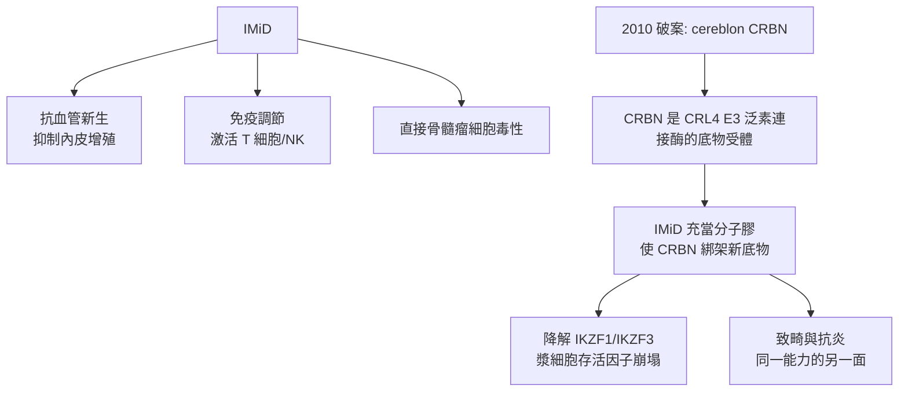

## 1999 - 沙利竇邁復活治療多發性骨髓瘤（一個墮胎藥的贖罪之路，與免疫調節藥的誕生）

## 案件摘要

**本案偵破的是藥物史上最戲劇性的一次「翻案」：被釘上恥辱柱四十年的沙利竇邁（thalidomide），如何成為多發性骨髓瘤的救命藥？**

1999 年 11 月，阿肯色的 Bart Barlogie 與紐約的 Singhal 在 *NEJM* 發表：沙利竇邁單藥讓約三分之一的**頑固性骨髓瘤**病人血清 M 蛋白下降 75% 以上——在幾乎無藥可用的晚期骨髓瘤，這是震撼彈。此後 lenalidomide、pomalidomide 等「免疫調節藥物（IMiD）」問世，與蛋白酶體抑制劑（bortezomib, 2003）、自體移植（見 `1956-湯瑪斯骨髓移植.md`）聯手，把骨髓瘤中位存活期從 3 年拉到 10 年以上。本案的偵查主線是：**一個舊證物，在新的取證框架（腫瘤血管新生、免疫微環境）下，說出了當年無人聽得懂的證詞。**

## 前因 -- 為什麼會有這個案子

- **沙利竇邁的雙面檔案**：1950 年代西德 Chemie Grünenthal 以鎮靜劑上市，因治孕吐導致全球約 1 萬名「海豹肢」畸形兒（1961 年 Lenz 確認、McBride 警示），1961 年全球撤市——史上最嚴重的藥害事件，也是 FDA 1962 年 Kefauver 修正案（安全審查強化）的直接導火線。
- **意外的線索**：1965 年以色列 Sheskin 以沙利竇邁治療麻風結節紅斑（ENL）有效——「抗發炎／免疫調節」的新側寫浮現。
- **骨髓瘤的絕境**：1990 年代骨髓瘤治療僅有 melphalan＋prednisone，中位存活約 3 年；高劑量化療＋自體移植雖延長存活，復發仍不可避免。
- **Folkman 的血管新生假說**：1971 年 Judah Folkman 提出「腫瘤依賴血管新生」；1990 年代末，D'Amato 等人發現沙利竇邁能抑制兔角膜血管新生——「以血管新生抑制劑抗癌」的框架，讓這個舊證物重新出庭。

## 線索與推理 -- 數學式、程式、理論

**線索一：Barlogie–Singhal 的臨床推理。** 169 例頑固/復發骨髓瘤中，多例獲顯著反應（M 蛋白下降 ≥ 75%）——在「別無選擇」的人群中，單臂試驗的證據力被病情的絕望程度放大；後續隨機試驗（2000s）確認沙利竇邁聯合方案提升存活。偵查上的教訓：**證據等級要看背景——在零選項的案子裡，目擊證人（單臂反應）也值得立案**。

**線索二：機制的多重身分。** 沙利竇邁/IMiD 不是單一靶點藥，而是「多面兇器」：

**線索三：2010 年的分子定讞。** 為什麼同一個分子既致畸又抗癌？2010 年日本 Handa 團隊以「固定化沙利竇邁親和層析」釣出結合蛋白 **cereblon（CRBN）**——沙利竇邁是「分子膠（molecular glue）」：它讓 CRBN 的 E3 泛素連接酶去降解原本不認識的底物（IKZF1/Ikaros、IKZF3/Aiolos——漿細胞與淋巴球的關鍵轉錄因子）。**畸形兒與救命藥，是同一種「綁架泛素酶」能力的兩面**。這個發現開啟了「靶向蛋白質降解（PROTAC／molecular glue）」的整個新藥平台。

**線索四：骨髓瘤治療的世代交替。**

$$ \text{1990s: MP 方案，中位 OS} \approx 3\,\text{年} \ \longrightarrow\ \text{2000s–2020s: IMiD + 蛋白酶體抑制劑 + 抗CD38 單抗 + 自體移植，中位 OS} > 10\,\text{年} $$

高危細胞遺傳學（t(4;14)、del(17p)）病人續接 CAR-T（ide-cel, 2021 核准）與雙特異抗體——骨髓瘤成為免疫治療戰果最豐的「液體腫瘤」。

**線索五：倫理的再審。** 沙利竇邁復活的前提是嚴格的懷孕防止登記制度（美國 iPLEDGE，1998 年起）——**歷史罪證成為制度設計的教材**：同一藥物在「孕婦禁入」的防火牆後重新服刑—立功。

## 結案 -- 後果與影響

- **骨髓瘤進入慢性病時代**：IMiD＋蛋白酶體抑制劑＋單抗的三聯/四聯方案使多數病人存活逾十年；微小殘存病（MRD）陰性成為新的治療目標。
- **分子膠與靶向降解的誕生**：CRBN 案催生 PROTAC 產業與「事件驅動藥理學」——藥物作用方式從「抑制」進化到「指令銷毀」。
- **舊藥新用的偵查範式**：沙利竇邁案確立老藥重定位的推理路——**換一套取證框架，舊證物能說出新證詞**。
- **一句話結案**：本案的教訓有兩層——藥理上，「一個分子」從來不只有一種行為，是你只看過一種現場；倫理上，**翻案的前提是面對原始罪證**。

## 關鍵人物與文獻

- **Bart Barlogie（1941–2023）**——阿肯色骨髓瘤計畫主持人，自體移植與 IMiD 時代的臨床總設計師。
- **Sungnwha Singhal 與 Paul Richardson**——1999 年 NEJM 報告與其後 IMiD 臨床開發的關鍵執行者。
- **Hiroshi Handa 團隊**——2010 年 cereblon 的鑑識者；分子膠概念的實驗奠基人。
- **Widukind Lenz 與 William McBride**——1961 年獨立指出沙利竇邁致畸的兩位醫師；本案「原始罪證」的舉報人。
- 原始文獻——Singhal, Barlogie et al., "Antitumor activity of thalidomide in refractory multiple myeloma," *NEJM*, 1999；Ito, Handa et al., *Science*, 2010（CRBN 鑑定）。

