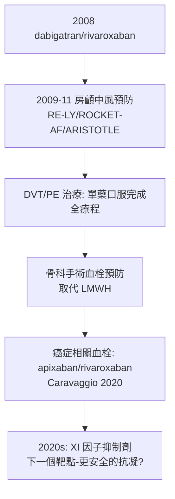

## 2008 - 直接口服抗凝劑 DOAC 問世（把抗凝治療從「化驗單依賴」解放成「一顆藥」）

## 案件摘要

**本案偵破的是抗凝醫學的「使用性懸案」：warfarin 療效確鑿（見 `1954-華法林從鼠藥到抗凝藥.md`），但需要定期抽血、飲食受限、劑量反覆調整——能否造出一種「吞下去就行」的抗凝藥？**

2008 年，兩個直接抑制劑幾乎同時獲准：達比加群（dabigatran，直接凝血酶 IIa 抑制劑，歐盟 3 月核准房顫適應症）與 rivaroxaban（直接 Xa 抑制劑，歐盟核准 DVT 預防）。此後 apixaban、edoxaban 陸續加入，統稱 **NOAC/DOAC**。到 2010 年代末，北美與歐洲的 DOAC 處方量已超越 warfarin——抗凝治療完成了從「實驗室監測時代」到「固定劑量時代」的換軌。本案的偵查核心：**把藥物的安全餘裕（治療窗）做寬，比教病人配合監測更有效**。

## 前因 -- 為什麼會有這個案子

- **warfarin 的三重枷鎖**：窄治療窗（INR 2–3）＋代謝受 CYP2C9/VKORC1 基因與飲食維生素 K 干擾＋起效慢需橋接肝素——依從性與安全性常年成問題，藥物基因體學（2000s）也只解決了「起始劑量」一角。
- **凝血瀑布圖的成熟**（見 `1964-凝血瀑布學說.md`）：凝血酶（IIa）與 Xa 是級聯的兩大樞紐——「圈住單一節點」的靶點設計已有路徑圖。
- **低分子量肝素的中場示範**：1980–90 年代 LMWH（依諾肝素等）證明「選擇性抑制 Xa、可預測劑量、不需監測」皮下可行——「無監測抗凝」的可行性已被小分子半成品驗證。
- **結構化學的工程**：1990 年代 pharmaceutical 化學家以 Xa 因子晶體結構（1990s 解出）做基於結構的藥物設計——rivaroxaban 是早期的設計產物。

## 線索與推理 -- 數學式、程式、理論

**線索一：靶點選擇的推理——Xa 還是 IIa？** 級聯圖上有兩個最佳節點：

```text
直接 IIa（凝血酶）抑制: 上下游全部切斷，但凝血酶在體內基礎生成量波動大
直接 Xa 抑制:           位於內外源匯流點，劑量-反應更平緩
```

兩條路線最終都成功——dabigatran（RE-LY 2009：房顫中風預防勝 warfarin，大出血相近）與 rivaroxaban/apixaban（ROCKET-AF、ARISTOTLE 2010–11：apixaban 更勝一籌——大出血顯著更少）。**「同一張圖，兩個靶點，各有勝場」**是靶點偵查學的典型案例。

**線索二：藥代動力學就是安全設計。** DOAC 的「不需監測」不是偶然，而是設計出來的：

$$ \text{固定劑量可行} \iff \text{高生物利用度} \cap \text{短且穩定的半衰期（10–14 h）} \cap \text{藥物—食物交互作用少} $$

其中最精妙的發明是 **dabigatran etexilate** 的前藥設計：活性分子極性太強吸收差，工程師替它穿上「酯外套＋P-醣蛋白基質」外衣，腸道吸收後肝酯酶脫衣——**口服生物利用度從接近 0 提升到 6.5%**，靠的是分子偽裝術。

**線索三：特異解毒劑的補課。** warfarin 有維生素 K 解毒（見 `1954` 案），DOAC 上市時卻「有槍無盾」——2010 年代中期補齊：idarucizumab（單抗片段，逆轉 dabigatran，2015 核准）與 andexanet alfa（誘餌蛋白，逆轉 Xa 抑制劑，2018 核准）。偵查邏輯：**任何強效抗凝藥，必須同時預先設計「撤銷鍵」**——這已成為新抗凝藥的倫理前置。

**線索四：臨床版圖的擴張。**



**線索五：真實世界證據的驗收。** DOAC 是第一批以電子病歷大數據（數十萬人級 real-world study）輔助驗證安全性的藥物類群——隨機試驗＋真實世界雙重取證，成為 2010 年代後新藥偵查的標準配置。

## 結案 -- 後果與影響

- **房顫抗凝率大幅提升**：全球數千萬房顫病人的中風風險管理從「少數人做得到」變成「多數人做得到」——公共衛生層面的中風率下降有 DOAC 的明確貢獻。
- **血液檢驗科的角色重組**：INR 監測業務萎縮，但 DOAC 濃度檢測（抗 Xa 校正法、稀釋凝血酶時間）與「無作用於常規凝血指標」的解讀學成為新課題——偵查工具跟著案情升級。
- **XI 因子的下一站**：2020 年代 asundexian、abelacimab 等 XIa 抑制劑進入三期——理論是「XI 缺乏者幾乎不自然出血」（見 `1964` 案的天然實驗），故「抗 XI 抗凝可能比 DOAC 更安全」——瀑布圖上最後一個高價值節點的競標正在進行。
- **一句話結案**：DOAC 案證明——**藥物安全不只是分子性質，更是「病人生活」的函數**；把監測的成本折疊進分子設計，等於替千萬病人拿掉了每天的手術。

## 關鍵人物與文獻

- **Volker Laux 與 Bayer 團隊**——rivaroxaban 的結構設計者（基於 Xa 晶體結構的經典 SBDD 案例）。
- **Lars C. Petersen 與 Boehringer Ingelheim 團隊**——dabigatran 前藥與直達凝血酶抑制路線的工程實現者。
- **Connolly、Patel、Granger 等試驗主持人**——RE-LY（2009）、ROCKET-AF（2011）、ARISTOTLE（2011）三大試驗的首席研究者，DOAC 定讞的三份判決書。
- 原始文獻——Connolly et al., "Dabigatran versus warfarin in patients with atrial fibrillation," *NEJM*, 2009；Patel et al., *NEJM*, 2011；Granger et al., *NEJM*, 2011。

