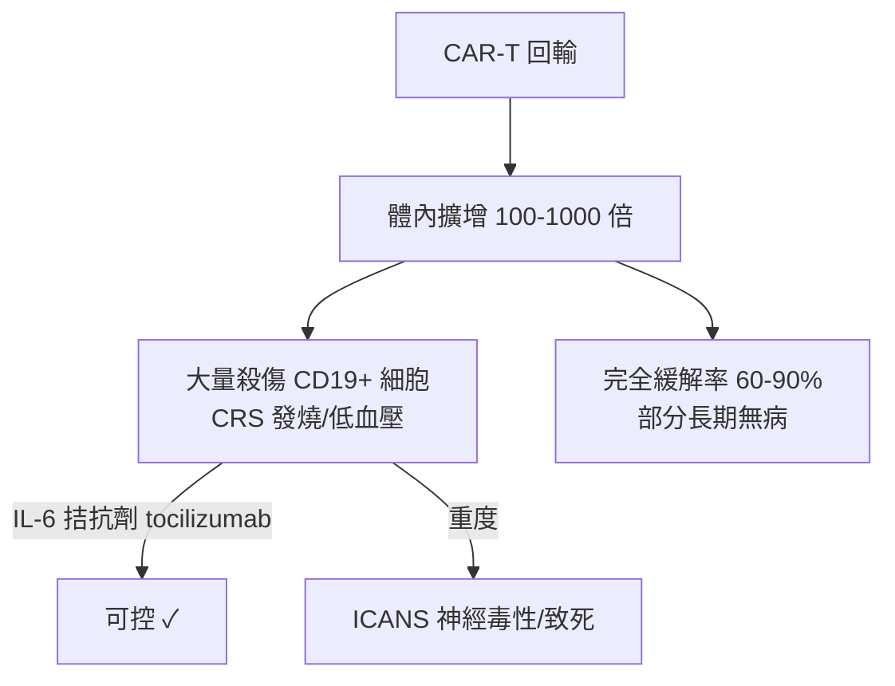

## 2017 - CAR-T 細胞療法獲准（把免疫細胞改造成「活體追蹤器」，血液腫瘤的第二場革命）

## 案件摘要

**本案偵破的是免疫治療的終極工程題：能否把病人自己的免疫細胞，改造成會認得、會追殺自己癌細胞的活體藥物？**

2017 年 8 月，FDA 核准 tisagenlecleucel（Kymriah）——以嵌合抗原受體 T 細胞（CAR-T）治療復發/頑固性 B 細胞急性淋巴性白血病（兒童與青年），**緩解率約 83%**，許多病人是化療、移植全部失敗後的「無路可走」者；同年 10 月 axicabtagene ciloleucel（Yescarta）獲准治療大 B 細胞淋巴瘤。本案的推理核心是一條逆向偵查：化療與移植都失敗的案情，說明問題不在「藥不夠強」，而在「免疫系統沒認出癌細胞」——**那就替免疫細胞裝上人工辨識器**。

## 前因 -- 為什麼會有這個案子

- **1989 年 Gross 與 Eshhar 的發明**：以色列 Weizmann 研究所的 Zelig Eshhar 把抗體的單鏈可變區（scFv）接上 T 細胞受體（TCR）的恆定區，造出「T-body」——第一代 CAR 的原型：讓 T 細胞以抗體的方式辨識抗原，**繞過 MHC 限制**。
- **1990 年代的血癌靶點線索**：CD19 被確認是 B 細胞系（含多數 B 細胞白血病/淋巴瘤）的專一表面抗原，且在正常 B 細胞與惡性 B 細胞上皆表達——「殺光 CD19+ 細胞」的代價（低丙種球蛋白）可承受。
- **Carl June 的臨床轉譯**：賓州大學的 Carl June 團隊以 HIV 治療研究中積累的基因改造 T 細胞技術（反轉錄病毒轉染、共刺激訊號 CD28/4-1BB 的第二代 CAR），於 2010–11 年治療慢性淋巴性白血病；2012 年治療 7 歲的 Emily Whitehead——ALL 患兒，細胞因子風暴後完全緩解，至今無病。
- **工程與製造的成熟**：自體細胞的離體改造、擴增、回輸的閉環流程（apheresis→工程化→淋巴清除化療→回輸）在 2010 年代初被標準化——「細胞是藥」的物流學誕生。

## 線索與推理 -- 數學式、程式、理論

**線索一：CAR 的結構是一台「拼接的偵測器」。** 第二代 CAR 的構造：

$$ \text{CAR} = \underbrace{\text{scFv（抗體辨識域）}}_{\text{認得 CD19}} + \text{鉸鏈/跨膜區} + \underbrace{\text{CD3ζ}}_{\text{活 }} + \underbrace{\text{CD28 或 4-1BB}}_{\text{存活訊號}} $$

第一代 CAR 只有活化訊號，T 細胞「打一槍就陣亡」；加上共刺激域後，T 細胞能**增殖、持久、形成記憶**——體內擴增可達數百至數千倍，等效劑量遠超任何小分子。

**線索二：為什麼血液腫瘤是 CAR-T 的首選戰場？** 實體瘤有免疫抑制微環境與抗原異質性；而血癌細胞**游離在血與骨髓中**、抗原單一且暴露、T 細胞可直達現場——「案子在哪裡，偵探就能去哪裡」的條件，血液系統天然齊備。這也解釋了為何 CAR-T 的第一波勝利全部發生在血液科（CD19、BCMA 骨髓瘤、CD22、CD20）。

**線索三：CRS 的雙面推理——療效與毒性是同一事件。** 大量 T 細胞活化釋放 IFN-γ、IL-6，引發細胞因子釋放症候群（CRS）與 ICANS 神經毒性：

CRS 既是療效的證據（殺傷規模），也是主要毒性——管理學（分級、tocilizumab、類固醇、監護）成為 CAR-T 中心的「執業執照」。偵查教訓：**證據（殺傷）與事故（風暴）共用同一現場，差別只在強度控制**。

**線索四：B 細胞再生障礙的「可接受代價」。** CD19-CAR-T 會連正常 B 細胞一起清除，造成長期低丙種球蛋白血症——但免疫球蛋白可補充輸注。這是**治療窗推理**的細胞版：選一個「沒有它也活得下去」的靶點，把治療窗拉到最大（與 `1901-蘭德施泰納ABO血型.md` 的「抗原特異性」思想一脈相承）。

**線索五：復發的殘案——抗原逃逸。** 約 10–20% 的完全緩解者復發，主因是 **CD19 丟失**（抗原調變/編輯）——癌細胞把門牌拆了。對策是雙靶（CD19/CD22）、序貫 CAR、與發現新靶點（GPRC5D、FcRL5 for myeloma）——「靶點軍備競賽」成為本案的續集劇本。

## 結案 -- 後果與影響

- **「細胞是活藥」的法定地位**：2017 年後 FDA/EMA 確立細胞治療的審查與定價框架（一次 ~40 萬美元的「活體藥」）；長期追蹤顯示部分 ALL 兒童緩解逾 10 年——治癒不再是空談。
- **骨髓瘤的第二戰場**：BCMA-CAR-T（ide-cel, 2021; ciltacabtagene, 2022）使多方案耐藥骨髓瘤亦有高緩解率，接棒 `1999-沙利竇邁復活治療骨髓瘤.md` 開啟的戰線。
- **實體瘤的攻堅與通用型 CAR 的工程**：異體「off-the-shelf」CAR-NK/CAR-T（以基因編輯去除 TCR 避免排斥）在 2020 年代進入臨床——「現貨細胞」若成功，本案的物流瓶頸將被拆除。
- **一句話結案**：CAR-T 案的破案公式——**當藥物追不上敵人，就把偵探本人武裝起來**；病人血液裡抽出的 T 細胞，經過工程改造，成為史上第一種會自我複製、會記住敵人的處方。

## 關鍵人物與文獻

- **Zelig Eshhar（1941– ）**——Weizmann 研究所免疫學家，1989 年 T-body（CAR 原型）的發明人，「CAR-T 之父」之一。
- **Carl June（1953– ）**——賓州大學細胞治療先驅，Emily Whitehead 案的主治偵探；Lasker–DeBakey 獎（2014）得主。
- **Emily Whitehead（2005– ）**——2012 年全球首批 CAR-T 治療的兒童 ALL 病人之一；她的無病存活成為本案最著名的「結案照」。
- **Michel Sadelain 與 Isabelle Rivière**——Memorial Sloan Kettering 團隊，CAR 設計與製造工程的關鍵貢獻者。
- 原始文獻——Porter, June et al., "Chimeric antigen receptor-modified T cells in chronic lymphoid leukemia," *NEJM*, 2011；Grupp, June et al., *NEJM*, 2013（兒童 ALL）；Maude et al., *NEJM*, 2014/2018（tisagenlecleucel 註冊試驗）。

