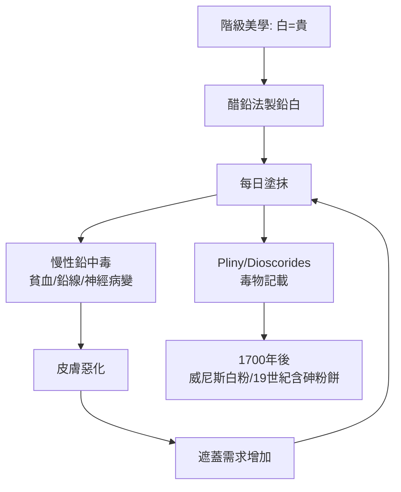

## -0150 - 羅馬毒美人的鉛白與汞（皮膚白皙的文化競賽與最早的毒物學反擊）

## 案件摘要

**本案的謎題是：當整個上流社會集體往臉上抹毒，為什麼第一個揭發的人不是醫生，而是詩人？**

共和末期的羅馬（約西元前 150 年起），貴婦的梳妝台上有兩大兵器：**cerussa**（鉛白，醋鉛法製成的鹼式碳酸鉛）用於漂白面部，**henna 與汞劑**用於染髮。白色皮膚象徵不需要在田裡勞動的階級，美學標準直接綁定化學品。第一位系統性寫下這些化妝品毒性的人，正是毒物學之父——尼祿的宮廷醫師 **Dioscorides 與 Pliny the Elder**，而諷刺詩人 Ovid 與 Juvenal 則在詩行裡留下了完整的「受害者陳述」。

## 前因 -- 為什麼會有這個案子

- **階級美學的化學化**：羅馬貴族追求「lavender 與 marble 般的白」，蒼白＝地位；鉛白遮瑕力強、質地細膩、持妝持久——在沒有二氧化鈦與氧化鋅的年代，它是唯一的高遮蓋白色顏料。
- **醋鉛法**：把鉛片懸掛在醋酸蒸氣上，生成醋酸鉛後再與二氧化碳反應成鹼式碳酸鉛 $ 2PbCO_3 \cdot Pb(OH)_2 $。老普林尼在《博物志》中詳載此法。
- **染髮的汞**：羅馬人用硫化汞（硃砂/銀硃）與銅鹽把頭髮染成金褐色；持續使用造成頭皮潰瘍與脫髮——於是發展出**以奴隸的頭髮製作假髮**的替代產業。
- **Theophrastus 與 Dioscorides** 的礦物學與藥學著作已記載鉛與汞的毒性症狀。

## 線索與推理 -- 數學式、程式、理論

**線索一：毒物動力學的定性推理。** 鉛白經皮吸收有限，但三條暴露途徑讓累積劑量持續上升：

$$ Pb_{total}(t) = \int_0^t \left( r_{skin} + r_{oral} + r_{inhaled} \right) dt' - k_{excrete} \, t $$

鉛的半衰期在血液中約 30 天，**在骨骼中長達 20–30 年**：每一次少量化妝都是往「骨鉛銀行」存款，停用後仍持續釋放。慢性鉛中毒（saturnism）呈現：貧血、腹絞痛、齒齦鉛線、周邊神經病變與精神錯亂——而這些症狀在當時被歸咎於「子宮病」或其他體液失調。

**線索二：詩人當法醫。** Ovid 在《愛的藝術》（*Ars Amatoria*, 約前 2 年）中直接勸告女子夜間卸妝、不要讓情人看見「臉上的漿糊」；Juvenal 第六首諷刺詩描述貴婦「用一層麵團般的白粉糊臉，到睡覺時再把這張臉洗進枕頭」。文學證據與現代毒理學交叉驗證：**當時的使用者已經觀察到依賴性與皮膚損害——卸妝後皮膚更糟，於是更需要鉛白**。這是最早記載的「化妝品依賴循環」。

```python
# 化妝品依賴循環的系統動力學
lead_load = 0.0
skin_damage = 0.0
for day in range(365):
    lead_load += 0.5            # 每日化妝吸收
    lead_load *= 0.98           # 部分代謝（骨骼蓄積未計）
    skin_damage = max(skin_damage, lead_load * 0.1)  # 鉛致皮膚變差
    need = skin_damage + 1.0    # 皮膚越差越需要遮蓋
    # need ↑ → 明天繼續化妝 → 惡性循環
print("365天後鉛負荷:", round(lead_load, 1))   # 持續上升
```

**線索三：Dioscorides 的定性毒理表。** 《藥物志》（*De Materia Medica*, 約 70 年）記載：鉛製劑「內服致命、外用致瘡」；汞（quicksilver）「具腐蝕性、致潰瘍」。他提出解毒直覺：以吐根與瀉劑排出——雖無螯合理論，但「**移除暴露源＋促進排泄**」的框架正是現代毒物學兩大原型的雛形。



關鍵推論：羅馬人**已經知道毒性**，卻照用不誤。原因不是無知，而是結構性的：(1) 沒有替代品；(2) 美學標準由階級競爭定義，退出者先付出社交成本；(3) 毒性是慢性且分布式的，無法與特定一盒粉餅建立因果。這個「慢性毒物的因果可見性問題」，將在 20 世紀的矽膠注射（`1945-矽膠注射時代.md`）與 UV 美甲（`2009-美甲UV燈風險爭議.md`）中精確重演。

## 結案 -- 後果與影響

- **鉛白統治白粉世界 1800 年**：從羅馬到文藝復興威尼斯（「威尼斯白粉」導致貴族鉛中毒與禿髮）、伊麗莎白一世時代的英國，直到 19 世紀鋅白（氧化鋅）與鈦白問世才被替代。
- **毒物學的誕生現場**：Dioscorides 與 Pliny 對金屬毒性的記載，成為中世紀毒物學與職業病學（Ramazzini, 1700）的直接源頭。
- **卸妝觀念的發明**：Ovid 的夜間卸妝忠告，是化妝品護膚概念的最早文獻之一。
- **一句話結案**：美麗的階級競賽會自動選出毒性最強的化學品——除非醫學能把慢性因果變成可見的證據。

## 關鍵人物與文獻

- **Pedanius Dioscorides（約 40–90）**——《藥物志》作者，金屬毒物學的奠基者。
- **Pliny the Elder（23–79）**——《博物志》記載醋鉛法與化妝品配方。
- **Ovid（前 43–17）**——《愛的藝術》記錄卸妝與化妝品傷害。
- **Juvenal（約 55–130）**——諷刺詩第六首的美容文化證詞。
- 延伸閱讀：`-3000-古埃及眼妝與鉛的誘惑.md`、`1905-克羅邁爾磨皮術.md`
