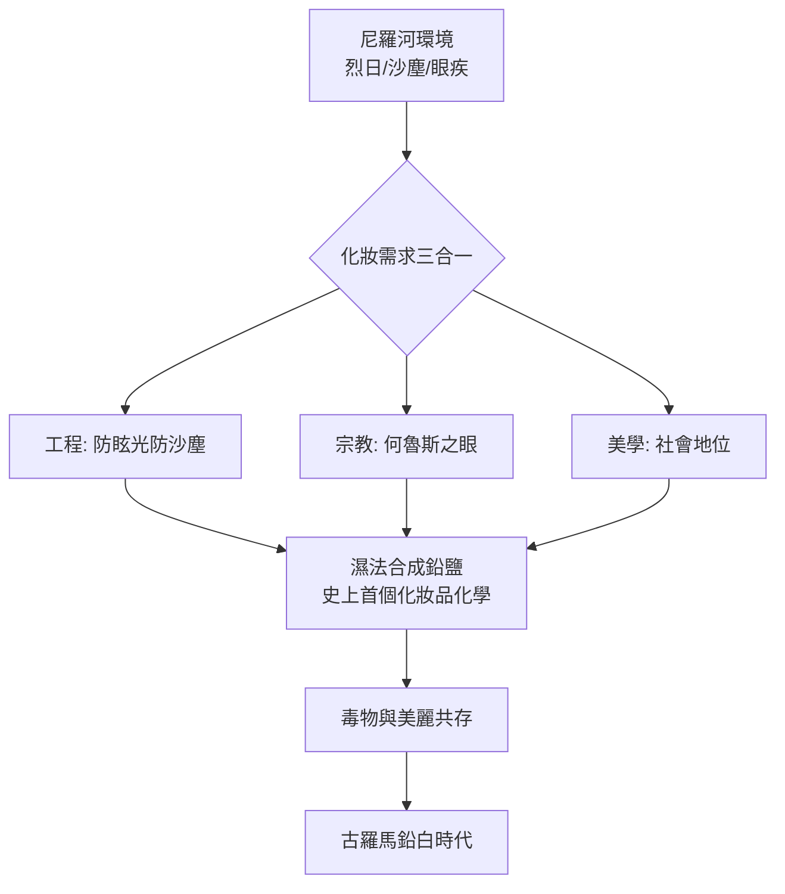

## -3000 - 古埃及眼妝與鉛的誘惑（美麗被工程化的第一座實驗室）

## 案件摘要

**本案偵破的，不是一盒眼影，而是人類第一次用化學工程改造自己的外表。**

約西元前 3000 年起，尼羅河兩岸的男女每天以研缽研磨方鉛礦（galena，硫化鉛）與孔雀石（malachite，碳酸銅），調和油脂後塗抹眼瞼——這就是 kohl 與「眼影 msdmt」。考古學家在法老圖坦卡門墓中找到的眼妝罐，四千年後被質譜儀拆解，驗出高濃度鉛鹽；同時，古文獻卻聲稱這些化妝品能「保護眼睛、驅除蟲害」。美麗與毒物、化妝與藥物，從文明的第一天起就裝在同一個罐子裡。

## 前因 -- 為什麼會有這個案子

- **烈日、沙塵與眼疾**：尼羅河谷陽光刺眼、沙塵飛揚，結膜炎與沙眼橫行。眼瞼塗黑可以像運動員眼貼一樣降低眩光，這是化妝的原始工程功能。
- **化妝即宗教**：眼睛妝容模仿何魯斯神的眼睛，畫眼線是對神明的模仿與保護；棺木上的假人永遠畫著誇張眼線，供亡者在來世使用。
- **化學工藝已成熟**：埃及人掌握研磨、煅燒、乳化的技術，能把孔雀石燒成更深的氧化銅，能調配蜂蠟、樹脂與植物油當載體——這是世界上第一個化妝品配方式產業。
- **鉛無所不在**：不僅眼妝，埃及人也用鉛白敷臉、用鉛化合物染髮；地中海對岸的克里特與兩河同樣如此。

## 線索與推理 -- 數學式、程式、理論

**線索一：羅浮宮 X 光繞射的證詞。** 1999 年起，法國化學家 Christian Amatore 與 Walter Walter 領導團隊，以 X 光繞射與離子層析分析羅浮宮藏的 49 件古埃及化妝品殘餘物，發現三類成分：

| 成分 | 化學式 | 用途 |
|---|---|---|
| 方鉛礦 | $ PbS $ | 黑色眼線主體 |
| 孔雀石 | $ Cu_2CO_3(OH)_2 $ | 綠色眼影 |
| 白鉛礦／氯化磷灰石 | $ PbCO_3 $、氯化鈣磷灰石 | 白色與淺灰 |

關鍵異常：部分樣本含有**天然礦物中罕見的合成物**——氯氧化鉛（laurionite $ Pb(OH)Cl $ 與 phosgenite $ Pb_2Cl_2CO_3 $）。這些化合物無法簡單研磨天然礦石得到，必須用濕法化學合成：把方鉛礦在碳酸鈉鹽水中長時間浸泡：

$$ PbS + NaCl + H_2O \;\xrightarrow{\text{溫和加熱}}\; Pb(OH)Cl + \text{副產物} $$

古埃及化學家有意識地**合成了自然界不存在的含鉛化合物**，以獲得更亮、更細的質地。這是化妝品史上第一次「分子工程」。

**線索二：毒與藥的詭辯。** 鉛是神經毒物，但古人為何未大量中毒、甚至聲稱有益？推理有三層：

1. **劑量控制**：局部塗抹的鉛皮膚吸收率低，且埃及人可能只是低頻使用；
2. **經驗性「副作用偽裝成療效」**：微量鉛鹽確實具弱抗菌性；
3. **演化人類學的翻案**：2010 年 Toulouse 大學團隊在《Analytical and Bioanalytical Chemistry》提出——低劑量鉛離子會刺激皮膚角質細胞大量釋放一氧化氮（NO），而 NO 是先天免疫的訊號分子，可對抗沙眼衣原體等病原。

```python
# 眼妝的「工程功能 vs 美學功能」效益模型
def kohl_benefit(sunlight, dust, infection_risk, beauty_weight):
    glare_reduction = 0.3 * sunlight      # 塗黑眼周降低眩光
    dust_barrier   = 0.2 * dust           # 物理隔離沙塵
    no_boost       = 0.15 * infection_risk  # 鉛刺激 NO 免疫反應
    beauty         = beauty_weight        # 宗教與美學
    return glare_reduction + dust_barrier + no_boost + beauty

print(kohl_benefit(10, 8, 7, 100))  # 美學權重仍壓倒一切 → 為何毒物被容忍
```



關鍵推論：埃及人不是「不知道鉛有毒而誤用」，而是**在美學收益壓倒健康風險的理性計算下使用**——這個公式此後五千年不曾改變，只是劇本換人演出（見 `-0150-羅馬毒美人鉛白與汞.md` 的威尼斯白粉、19 世紀的含砷綠色染料）。

## 結案 -- 後果與影響

- **化妝品的產業原型**：配方、載體、合成、貯藏——四千年後的現代化妝品工業流程，在圖坦卡門的化妝箱裡已全部就位。
- **「美麗優先於安全」的文化基因**：鉛白眼妝開啟了長達五千年的毒物美容史；汞、砷、鐳將逐一登場。
- **一氧化氮假說的現代迴響**：化妝品學界開始認真研究「化妝品不只是掩飾、可以真的改變皮膚生理」——這正是日後果酸（`1974-果酸換膚革命.md`）與機能性保養品的思想前驅。
- **一句話結案**：美麗被工程化的第一課，是人類學會為了漂亮而容忍毒物——並且替毒物找到救贖的理論。

## 關鍵人物與文獻

- 佚名埃及化妝品師——掌握 laurionite 濕法合成工藝的無名化學家，距今 3300 年。
- **Christian Amatore、Philippe Walter**——羅浮宮—法國國家科學研究中心（CNRS）古化妝品分析計畫主持人。
- **Christian Amatore et al.**, "Making cosmetics in ancient Egypt", *Nature* 397:483 (1999)。
- **C. Hallmann**, "Was ancient Egyptian kohl a poison or a medicine?", *Archaeometry*（2008–2010 相關討論）。
- 延伸閱讀：`-0150-羅馬毒美人鉛白與汞.md`、`1938-防曬乳誕生.md`
