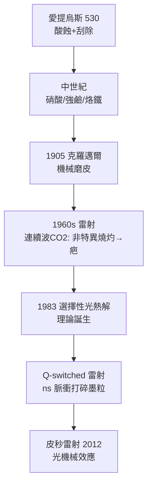

## 0500 - 愛提烏斯與文身去除（整形外科最古老的外科切片手術）

## 案件摘要

**本案偵破的是一個悖論：人類把墨水刺進皮膚用了五千年，卻用了兩千年才學會怎麼把它拿出來。**

約 530 年，拜占庭宮廷醫師 **愛提烏斯（Aetius of Amida）**在《十六書》（*Tetrabiblon / Libri medicinales*）中寫下史上第一份系統性的文身去除處方：以硝酸、松脂與硫磺腐蝕紋身，再以鹽水敷料覆蓋，以及**以刀片逐層刮除表皮**的外科術式。他在書中特別記載了適應症——去除奴隸與罪犯身上的烙印，以及「被神廟文身困擾的信徒」。這份處方被人類逐字沿用了一千四百年，直到 1983 年選擇性光熱解理論（`1983-選擇性光熱解理論.md`）改寫規則為止。

## 前因 -- 為什麼會有這個案子

- **紋身早於文字**：奧茲冰人（Ötzi，約前 3300 年）身上有 61 條紋線；古埃及女祭司木乃伊、色雷斯與斯基泰人皆有紋身。墨水（炭黑與靛藍懸浮液）被針送入真皮層。
- **皮膚的囚牢**：紋身墨粒被真皮層的巨噬細胞吞噬後**留在原地**——巨噬細胞死亡後墨粒被新的巨噬細胞再吞噬，長期形成穩定的色素沉積。這是紋身能終身不褪的機制，也是去除的難點。
- **社會性適應症**：羅馬以烙印與文身標記奴隸、罪犯與傭兵；基督教帝國則面對皈依者想去除異教神廟文身的需求——去除文身成為真實的醫療市場。
- **醫學工具箱的極限**：愛提烏斯的時代只有刀、火、酸三種手段。

## 線索與推理 -- 數學式、程式、理論

**線索一：愛提烏斯的處方解密。** 原文記載兩條路線：

| 路線 | 材料 | 機制 | 現代對應 |
|---|---|---|---|
| 腐蝕法 | 硝酸、松脂、硫磺、石灰 | 化學燒灼全層表皮與淺層真皮 | 化學換膚、TCA 紋身去除 |
| 刮除法 | 刀片＋鹽水敷料 | 機械切除含色素的真皮 | 磨皮、手術切除、植皮 |

兩者共同原理：**紋身墨在真皮的淺層（約 0.5–1.5 mm），把這一層連同皮膚一起破壞，墨就隨傷口癒合離開**。

**線索二：為什麼當時的方法必然伴隨疤痕。** 皮膚的結構是分層的：表皮（0.05–0.1 mm）、真皮（1–4 mm，含膠原與毛囊）。墨粒分布在真皮乳頭層。刮除真皮必然切斷膠原支架，癒合時纖維母細胞以**瘢痕膠原（type I 排列紊亂）**代替原有結構：

$$ \text{疤痕面積} \propto \frac{\text{真皮切除深度}}{\text{表皮再生能力}} $$

表皮可以無痕再生（因為毛囊與汗腺的幹細胞可再鋪表皮），真皮不能。**所以一切舊式去除法的疤痕，都是真皮被犧牲的帳單。**愛提烏斯深知此點，處方中特別指示「勿過深、分次進行」——這是分次治療概念最早的文字記錄。

**線索三：去除法的千年技術樹。**

關鍵推論：愛提烏斯的方案本質上是「**以疤換墨**」的交易。此後一千年所有改良，本質上都是在尋找「只殺墨、不傷真皮」的方法——這個目標在 1983 年被 Anderson 與 Parrish 的選擇性光熱解理論數學化地達成（見 `1983-選擇性光熱解理論.md`）。

## 結案 -- 後果與影響

- **第一份去除手術 SOP**：分次、控制深度、術後濕潤敷料——三項原則至今仍是所有皮膚外科的鐵律。
- **文身的社會生命週期**：刺入與去除總是跟著社會制度走——奴隸印、罪犯標記、集中營編號（二戰後波蘭的去除手術）、再到現代個人意義的翻新與洗白。
- **理論匱乏的長夜**：530–1983 年間去除技術幾乎原地踏步，證明**缺乏機制理論時，經驗醫學的改良會撞上天花板**。
- **一句話結案**：愛提烏斯知道墨在哪一層，卻沒有只取出那一層的工具；工具要等 1453 年後的物理學。

## 關鍵人物與文獻

- **Aetius of Amida（約 502–575）**——拜占庭醫師，《十六書》第四書記載文身去除與鼻整形等最早整形外科文獻之一。
- Adams, F. — *The Seven Books of Paulus Aegineta* 對拜占庭外科文獻的英譯與註釋。
- **R. Anderson & J. Parrish**, "Selective photothermolysis: precise microsurgery by selective absorption of pulsed radiation", *Science* 220:524 (1983)。
- 延伸閱讀：`1983-選擇性光熱解理論.md`、`1905-克羅邁爾磨皮術.md`、`-3000-古埃及眼妝與鉛的誘惑.md`
