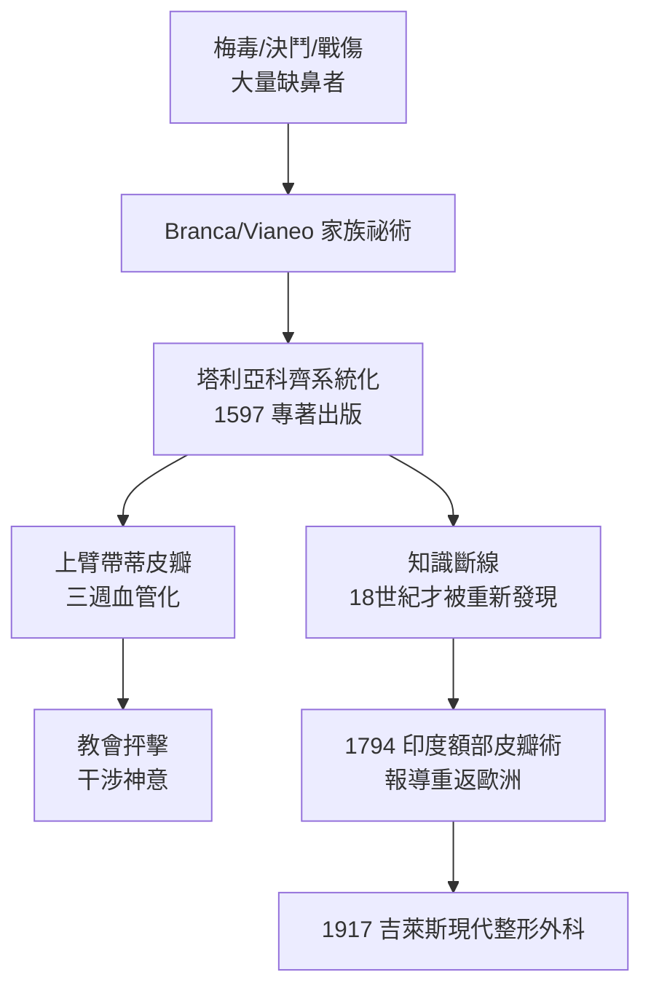

## 1597 - 塔利亞科齊造鼻術（整形外科的第一本教科書，與教會的圍剿）

## 案件摘要

**本案的謎題是：為什麼外科學最偉大的里程碑之一，作者臨終前卻聲名狼藉、書稿險遭焚毀？**

1597 年，波隆那大學解剖學與外科教授 **加斯帕雷·塔利亞科齊（Gaspare Tagliacozzi, 1545–1599）**出版《畸形外科修復術》（*De curtorum chirurgia per insitionem*）——史上第一本整形外科專著，詳細圖解**義大利式上臂皮瓣造鼻術**：從患者自己的上臂內側掀起一塊帶蒂皮瓣，縫合到缺鼻處，養護三週待血管長入，再切斷蒂部塑形。兩年後塔利亞科齊去世；傳說耶穌會下令將其遺體遷出聖地、甚至掘出其屍——因為教會認為「以人體修補人體」是干涉神意。

## 前因 -- 為什麼會有這個案子

- **需求爆炸**：梅毒大流行（見 `../性病的歷史/1494-那不勒斯梅毒大流行.md`，性病史系列）造成大量鼻樑潰爛缺失；決鬥與戰傷亦然。缺鼻者被社會視為「染病者」，戴金屬假鼻或蒙面生活。
- **古老傳統的斷線**：古印度《妙聞本集》（約前 600 年）已有額部皮瓣造鼻術，但此知識未傳入歐洲；文藝復興的西西里 Branca 家族（15 世紀）重啟皮瓣技術，其後 Calabria 的 Vianeo 家族以「代客造鼻」聞名，卻保密如商業機密。
- **塔利亞科齊的突破**：他不是發明者，而是**系統化者**——首次以解剖學、圖解與病例追蹤，把家族祕術變成可傳授、可驗證的公開科學。
- **時代氛圍**：教會對「改變身體」持懷疑態度；同時解剖學（維薩里 1543）正在興起，醫學界本身也分成支持與鄙視兩派。

## 線索與推理 -- 數學式、程式、理論

**線索一：帶蒂皮瓣的生理學本質。** 皮瓣移植的核心難題是**缺血耐受**。遊離皮膚移植後必須在 48–72 小時內重建血供，否則壞死。塔利亞科齊的帶蒂皮瓣是聰明的妥協：

$$ \text{成活條件}： V_{perfusion}^{蒂部} \geq V_{metabolic}^{皮瓣} \quad \text{直到} \quad t_{neovascularization} \approx 3 \text{週} $$

皮瓣的蒂部持續供血，同時皮瓣底部與鼻部缺損床之間新生血管（inosculation + angiogenesis）逐漸接通；三週後切斷蒂部，皮瓣靠新血管存活。這是**漸進式寄生轉獨立**的工程，比遊離移植早了 350 年（遊離皮瓣要等到 20 世紀顯微外科吻合血管才可行）。

**線索二：三週的數字從哪來。** 血管新生（angiogenesis）的速度由內皮細胞遷移率決定，毛細血管芽生長速度約 $ 0.2{-}0.6 \ \mathrm{mm/day} $。皮瓣底面積數平方公分，血管從缺損床邊緣長入 1–2 cm，需要 $ 10{-}20 $ 天——塔利亞科齊憑臨床觀察定下的「三週」，恰好落在生理學的最優區間。

```python
# 帶蒂皮瓣血管化時間估算
import math
def flap_maturation(defect_radius_mm, angiogenesis_rate=0.4):
    days = defect_radius_mm / angiogenesis_rate  # 血管從邊緣長入
    return math.ceil(days)

for r in [5, 10, 15]:
    print(f"缺損半徑 {r} mm → 血管化約 {flap_maturation(r)} 天")
# 5→13天, 10→25天, 15→38天: 塔利亞科齊選的鼻部缺損(小面積)最適合三週方案
```



**線索三：聲譽毀滅的偵查。** 傳說耶穌會仇視他——現代史學家考證後認為更可能是**醫學界的同行嫉妒與巴黎大學（Paré 派）的抵制**，教會譴責則被誇大為神話。塔利亞科齊死於 1599 年瘟疫，葬禮寒酸；他的技術在 17 世紀幾乎失傳——**一門外科學的死亡，不是因為無效，而是因為沒有接棒的制度**。

關鍵推論：塔利亞科齊證明了「美麗與器官功能可以被外科工程化」，但證明本身無法自保——**醫學知識的存活需要大學、期刊與專科制度**，這些要到 19–20 世紀才齊備（見 `1917-吉萊斯與一次大戰整形外科.md`）。

## 結案 -- 後果與影響

- **整形外科的創世文獻**：1597 年專著中的圖版（上臂縛於頭部的患者姿勢）成為醫學史最著名的圖像之一。
- **「重建」與「美容」的邊界就此確立又立刻模糊**：造鼻術既是功能重建（呼吸、進食），也是社會性美容（去除病恥感）——本書全書的主題在此第一次登場。
- **技術失傳 150 年**：直到 1794 年英國《紳士雜誌》報導印度額部皮瓣造鼻術、1797 年 Carpue 重做手術，皮瓣外科才復活。
- **一句話結案**：外科能修補身體的證據早就存在，讓它成為正當醫學的不是技術，而是制度與社會對「改變身體」的許可。

## 關鍵人物與文獻

- **Gaspare Tagliacozzi（1545–1599）**——波隆那大學外科與解剖學教授，《De curtorum chirurgia per insitionem》（1597）作者。
- **Branca 家族與 Vianeo 家族**——15–16 世紀西西里與卡拉布里亞的皮瓣外科世家。
- **Ambroise Paré（1510–1590）**——法國外科宗師，對異國技術態度保守，其學派間接抑制了造鼻術傳播。
- 延伸閱讀：`1917-吉萊斯與一次大戰整形外科.md`、`0500-愛提烏斯與文身去除.md`
