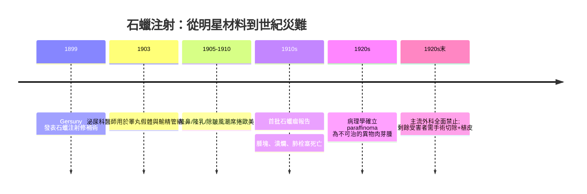

## 1899 - 石蠟注射悲劇（把「填充」這個念頭放進醫學，也放進了墳墓）

## 案件摘要

**本案的兇手不是一個醫生，而是一個極具誘惑力的物理性質：不反應、不吸收、不變形——石蠟太完美了，完美得像陷阱。**

1899 年，維也納外科醫師 **Robert Gersuny（1844–1924）**發表論文，提出以**液態石蠟（paraffin）注射**矯正身體缺陷：先是替結核病患者修補睪丸缺損，隨後被同行用於隆鼻、隆乳、消除皺紋。石蠟注射風潮席捲歐美三十年，隨之而來的是「石蠟瘤」（paraffinoma）大流行——石蠟在組織中游走、包裹、肉芽腫化，患者臉部腫塊潰爛、乳房硬化變形，甚至栓塞致死。這是醫學美容史上第一次大規模的「填充劑災難」，也是此後一個世紀所有填充悲劇（矽膠、PAAG、奧美定）的原型案件。

## 前因 -- 為什麼會有這個案子

- **石油工業的意外禮物**：19 世紀末石油分餾技術成熟，石蠟（碳數 20–40 的烷烴混合物）熔點可調、化學惰性、價格便宜——醫師第一次拿到「液態可注射的固體材料」。
- **重建醫學的材料荒**：當時矯正臉部與乳房缺損只有自體脂肪（存活率低、易吸收）與義體（金屬、象牙），皆不理想。Gersuny 看中石蠟「注入後冷卻定型、終身不變」的特性。
- **石蠟的兩面**：熔點 50–60°C 的石蠟在體溫下其實是**半液態的黏性流體**，會隨重力與肌肉壓力緩慢遷移——這個流變學事實在推廣風潮中被完全忽略。

## 線索與推理 -- 數學式、程式、理論

**線索一：石蠟瘤的病理機制。** 石蠟是**非降解的異物**。注入組織後，巨噬細胞與異物巨細胞將其包裹，形成油囊腫（oil cyst）與異物肉芽腫：

$$ \text{石蠟瘤} = \text{異物} \times \text{免疫隔離反應} \times \text{時間} $$

因為石蠟不會被代謝，肉芽腫反應**終身不熄**；注射後 5–20 年才大規模發作的延遲性，正是「當時看起來安全」的假象來源。

**線索二：流變學的殺人細節。** 用流變學語言重新檢視：石蠟是**黏性流體（viscous fluid）**而非黏彈性凝膠（viscoelastic gel）。它的儲存模量 $ G' \approx 0 $，只有損耗模量 $ G'' $：

```python
# 填充材料分類: 為什麼石蠟會游走而玻尿酸不會
materials = {
    "石蠟":   {"G_prime": 0.1,  "G_pprime": 900, "降解": False},  # 流體→遷移
    "矽膠液": {"G_prime": 0.2,  "G_pprime": 800, "降解": False},  # 同樣問題(1945)
    "玻尿酸": {"G_prime": 500, "G_pprime": 300, "降解": True},   # 凝膠→原位停留
}
for m, p in materials.items():
    tan_delta = p["G_pprime"] / p["G_prime"]
    verdict = "會遷移" if tan_delta > 1 and not p["降解"] else "原位可控"
    print(f"{m}: tan δ={tan_delta:.0f} → {verdict}")
```

損耗角正切 $ \tan\delta = G''/G' $ 越大，材料越像液體。石蠟的 $ \tan\delta \gg 1 $：在重力和組織壓力下，它**一定會**沿組織間隙向下、向深處移動——這解釋了為何隆乳注射者的石蠟最終出現在下腹與腹股溝。

**線索三：時間軸上的因果還原。**



關鍵推論：石蠟悲劇的教訓不是「注射填充危險」，而是三條**填充劑設計法則**的誕生：(1) 材料必須可降解或具穩定凝膠結構；(2) 遷移性必須以流變學評估而非外觀；(3) 長期追蹤是唯一能暴露延遲性災難的試驗設計。這三條法則，直接塑造了 1981 年膠原蛋白（`1981-膠原蛋白填充劑Zyderm.md`）與 1996 年玻尿酸（`1996-玻尿酸填充登場.md`）的研發路線。

## 結案 -- 後果與影響

- **「永久填充」成為禁忌詞**：石蠟瘤之後，醫學界花了近百年學會對「不可降解、不可取出」的注射材料保持恐懼——但同樣的劇本在 1945 年以矽膠重演（`1945-矽膠注射時代.md`）、在 2000 年代以奧美定（聚丙烯醯胺凝膠）再演。
- **異物肉芽腫成為獨立病理學主題**：paraffinoma、siliconoma、granuloma 的鑑別診斷寫入皮膚病理教科書。
- **監管意識萌芽**：填充劑從「外科醫師的自由發揮」逐步走向材料審查——最終落地為 FDA 對填充物的分類管理。
- **一句話結案**：填充醫學的第一課，是「看不見的材料不等於消失的材料」——永久性與安全性是反比關係的起點。

## 關鍵人物與文獻

- **Robert Gersuny（1844–1924）**——維也納外科教授，1888 年首創以凡士林混合物填充、1899 年發表石蠟注射。
- **Eugène Holländer**——柏林外科醫師，石蠟隆乳的推廣者之一，亦是石蠟瘤受害者群體的報告者。
- Conway, H. & Lerner, B., "Permanent injections for soft tissue augmentation: paraffinoma", *Plastic and Reconstructive Surgery*（1940s 回顧）。
- 延伸閱讀：`1945-矽膠注射時代.md`、`1981-膠原蛋白填充劑Zyderm.md`、`1996-玻尿酸填充登場.md`
