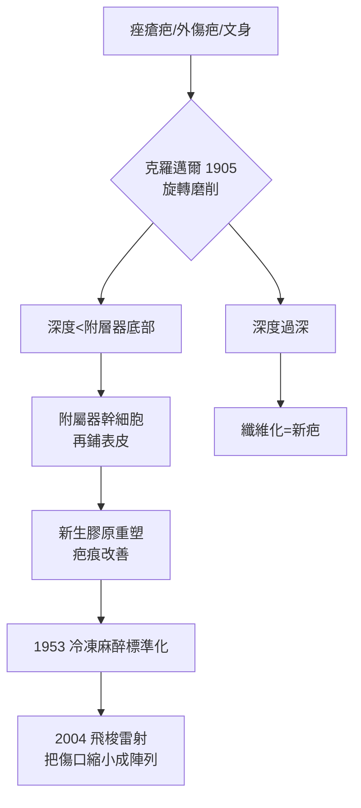

## 1905 - 克羅邁爾磨皮術（機械換膚的誕生：用砂輪挑戰「皮膚不能再生」的常識）

## 案件摘要

**本案的謎題：為什麼把皮膚磨掉一層不會留下永久疤痕，而同樣深度的切割卻會？**

1905 年，德國皮膚科醫師 **恩斯特·克羅邁爾（Ernst Kromayer, 1865–1931）**發表以**旋轉銼刀與砂輪**機械磨除表皮與真皮乳頭層，治療痤瘡疤痕、文身與色素沉著——這是現代磨皮術（dermabrasion）的誕生。他不僅證明手術可行，還解答了關鍵疑問：只要保留皮膚附屬器（毛囊、汗腺導管）的上皮幹細胞，表皮可以完全無痕再生。這一「**附屬器是再生的種子庫**」的洞見，將在 2004 年成為飛梭雷射（`2004-飛梭雷射.md`）的理論基石。

## 前因 -- 為什麼會有這個案子

- **痤瘡疤痕的社會壓力**：19 世紀末痤瘡（青春痘）成為都市青少年的流行病，凹陷疤痕無藥可治。
- **化學腐蝕的先例與極限**：招魂式酸燒灼（石炭酸、三氯醋酸）深度不可控，愛提烏斯以來的腐蝕法常造成疤痕（見 `0500-愛提烏斯與文身去除.md`）。
- **牙科器械的跨界**：克羅邁爾借用了牙科鑽頭技術——史上第一次，皮膚外科借用了精密旋轉器械。
- **Rebecca 与第二次開發**：美國皮膚科醫師 Abner Kurtin 在 1930–50 年代推廣改良，1953 年 Cornell 的 Fulton 與同事以冷凍麻醉 + 鋼絲刷標準化手術。

## 線索與推理 -- 數學式、程式、理論

**線索一：皮膚再生的臨界深度。** 表皮再生的幹細胞位於毛囊隆突區（bulge）與汗腺導管。只要磨削深度停留在真皮網狀層之上（約 0.3–0.45 mm，面頰部），殘存的附屬器上皮便可在 7–14 天內爬行覆蓋創面：

$$ D_{safe} < D_{附屬器底部} \quad \Rightarrow \quad \text{無痕再生} $$

$$ D_{safe} > D_{附屬器底部} \quad \Rightarrow \quad \text{疤痕} $$

克羅邁爾的臨床判斷「磨至點狀出血（pinpoint bleeding）」正是解剖學上的真皮乳頭層深度——出血表示到達乳頭血管叢，再深一步就會留疤。

**線索二：為何磨皮改善疤痕。** 機制不是「磨平」而是「重啟」：磨削造成真皮淺層的淺表傷口，傷口癒合時纖維母細胞分泌新膠原，**新生膠原的排列比舊疤痕規整**，且邊緣的凹陷被新生組織部分填平。這是「**可控損傷換取重塑**」原理——果酸換膚（`1974-果酸換膚革命.md`）與雷射換膚共享同一邏輯。

```python
# 磨削深度與結果的關係模型
def dermabrasion(depth_mm, appendage_depth_mm=0.45):
    if depth_mm < 0.10:
        return "僅角質層: 無效果"
    elif depth_mm < appendage_depth_mm:
        return "乳頭層: 表皮7-14天再生, 膠原重塑, 無疤痕"
    else:
        return "超過附屬器: 纖維化疤痕!"

for d in [0.05, 0.3, 0.5]:
    print(d, "mm →", dermabrasion(d))
```



關鍵推論：磨皮術的核心發現是「**皮膚創面的幾何學決定疤痕學**」。連續大面積削磨的風險在於任何一處過深即留疤；半世紀後飛梭雷射的解法——把大傷口切成數千個微小的點陣傷口、每個點四周都是健康的「種子庫」——正是把克羅邁爾的洞見推到極致。

## 結案 -- 後果與影響

- **磨皮成為 20 世紀中葉的疤痕治療金標準**：1950–80 年代，冷凍麻醉＋鋼絲刷磨皮是痤瘡疤痕的主流手術。
- **「附屬器再生理論」寫入教科書**：成為後來所有換膚技術（酸類、雷射、飛梭）評估安全深度的共同基準。
- **被雷射取代但不被淘汰**：CO2 雷射換膚（`1983-選擇性光熱解理論.md` 系列應用）一度取代機械磨皮，但飛梭時代機械微針（微針滾輪、射頻微針）復活——本質仍是克羅邁爾的原理。
- **一句話結案**：皮膚不是不能再生，而是只在「種子庫」倖存時再生——所有換膚技術都在賭同一件事：損傷的深度恰好停在種子之上。

## 關鍵人物與文獻

- **Ernst Kromayer（1865–1931）**——柏林皮膚科醫師，1905 年發表旋轉器械磨皮術與「可控深度換膚」概念。
- **Abner Kurtin（1901–1960）**——紐約皮膚科醫師，1930–50 年代改良推廣磨皮術。
- **Kurtin, A.**, "Corrective surgical planing of skin", *AMA Archives of Dermatology* 68:389 (1953)。
- 延伸閱讀：`0500-愛提烏斯與文身去除.md`、`1974-果酸換膚革命.md`、`2004-飛梭雷射.md`
