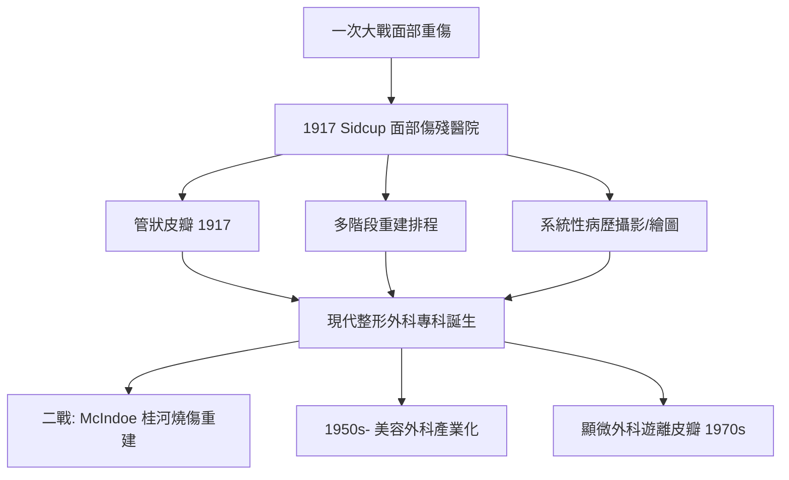

## 1917 - 吉萊斯與一次大戰整形外科（現代醫美的祖父誕生在戰壕裡）

## 案件摘要

**本案的謎題：為什麼醫學美容的正統血統，要從一場殺戮機器裡去認領？**

1917 年，紐西蘭裔外科醫師 **Harold Gillies（1882–1960）**在英國肯特郡 Sidcup 建立「面部傷殘醫院」（Queen's Hospital），收治索姆河戰役中的面部重傷兵。機槍與炮彈把下顎、鼻、眼眶打碎，士兵無法進食、說話、見人。Gillies 在五年間執行逾 11,000 次手術、治療約 5,000 名傷兵，發明**管狀皮瓣（pedicled tube flap）**與多階段重建術式，並留下數千幅病歷圖畫與前後對照照片——這是現代整形外科的誕生現場，也是「**以手術重建人的社會面孔**」這一醫學美容核心信念的第一次大規模實踐。

## 前因 -- 為什麼會有這個案子

- **戰壕戰的解剖學後果**：塹壕把士兵的頭部恰好暴露在機槍射界之上；砲彈碎片造成顏面粉碎性骨折。一次大戰英軍面部重傷約 20,000 人。
- **外科學的真空**：當時沒有「整形外科」專科；顏面傷被骨科、耳鼻喉科、一般外科互相推諉。1915 年 Gillies 隨紅十字會赴法國，見證了 Charles Valadier 的臨時顏面重建，立志建立專科。
- **塔利亞科齊的遺產**：皮瓣技術的原理（見 `1597-塔利亞科齊造鼻術.md`）僅存於教科書；Gillies 自學重拾並大幅擴展。
- **麻醉與感染控制的進步**：乙醚麻醉、無菌術、X 光診斷讓長時間多階段手術成為可能。

## 線索與推理 -- 數學式、程式、理論

**線索一：管狀皮瓣的發明邏輯。** 傳統扁平皮瓣的致命弱點是蒂部暴露易感染、皮瓣容易收縮變形。Gillies 於 1917 年把皮瓣的兩側邊緣縫合成管——創面完全閉合、血供集中在管芯：

$$ \text{管狀皮瓣}： \; \frac{V_{blood}^{管芯}}{A_{cross-section}} \uparrow, \quad \text{暴露創面} \to 0 $$

管道可以先從腹部或頸部「長」出來，再一節一節**徒步移植**（waltzing）到面部——每一步都保留一端血供。這是把皮瓣血管化過程變成可控制的分階段工程。

**線索二：多階段手術的排程理論。** 一個下顎與鼻同時缺損的士兵，可能需要 8–12 次手術、跨越 2 年。Gillies 的病歷圖畫顯示他以**關鍵路徑**方式規劃：皮管培養 → 轉移至前臂中繼站 → 轉移至面部 → 軟骨支架植入 → 塑形。每次手術都必須在前一次血管化完成後進行（約 3 週，即塔利亞科齊的時間常數）。

```python
# 管狀皮瓣「徒步移植」的階段排程
from datetime import timedelta
def tube_flap_schedule(start, stages, maturation_days=21):
    d = start
    plan = []
    for s in stages:
        plan.append((d.date(), s))
        d += timedelta(days=maturation_days)
    return plan

for date, s in tube_flap_schedule(
    __import__('datetime').datetime(1917, 8, 1),
    ["腹部皮管成形", "轉移至左前臂", "前臂貼至鼻部", "切斷蒂部", "鼻軟骨支架", "最終塑形"]):
    print(date, s)
```



**線索三：攝影與「證據文化」。** Gillies 強制要求每位患者術前術後同角度攝影、並由他的藝術家助手 Henry Tonks 繪製水彩對照圖。這建立了整形外科的**療效證據格式**——今日醫美診所牆上的對照照片，語法直接繼承自 Sidcup。

關鍵推論：Gillies 的貢獻不只是技術，而是三件制度發明：專科（整形外科）、術式庫（皮瓣系統）、證據格式（對照影像）。**醫學美容要成為醫學，必須先擁有可檢驗的證據格式**——這正是石蠟注射時代（`1899-石蠟注射悲劇.md`）所缺的東西。

## 結案 -- 後果與影響

- **整形外科成為皇家認可的專科**：1946 年英國整形外科學會成立；美國 1937 年成立學會（Gillies 為榮譽會員）。
- **學徒帝國**：Gillies 訓練出 Archibald McIndoe（二戰燒傷重建傳奇）、Pomfret Kilner 等第二代大師，師徒譜系統治了 20 世紀整形外科。
- **美容外科的合法性來源**：戰後大量「平民版」重建需求（燒傷、腫瘤切除後）讓技術溢出到純美容領域；1950 年代起隆鼻、拉皮在美國中產階級普及。
- **身分與臉孔的哲學遺產**：Sidcup 士兵的病歷成為醫學人文研究的經典——臉不只是器官，是身分；重建臉孔即重建社會存在。這是本書所有「美容」議題的價值基石。
- **一句話結案**：醫學美容的正統祖父不是美容師，是戰地外科醫師——因為只有先證明「手術能重建人」，才有資格討論「手術能否改善人」。

## 關鍵人物與文獻

- **Harold Gillies（1882–1960）**——「現代整形外科之父」，1917 年 Sidcup 面部傷殘醫院創院醫師，1920 年出版 *Plastic Surgery of the Face*。
- **Archibald McIndoe（1900–1960）**——Gillies 表弟與學生，二戰負責燒傷飛行員重建，創立「Guinea Pig Club」病友會。
- **Henry Tonks（1862–1937）**——藝術家，Sidcup 病歷水彩畫作者，現藏皇家外科醫學會。
- **Gillies, H.D.**, *Plastic Surgery of the Face* (Oxford Medical Publications, 1920)。
- 延伸閱讀：`1597-塔利亞科齊造鼻術.md`、`1899-石蠟注射悲劇.md`、`1962-SPF防曬係數誕生.md`
