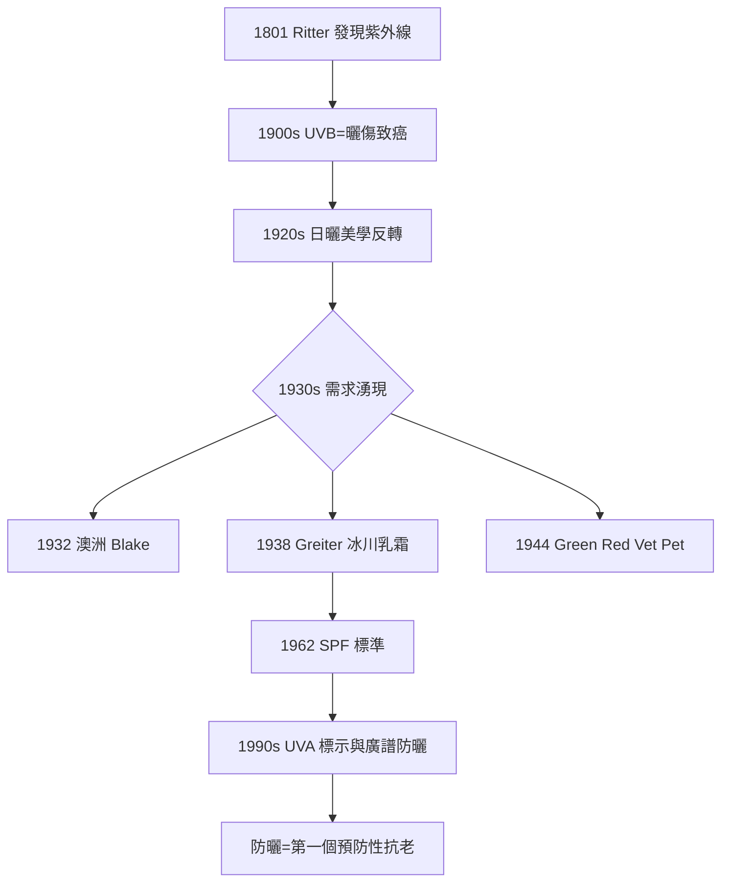

## 1938 - 防曬乳誕生（從burning ray的物理學到人類第一瓶光線防禦工程）

## 案件摘要

**本案的謎題：人類被太陽曬了三十萬年，為什麼防曬乳遲到這麼久——而它一登場，竟是為了保護上山放炸藥的人？**

1938 年，奧地利化學家 **Franz Greiter** 在攀登皮茲布因峰（Piz Buin）時嚴重曬傷，隨後在自家廚房研發出人類最早的商業防曬乳之一 **Gletscher Crème（冰川乳霜）**，並創立 Piz Buin 化妝品牌。幾乎同時，澳洲 Milton Blake（1932）與美國 Benjamin Green（1944，為二戰叢林作戰的美軍研發 Red Vet Pet）也推出防曬產品。防曬是醫學美容史上第一個「**預防性美容技術**」——不是修飾傷害，而是阻止傷害發生。

## 前因 -- 為什麼會有這個案子

- **紫外線的科學發現**：1801 年德國物理學家 Johann Ritter 發現紫外線（Ultraviolett）；20 世紀初醫學確立 UVB（290–320 nm）是曬傷元凶，並且是皮膚癌的致癌物。
- **日曬美學的大反轉**：19 世紀歐洲以蒼白為貴（見 `-0150-羅馬毒美人鉛白與汞.md` 的階級邏輯）；1920 年代 Coco Chanel 在度假時曬成古銅色，時尚界反轉美學——**晒黑成為有閒階級的象徵**。美學反轉直接製造了新的醫學問題。
- **皮膚癌流行病學**：澳洲（白種人 + 高紫外線）成為全球皮膚癌發病率最高的國家，防曬從美容問題升格為公共衛生問題。
- **化學工業的供給**：苯甲酸類（PABA）、肉桂酸酯等紫外線吸收劑在 1930–40 年代陸續可用。

## 線索與推理 -- 數學式、程式、理論

**線索一：SPF 的數學本質。** 1962 年 Greiter 提出**防曬係數 SPF（Sun Protection Factor）**的定義：塗抹防曬後與未塗抹時，產生相同紅斑所需的最小紫外線劑量比：

$$ SPF = \frac{MED_{with\ sunscreen}}{MED_{without}} \qquad (\text{MED = Minimal Erythema Dose, 最小紅斑劑量}) $$

防曬乳吸收 UVB 遵循 Beer–Lambert 定律，透射率 $ T = 10^{-A} $（A 為吸光度）。SPF 與吸光度的關係：

| SPF | 允許透過的 UVB | 阻隔率 |
|---|---|---|
| 2 | 1/2 | 50% |
| 10 | 1/10 | 90% |
| 30 | 1/30 | 96.7% |
| 50 | 1/50 | 98% |

```python
# 為什麼SPF 50以上邊際效益急遽遞減
for spf in [2, 10, 30, 50, 100]:
    blocked = (1 - 1/spf) * 100
    print(f"SPF {spf}: 阻隔 {blocked:.1f}%")
# 50→100 只多擋 1 個百分點, 但成分負擔倍增
```

**線索二：UVA 的隱形戰場。** UVB 造成紅斑（可測、可算 SPF），但 UVA（320–400 nm）穿透更深、產生活性氧破壞膠原與 DNA，且**幾乎不產生立即紅斑**——防曬乳普及後出現新現象：人們不曬傷了，卻仍曬老、曬癌。這解釋了為何 1990 年代起各國陸續強制標示 UVA 防護（PA、UVA 圓圈標）——**可見的指標（SPF）會誤導防護行為**。



**線索三：防曬乳的雙重工程學。** 現代防曬是化學吸收劑（有機分子吸收光子後以熱量釋放）與物理散射劑（氧化鋅、二氧化鈦反射散射）的混合配方。工程難題在於**光穩定性**：阿伏苯宗（avobenzone，UVA 吸收主力）在陽光下 1 小時降解過半，必須搭配光穩定劑（如奧克立林）——這是化妝品化學中少數需要「分子夥伴制度」的設計。

關鍵推論：防曬乳的歷史揭穿了美容工業的一個深層結構——**市場只獎勵「修復」與「立即效果」，預防性產品必須靠醫學證據與監管才能存活**。SPF 標準（1962）是化妝品史上第一個被量化規範的功效聲明，為日後果酸（`1974-果酸換膚革命.md`）等活性成分的監管鋪路。

## 結案 -- 後果與影響

- **皮膚癌預防的公共衛生勝利**：澳洲「Slip! Slop! Slap!」運動（1981）結合 SPF 制度化，被評估為 20 世紀最成功的癌症預防宣導之一。
- **抗老醫學的第一根支柱**：光老化（photoaging）概念在 1980 年代確立（Kligman），防曬成為所有抗老方案的基礎處方。
- **全球標準之戰**：SPF（歐洲）、PA（日本）、Boots Star（英國）等標示制度的分岔，反映「防護指標無法被單一數字壓縮」的科學事實。
- **一句話結案**：防曬乳是醫美史上第一次「什麼都不做也是一種工程」——它的效果以不存在的方式呈現，這也是它最難被消費者理解的原因。

## 關鍵人物與文獻

- **Franz Greiter（1921–2005）**——奧地利化學家，Piz Buin 創辦人，Gletscher Crème 與 SPF 概念發明者。
- **Milton Blake**——澳洲化學家，1932 年推出早期防曬霜。
- **Benjamin Green**——美國藥劑師，二戰美軍防曬「Red Vet Pet」，後發展為 Coppertone。
- **Albert Kligman（1916–2010）**——皮膚科學者，光老化與視黃酸研究的奠基者。
- 延伸閱讀：`1962-SPF防曬係數誕生.md`、`1974-果酸換膚革命.md`、`-0150-羅馬毒美人鉛白與汞.md`
