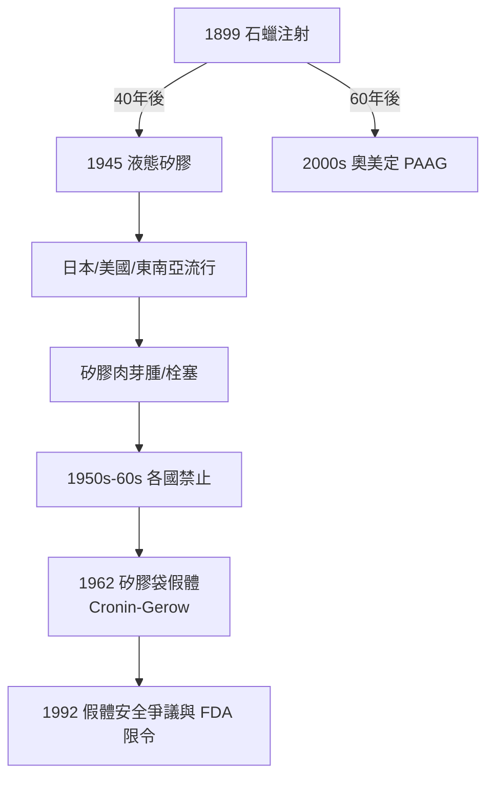

## 1945 - 矽膠注射時代（石蠟悲劇的完美重演，只是換了一種更滑的液體）

## 案件摘要

**本案的謎題：醫學界明明才剛埋葬石蠟瘤，為什麼四十年後又對一種幾乎一模一樣的材料敞開大門？**

1940 年代末至 1950 年代，**液態矽膠（液態聚二甲基矽氧烷，PDMS）注射**開始在日本（戰後隆乳、隆鼻）、美國（加州診所）與東南亞流行。醫師宣稱矽膠「化學惰性、不被吸收、不致癌」——每個字都對，組合起來卻是災難：矽膠沿組織游走、誘發矽膠肉芽腫（siliconoma）、硬化與遠處栓塞， victims 需要切除整個乳房或面頰。日本厚生省 1950–60 年代全面禁止；美國 FDA 直到 1965 年才介入。此案與 1899 年石蠟注射（`1899-石蠟注射悲劇.md`）構成醫美史上最著名的「**重複事故**」。

## 前因 -- 為什麼會有這個案子

- **材料科學的戰爭紅利**：二戰中 Dow Corning 為軍方開發矽膠（防水、絕緣、惰性）；戰後軍用材料尋找民用出路，矽膠以其「完美惰性」的形象進入醫學。
- **戰後日本的特殊環境**：物資匱乏、美容需求反彈、監管真空。隆乳手術以液態矽膠直接注射（被称为「プレゼント注射」等），短時間內累積數萬例。
- **經濟學誘因**：注射比手術便宜、快速、無疤——「十分鐘變大」的商業模式擊敗了緩慢的假體手術。
- **監管的時間差**：FDA 對醫療器材的管理在 1976 年《醫療器材修正案》之前幾乎不存在——矽膠注射流行的 20 年正是監管黑洞期。

## 線索與推理 -- 數學式、程式、理論

**線索一：惰性是個分母錯誤的命題。** 「材料惰性」描述的是**材料不與組織反應**，但注射的安全風險主要由**組織對材料的異物反應**與**材料的物理行為**決定。以風險方程式重寫：

$$ R = P_{migration} \times P_{granuloma} \times \text{劑量} \times \text{不可取出性} $$

液態矽膠的 $ P_{migration} \approx 1 $（低黏度者必然游走）、不可取出性 = 100%——「惰性」這個因子根本不在方程式裡。

**線索二：黏度—併發症的定量關係。** 病例對照顯示併發症率與矽膠黏度強烈相關：高黏度（數萬 cSt）注射者的肉芽腫率顯著低於低黏度（350 cSt）者。流變學解釋與石蠟案相同（$ \tan\delta = G''/G' \gg 1 $）：低黏度液體在組織壓力梯度下持續位移，並可經由血管或淋巴進入肺部造成**矽膠栓塞**——日本報告多例致死。

```python
# 液態注射材料的「災難四因子」評分
def disaster_score(migrates, degrades, extractable, granuloma_risk):
    return migrates*3 + (not degrades)*2 + (not extractable)*3 + granuloma_risk*2

print("石蠟   :", disaster_score(True, False, False, 0.8))   # 10.6
print("液態矽膠:", disaster_score(True, False, False, 0.7))   # 10.4
print("玻尿酸 :", disaster_score(False, True, True, 0.1))    # 0.0
# 石蠟與液態矽膠得分幾乎相同 → 歷史為何重演
```

**線索三：制度的免疫記憶問題。** 為什麼醫學會重複犯錯？偵查發現三個斷點：(1) 石蠟慘案的文獻以德文/英文發表，日本戰後資訊隔絕；(2) 「新材料」的心理光環讓醫師認為本案不同；(3) 受害者的延遲發病（5–15 年）使早期臨床報告全是正面的。**延遲性災難 + 資訊斷點 + 新奇偏誤 = 重複事故**——這個三元組將在奧美定（2000 年代）第三次上演。



**線索四：正面的遺產。** 矽膠災難並非全然浪費——它直接催生了 **1962 年 Cronin–Gerow 矽膠袋假體**（把矽膠封在彈性外殼內，解決游走問題），以及後來 「**不可取出=不可注射**」的填充劑鐵律。

關鍵推論：矽膠案證明醫學的安全記憶不是天然的，而是**制度性**的：需要文獻流通、上市後監測、以及對「永久性材料」的制度性懷疑。三者齊備之前，同樣的悲劇必然重演。

## 結案 -- 後果與影響

- **日本整形外科的集體創傷**：矽膠注射受害者的修復手術持續至 2000 年代，使日本醫界對注射式隆乳長期戒慎。
- **矽膠假體的曲折歷史**：1992 年 FDA 因結締組織病疑慮限制矽膠假體（後證實無因果，2006 年重新核准）——對矽膠的制度性恐懼與證據的和解花了 14 年。
- **填充劑監管的誕生**：本案與奧美定案共同促成各國對注射填充物按醫療器材分類管理、要求長期追蹤數據。
- **一句話結案**：醫學不會自動記取教訓；「惰性材料」的誘惑每代換一次名字，除非制度把上一次的墳墓擋在下一次的診所門口。

## 關鍵人物與文獻

- **Frank Gerow 與 Thomas Cronin**——1962 年發明第一代矽膠袋乳房假體，終結注射式隆乳的主流地位。
- 日本厚生省——1950–60 年代逐步禁止液態矽膠注射的監管機構。
- Duffy, D.M., "Liquid silicone injectable filler: physician, patient, and legal responsibilities", *Seminars in Cutaneous Medicine and Surgery*（歷史回顧）。
- 延伸閱讀：`1899-石蠟注射悲劇.md`、`1981-膠原蛋白填充劑Zyderm.md`、`1996-玻尿酸填充登場.md`
