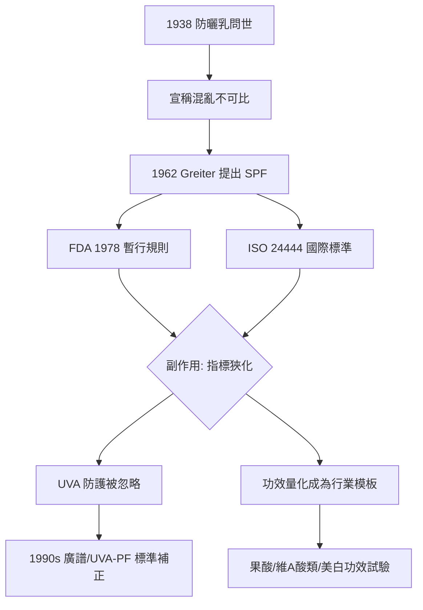

## 1962 - SPF 防曬係數誕生（把「太陽的危險」翻譯成一個數字）

## 案件摘要

**本案偵破的不是一項發明，而是一次翻譯：如何把光生物學的複雜劑量—反應關係，壓縮成消費者能懂、監管能查的一個整數。**

1962 年，奧地利化學家 **Franz Greiter** 正式提出**防曬係數 SPF（Sun Protection Factor）**的測定方法與標示概念，並在其品牌 Piz Buin 的產品上使用。此後 SPF 成為全球最成功的美妝功效指標：一個數字，背後站著紅斑劑量學、Beer–Lambert 光學與人體試驗標準。本案追蹤的是「**功效量化**」這條線——它從防曬出發，最終強迫整個化妝品行業學會用數字說話。

## 前因 -- 為什麼會有這個案子

- **1938 年防曬乳問世後的混亂**（見 `1938-防曬乳誕生.md`）：各廠牌自行宣稱「防曬力 X 倍」「阻隔 Y%」，數字彼此不可比、不可驗證——市場上充斥無法證偽的宣稱。
- **紅斑劑量學已成熟**：1930 年代，皮膚科學界建立了**最小紅斑劑量（MED）**概念——在標準光源下，使皮膚產生剛可見紅斑所需的 UV 劑量。這是可重複測量的生物終點。
- **澳洲的公共衛生壓力**：皮膚癌高發使澳洲醫界迫切需要一個可比較、可管制的防曬標準。
- **Greiter 的工程師直覺**：與其描述成分，不如定義**終點行為**——「塗了之後你可以多待多久」。

## 線索與推理 -- 數學式、程式、理論

**線索一：SPF 的操作型定義。** 在同一受試者背部選兩處皮膚，一處塗抹標準劑量（2 mg/cm²）防曬乳：

$$ SPF = \frac{\text{塗抹處產生紅斑所需 UV 劑量 } MED_{prot}}{\text{未塗抹處所需劑量 } MED_{ctrl}} $$

這是一個**劑量放大比**，不是「防護百分比」。兩者的換算：

$$ \text{UVB 阻隔率} = 1 - \frac{1}{SPF} $$

```python
# SPF 數字的真實含義: 指數阻隔, 線性時間
for spf in [15, 30, 50]:
    print(f"SPF {spf}: 放行 {100/spf:.1f}%, 阻隔 {100-100/spf:.1f}%")
# 實務陷阱: 實際塗抹量通常只有 0.5-1.5 mg/cm², 不到標準一半
def real_spf(label_spf, applied_mg_cm2):
    # 防護力大致隨塗抹量指數級下降 (κ ≈ 1)
    return label_spf ** (applied_mg_cm2 / 2)
print("標示SPF50 只塗1mg/cm² → 實效約", round(real_spf(50, 1)))  # 約7
```

**線索二：一個數字丟掉了什麼。** SPF 只量化 UVB（紅斑終點），但光譜上還有 UVA（老化與致癌的主力之一）。把多維光譜防護壓縮成一維數字，製造了系統性盲區：消費者追求高 SPF，廠商以 UVB 濃度堆疊數字——UVA 防護原地踏步。1990 年代的修正（廣譜標示、UVA-PF、臨界波長 $ \lambda_c \geq 370 $ nm 等）本質上是**承認單一指標的失敗**。

**線索三：標準化的人體試驗。** SPF 測定最終寫入國際標準（FDA 1978 暫行辦法、ISO 24444）：標準光源、標準塗布、三名以上受試者、多點遞增劑量。這是**化妝品史上第一次以受控人體試驗證明功效**，成為日後所有功效宣稱（抗皺、美白）的方法學模板。



關鍵推論：SPF 的真正發明是「**以生物終點定義化妝品功效**」的翻譯協議。它的成功與副作用（指標狹化）共同說明：任何量化指標一旦進入市場，就會被市場的最優化行為扭曲——這是後來所有醫美指標（膠原增生率、皺紋評分、滿意度量表）都必須面對的宿命。

## 結案 -- 後果與影響

- **全球防曬標示制度**：SPF + UVA 標示成為法定義務（多數國家），防曬乳成為銷量最大的功能性化妝品。
- **公共衛生成效**：SPF 制度＋防曬教育是澳洲等地黑色素瘤發生率轉折的關鍵因素之一。
- **「數字軍備競賽」與監管剎車**：SPF 100+ 的出現促使 FDA 2011 年將標示上限訂為 SPF 50+（歐盟 50+）——承認數字的邊際效益與誤導風險。
- **功效試驗產業的誕生**：SPF 人體測試催生了獨立的化妝品功效測試實驗室（CPT、Consultox 等），醫美產品的臨床證據供應鏈由此成形。
- **一句話結案**：SPF 把光線的傷害翻譯成一個消費者能消費的數字——翻譯成功了，但翻譯永遠會丟失資訊，而丟失的資訊（UVA）回頭要求了第二次翻譯。

## 關鍵人物與文獻

- **Franz Greiter（1921–2005）**——SPF 概念與測定法的提出者，Piz Buin 創辦人。
- **FDA**, "Sunscreen drug products for over-the-counter human use", *Federal Register* 43:38206 (1978)。
- **ISO 24444:2019**——Cosmetics — Sun protection test methods — In vivo determination of the SPF。
- **Diffey, B.L.**——紫外線劑量學與防曬標準研究的核心學者。
- 延伸閱讀：`1938-防曬乳誕生.md`、`1974-果酸換膚革命.md`
