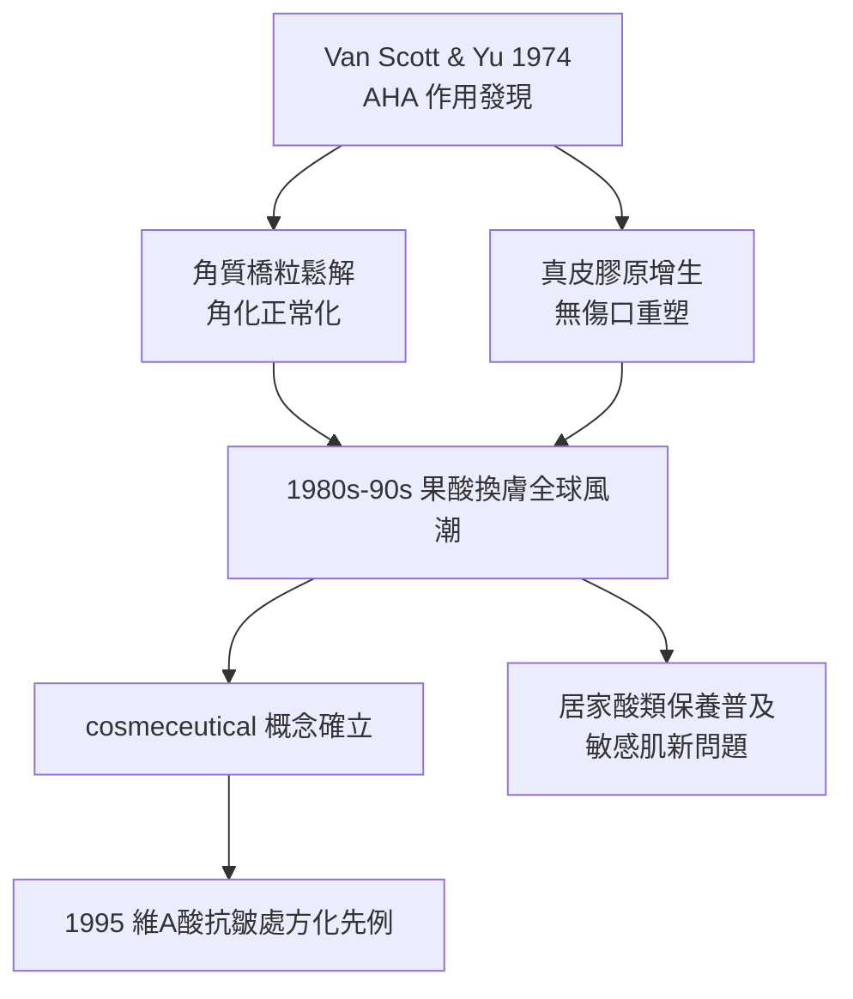

## 1974 - 果酸換膚革命（把廚房裡的水果酸，變成皮膚生物學的精確工具）

## 案件摘要

**本案的謎題：為什麼人類用酸燒皮膚用了兩千年（愛提烏斯的硝酸、羅馬的面皰酸液），直到 1974 年才算真正「發明」了換膚？**

1974 年，費城皮膚科教授 **Eugene Van Scott** 與生物化學家 **Ruey Yu（余瑞溶）**發表系列研究，證明**α-羥基酸（AHA，果酸）**——甘醇酸、乳酸——能在極低濃度、不燒灼的前提下改變皮膚角化與真皮結構，並申請專利、創立 Neostrata。果酸把「換膚」從**腐蝕學**變成**生物學**：不是把皮膚燒掉，而是調整皮膚代謝的時鐘。此案是「機能性化妝品（cosmeceutical）」概念的誕生現場。

## 前因 -- 為什麼會有這個案子

- **化學換膚的舊世界**：19–20 世紀主流換膚劑是石炭酸（phenol，深層但心臟毒性）、三氯醋酸（TCA）——本質全是**腐蝕燒灼**，深度即命運，過深即疤。
- **魚鱗病的科學線索**：Van Scott 研究魚鱗病（皮膚角化異常遺傳病）時注意到，AHA 能鬆散異常增厚的角質層——角質細胞間的**離子鍵與橋粒**依賴 pH 與鈣離子濃度。
- **「不燒灼的酸」的反直覺**：甘醇酸（分子量最小 76 Da）在 pH 3–4 時不產生凝固性壞死，卻持續引發生物反應——這在當時的皮膚科框架裡無法分類。
- **抗老需求的浮現**：戰後嬰兒潮世代進入 40 歲，「看起來年輕」的市場巨大，但除了外科拉皮與粗腐蝕換膚，別無溫和手段。

## 線索與推理 -- 數學式、程式、理論

**線索一：分子量—滲透—效力的三角關係。** AHA 效力的第一決定因素是分子量：

| AHA | 來源 | 分子量 (Da) | 特性 |
|---|---|---|---|
| 甘醇酸 | 甘蔗 | 76 | 滲透最深、刺激最大 |
| 乳酸 | 酸奶 | 90 | 溫和、具保濕（天然保濕因子成分） |
| 蘋果酸 | 蘋果 | 134 | 中等 |
| 檸檬酸 | 柑橘 | 192 | 最淺、抗氧化 |

$$ J_{penetration} \propto \frac{1}{\sqrt{MW}} \quad (\text{滲透通量與分子量平方根成反比}) $$

**線索二：pH 與游離度的生物學。** AHA 必須以**未解離的酸分子**形式穿透角質層，進入細胞後解離發揮作用。游離度由 Henderson–Hasselbalch 方程決定：

$$ \text{游離比例} = \frac{1}{1 + 10^{pK_a - pH}} $$

pH 越低，未解離分子越多、滲透越強、但刺激與燒灼風險越高。這就是果酸換膚的**核心參數三角**：濃度 × pH × 停留時間——三者共同決定「剝脫深度」與「生物調節」之間的位置。專業換膚用高濃度（30–70%）低 pH（<3.5）短時間接觸；居家保養品則受各國法規限制（如台灣化妝品 pH ≥ 3.5、濃度上限）。

```python
# 果酸換膚參數三角: 濃度/pH/時間的協同決策
def peel_intensity(conc, ph, minutes):
    un_dissociated = 1/(1+10**(3.83-ph))    # pKa(甘醇酸)≈3.83
    dose = conc/100 * un_dissociated * minutes
    if dose < 2:   return "居家級: 角質更新"
    elif dose < 8: return "專業淺層: 細紋/淺斑"
    else:          return "接近燒灼: 結痂風險"

for c, p, t in [(10,4.0,0), (50,3.0,5), (70,2.8,8)]:
    print(f"{c}% pH{p} {t}min →", peel_intensity(c,p,t))
```

**線索三：為何低濃度也能重塑真皮。** 連續使用 AHA 數月後，真皮膠原增生、黏多醣增加——機制是慢性溫和刺激激活角質細胞釋放細胞介質（IL-1α 等），間接驅動纖維母細胞。這是「**無傷口的重塑**」——與磨皮（`1905-克羅邁爾磨皮術.md`）的「有傷口的重塑」構成換膚光譜的兩端。



**線索四：監管的尷尬。** AHA 處於「化妝品與藥品之間」：改變皮膚結構＝藥效，但濃度低時又像保養品。FDA 1990 年代展開調查、各國設定濃度/pH 上限——**cosmeceutical（機能性化妝品）**這個 Kligman 造的詞，從此成為全球監管都無法乾脆分類的灰色地帶。

關鍵推論：果酸革命的實質是「**劑量—反應關係的細化**」：同樣的分子，透過濃度、pH、時間的控制，可以從去角質到真皮重塑連續調節。這是化妝品第一次獲得像藥物一樣的參數空間。

## 結案 -- 後果與影響

- **換膚的民主化**：從診所深層換膚到居家低濃度保養，酸類成為全球普及的抗老工具；「刷酸」文化至今不衰。
- **機能性化妝品產業確立**：Neostrata、隨後的 DHC、寶拉珍選等品牌建立「以成分與濃度說話」的新行銷語法。
- **科學的後續擴展**：β-羥基酸（水楊酸，親脂、入毛孔）、葡糖酸內酯（第二代、低刺激）、乳糖酸——AHA 家族樹持續生長。
- **風險與教育並進**：果酸術後光敏感（需配 SPF，見 `1962-SPF防曬係數誕生.md`）、過度刷酸的屏障受損，成為皮膚科新門診常客。
- **一句話結案**：果酸證明美麗可以被「代謝調節」而非「燒掉重建」——但調節的工具越精細，使用者的知識門檻就越高。

## 關鍵人物與文獻

- **Eugene Van Scott（1923–2015）**——費城皮膚科教授，魚鱗病與角化研究權威，AHA 醫學應用之父。
- **Ruey J. Yu（余瑞溶）**——生物化學家，Van Scott 的終身研究夥伴與 Neostrata 共同創辦人。
- **Van Scott, E.J. & Yu, R.J.**, "Control of keratinization with α-hydroxy acids and related compounds", *Archives of Dermatology* 110:586 (1974) 等系列。
- **Albert Kligman**——提出 cosmeceutical 一詞，並确立視黃酸與光老化理論。
- 延伸閱讀：`1905-克羅邁爾磨皮術.md`、`1938-防曬乳誕生.md`、`2004-飛梭雷射.md`
