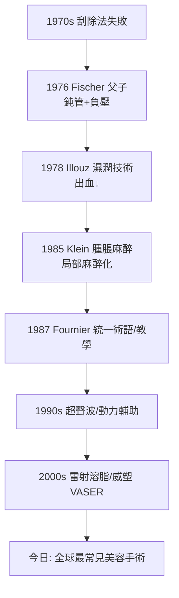

## 1976 - 抽脂誕生（用一根鈍管與負壓，向脂肪宣戰）

## 案件摘要

**本案的謎題：為什麼雕塑身體的手術，是由一對婦產科醫師父子在自家診所發明的？**

1976 年，義大利羅馬的婦產科醫師 **Arpad Fischer 與其子 Giorgio Fischer** 發表以**小切口插入鈍頭吸管、接負壓抽吸皮下脂肪**的技術——現代抽脂術（liposuction）的誕生。1978 年法國外科醫師 **Yves-Gérard Illouz** 改良出「濕潤技術」（先注射低張鹽水使脂肪細胞腫脹易碎）與鈍頭套管，大幅降低出血與神經損傷；1985 年美國皮膚科醫師 **Jeffrey Klein** 發明**腫脹麻醉（tumescent anesthesia）**，讓抽脂在局部麻醉下安全完成——抽脂從高風險手術變成全球最常見的美容手術之一。

## 前因 -- 為什麼會有這個案子

- **局部肥胖的治療真空**：節食與運動無法定位消除「腰間贅肉」；切皮手術（腹皮切除、大腿拉皮）創傷巨大且疤痕明顯。
- **刮除式先驅的失敗**：1970 年代歐洲醫師嘗試以子宮刮匙盲刮皮下脂肪，出血、神經損傷、皮膚壞死頻傳——**銳器是問題**。
- **婦產科的跨界視角**：Fischer 父子熟悉負壓吸引與小切口技術（人流吸引術），並質疑「脂肪必須切」的教條。
- **文化需求**：1970 年代西方審美轉向健美與束腰輪廓，中產階級願為「雕塑」付費。

## 線索與推理 -- 數學式、程式、理論

**線索一：鈍頭套管的物理學。** Fischer 與 Illouz 的核心洞察：脂肪葉是**疏鬆結締組織**中的脂肪細胞團，葉與葉之間有血管、淋巴與神經穿行。銳器切割所有結構（出血），鈍頭負壓管則**優先吸走機械強度最弱的脂肪葉、保留韌性結構**：

$$ \text{抽吸選擇性} = \frac{\text{脂肪葉可抽性}}{\text{血管/神經/纖維抗拉性}} \gg 1 $$

**線索二：Illouz 濕潤技術的化學。** 先注入低張鹽水（+透明質酸酶），脂肪細胞滲透性腫脹→細胞膜破裂→脂肪易於吸出，且液體墊層保護深層結構：

```python
# 濕潤技術 vs 乾式抽脂的出血量對比 (文獻量級)
dry   = {"出血占抽吸量%": 40}          # 干式: 出血可達抽出量的40%
wet   = {"出血占抽吸量%": 15}          # Illouz 濕潤技術
tumescent = {"出血占抽吸量%": 1}       # Klein 腫脹麻醉
for name, d in [("乾式", dry), ("濕潤", wet), ("腫脹", tumescent)]:
    print(name, d)
# 腫脹液: 大量稀釋利多卡因(濃度0.05-0.1%) + 腎上腺素
# 利多卡因極量從 7mg/kg 提升至 35mg/kg — 為何安全?
```

**線索三：Klein 腫脹麻醉的安全推理。** 大劑量利多卡因理論上致命（血液中毒濃度約 5 μg/mL），但 Klein 證明：腫脹液的利多卡因 (1) 高度稀釋並局限於脂肪層；(2) 脂肪組織灌注率極低，吸收緩慢（峰值在 12–18 小時後）；(3) 腎上腺素收縮血管進一步減緩吸收。血漿濃度曲線被「壓扁」：

$$ C_{peak} \approx \frac{Dose}{V_{dist}} \times \frac{1}{1 + k_{slow}t} \ll C_{toxic} $$

這是**藥代動力學直接改寫手術安全邊際**的教科書案例。



**線索四：抽脂不能治肥胖的數學。** 成年人脂肪細胞數量約恆定（$ 3\times10^{10} $），抽脂**移除細胞**而非「縮小」細胞——這是它對局部脂肪有效的原因。但若術後體重上升，剩餘脂肪細胞仍會肥大、且脂肪會異位沉積（內臟脂肪↑）。抽脂重塑的是**輪廓分配**，不是代謝健康——2004 年新英格蘭醫學期刊的研究顯示抽脂不改變胰島素敏感性等代謝指標。

關鍵推論：抽脂的成功在於三重工程妥協——鈍器（保護結構）、液體墊（物理隔離）、緩釋麻醉（化學緩衝）。而它的邊界（不能治肥胖）則是脂肪生物學決定的。

## 結案 -- 後果與影響

- **最常見的美容手術**：抽脂長期位居全球美容手術量前二；腫脹麻醉技術外溢到所有大範圍脂肪手術。
- **技術樹分岔**：超聲輔助（VASER 選擇性乳化脂肪）、動力輔助、雷射溶脂——皆為「如何更選擇性地破壞脂肪」的延續，與雷射的選擇性光熱解（`1983-選擇性光熱解理論.md`）思想同源。
- **脂肪的新身分**：抽出的脂肪從廢棄物變成**自體填充材料**（自體脂肪移植，Coleman 技術 1980s–90s），再進一步成為間質血管 fraction（SVF）與幹細胞研究的來源（見 `2013-PLT吸血鬼面膜.md`）。
- **風險常態化**：脂肪栓塞（尤其肺與腦）仍是抽脂最致命的併發症，推動大容量抽脂的規範與多層次抽脂技術（保留淺層脂肪）。
- **一句話結案**：抽脂證明身體輪廓可以被機械工程改寫——但它改寫的是地圖的分配，不是地圖的總面積。

## 關鍵人物與文獻

- **Arpad & Giorgio Fischer**——1976 年發表鈍頭負壓抽脂術的羅馬婦產科醫師父子。
- **Yves-Gérard Illouz（1929–2021）**——法國外科醫師，濕潤技術與抽脂標準化的推手。
- **Jeffrey Klein（1950–）**——美國皮膚科醫師，1985 年發表腫脹麻醉（tumescent technique）。
- **Illouz, Y.G.**, "Body contouring by lipolysis: a 5-year experience", *Plastic and Reconstructive Surgery* 72:591 (1983)。
- **Klein, J.A.**, "The tumescent technique for liposuction surgery", *American Journal of Cosmetic Surgery* 4:263 (1987)。
- 延伸閱讀：`1983-選擇性光熱解理論.md`、`2013-PLT吸血鬼面膜.md`
