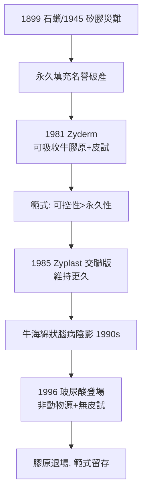

## 1981 - 膠原蛋白填充劑 Zyderm（第一個被監管核准的美容填充劑）

## 案件摘要

**本案的謎題：石蠟與矽膠慘案之後，醫學界靠什麼材料才敢重新打開注射器？答案是——借用身體自己的建材。**

1981 年 12 月，美國 FDA 核准 **Zyderm Collagen Implant**——由史丹佛大學免疫學家研究衍生、Collagen Corporation（加州 Palo Alto）生產的**牛第一型膠原蛋白注射劑**，成為史上第一個通過正式監管審查的美容填充劑。它證明了填充劑可以「可吸收、可預測、可退場」：效果維持 3–6 個月後自然降解。短效是它的弱點，也是它通過審查的理由——**永久性讓位給可控性**，這是石蠟案（`1899-石蠟注射悲劇.md`）四十年的教訓換來的範式轉移。

## 前因 -- 為什麼會有這個案子

- **兩場災難的陰影**：石蠟瘤與矽膠肉芽腫（見 `1945-矽膠注射時代.md`）讓「永久注射填充」在醫學界名譽破產；監管機關對任何不可取出的注射材料高度戒備。
- **膠原生物學的成熟**：1970 年代，膠原蛋白的一級結構（甘氨酸-X-Y 三股螺旋）、交聯與降解酶（膠原酶）已被闡明；膠原作為手術縫線與止血劑已有安全紀錄。
- **史丹佛的技術源頭**：1970 年代末，史丹佛研究團隊（Robert Knapp 等參與的泌尿科/皮膚科合作）開發出以胃蛋白酶消化牛膠原、純化出低免疫原性的 atelocollagen（去除端肽）技術。
- **市場等待**：臉部皺紋填充需求龐大，而自體脂肪移植存活不穩定。

## 線索與推理 -- 數學式、程式、理論

**線索一：免疫學的攻防。** 牛膠原與人膠原同源性高，但端肽（telopeptide）區域含異種抗原。解法：胃蛋白酶切除端肽 → atelocollagen。即便如此，仍需**術前皮試**（4 週前臂皮內注射觀察），因為約 1–3% 受試者呈陽性（IgG 抗牛膠原反應），極少數引發嚴重過敏。這是填充劑史上第一次把**免疫篩檢寫進標準流程**。

$$ \text{過敏風險} \propto \text{異種端肽暴露} \xrightarrow{\text{胃蛋白酶切除}} \text{風險下降但不清零} $$

**線索二：為什麼只能撐 3–6 個月。** 注入的膠原被宿主的 MMP（基質金屬蛋白酶）逐步降解，且注射物本身含大量水分（Zyderm 約 95% 水），注入後體積立即縮水約 30%——**過度矯正（overcorrection）100–150%** 成為必要技術。填充的維持時間取決於：

$$ t_{last} \sim \frac{V_{injected} \times \text{降解抗性}}{\text{MMP 活性} + \text{機械壓縮流失}} $$

**線索三：短效的辯證。** Zyderm 的可降解性原本被視為缺陷，卻成為它最大的安全論據：

```python
# 填充劑風險矩陣: 持續時間 vs 併發症嚴重度
fillers = {
    "石蠟":   {"持續": "永久", "取出": False, "肉芽腫風險": "高"},
    "液態矽膠": {"持續": "永久", "取出": False, "肉芽腫風險": "高"},
    "Zyderm": {"持續": "3-6月", "取出": "自行降解", "肉芽腫風險": "低"},
}
# 結論: 可降解 → 錯誤會自己消失 → 監管可核准
```



**線索四：退場的方式也很重要。** Zyderm 在 1990 年代後期因兩個因素衰落：(1) 歐洲狂牛症（BSE）恐慌使牛源材料承壓；(2) 1996 年起的玻尿酸（`1996-玻尿酸填充登場.md`）無需皮試、效果相當。但 Zyderm 確立的框架——**皮試/篩檢、過度矯正、劑量分次、可降解優先**——全部被後繼者繼承。

關鍵推論：Zyderm 的歷史角色不是「最好的填充劑」，而是**監管與醫學重新信任注射填充的破冰船**。它把填充劑從「醫師的黑箱手藝」變成「有專利、有批號、有禁忌症、有追蹤」的正式醫療產品。

## 結案 -- 後果與影響

- **填充醫學的監管起點**：Zyderm 之後，填充劑按醫療器材（美國 class III→III/II 分類）審查，長期安全性數據成為上市條件。
- **「過度矯正」與注射解剖學的建立**：層次、劑量、按壓塑形的手法知識體系由此累積。
- **交聯技術的先聲**：Zyplast（戊二醛交聯）證明化學交聯可延長維持時間——此技術被玻尿酸的 BDDE 交聯（Restylane/Juvederm）直接繼承。
- **過敏篩檢文化的正反面**：皮試降低風險但也製造就診摩擦；玻尿酸「免皮試」成為市場勝負手——安全便利化持續壓縮安全程序，這是值得警惕的張力。
- **一句話結案**：醫學重新接受注射填充，靠的不是找到完美材料，而是找到「會自己消失」的材料——可控性第一次戰勝了永久性。

## 關鍵人物與文獻

- **Collagen Corporation**——Zyderm/Zyplast 的開發與生產者（Palo Alto, 加州）。
- **Stegman, S.J.、Tromovitch, T.**——舊金山皮膚外科醫師，膠原填充臨床技術的早期權威與教科書作者。
- **Knapp, T.R. et al.**, "Injectable collagen for soft tissue augmentation", *Plastic and Reconstructive Surgery*（1970s 末技術文獻）。
- **FDA**——1981 年 12 月核准 Zyderm I 的審查文件（PMA 歷史）。
- 延伸閱讀：`1899-石蠟注射悲劇.md`、`1945-矽膠注射時代.md`、`1996-玻尿酸填充登場.md`
