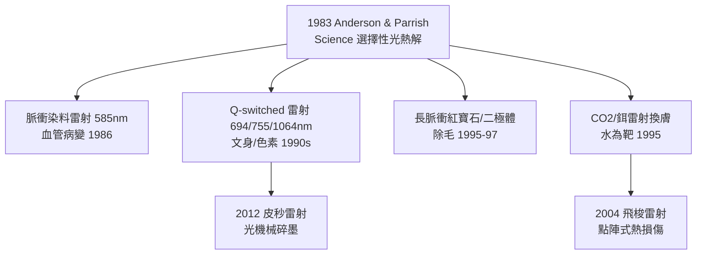

## 1983 - 選擇性光熱解理論（一篇 Science 論文，把雷射變成微米級手術刀）

## 案件摘要

**本案偵破的不是一場手術，而是一條方程式：如何讓光只殺死想要的目標、卻不碰傷旁邊的組織？**

1983 年 5 月，哈佛醫學院/麻省總醫院的 **Rox Anderson 與 John Parrish** 在《Science》發表〈Selective photothermolysis: precise microsurgery by selective absorption of pulsed radiation〉，提出**選擇性光熱解（Selective Photothermolysis）**理論：若雷射的 (1) 波長對準目標的吸收峰、(2) 脈衝寬度短於目標的熱弛豫時間、(3) 能量足夠達到目標損傷閾值，就能在不傷周圍組織的前提下精準破壞目標。這篇論文是現代皮膚雷射的憲法——此後的除毛雷射、血管雷射、色素雷射、換膚雷射、飛梭雷射，全部是這條方程式的應用題。

## 前因 -- 為什麼會有這個案子

- **連續波雷射的失敗**：1960 年代起，氬雷射（波長 488/514 nm）被用於燒灼血管瘤與文身，但連續波輸出缺乏時間控制，熱量四溢——效果與疤痕並存，雷射皮膚科幾乎被視為蠻荒。
- **皮膚光學的空白**：當時沒有系統性的「皮膚裡誰吸收什麼光譜」資料——Anderson 親自測定了黑色素、血紅素與水分的吸收光譜。
- **目標色基的清單**：皮膚的三個主要內源性色基（chromophore）——黑色素（表皮）、氧合/去氧血紅素（血管）、水（真皮基質）——各自有特徵吸收峰；外加文身墨粒為第四類。

## 線索與推理 -- 數學式、程式、理論

**線索一：理論三條件的數學表述。**

1. **波長選擇**：$ \mu_a^{target}(\lambda) \gg \mu_a^{surrounding}(\lambda) $（目標吸收係數遠大於周圍）
2. **脈衝時間**：

$$ \tau_{pulse} \leq t_r = \frac{d^2}{4\alpha} $$

其中 $ t_r $ 為目標的**熱弛豫時間**（target 的熱量降到一半所需時間）、$ d $ 為目標直徑、$ \alpha \approx 1.4\times10^{-7} \ \mathrm{m^2/s} $ 為組織熱擴散率。

3. **能量**：$ F_0 > F_{damage}^{target} $（達到損傷閾值）且 $ F_0 < F_{damage}^{surrounding} $。

**線索二：算出來的處方。** 以除毛為例：毛囊直徑約 200–300 μm：

```python
# 熱弛豫時間 = d²/(4α): 目標越大, 需要的脈衝越長
alpha = 1.4e-7  # m²/s 組織熱擴散率
targets = {"微血管": 50e-6, "毛囊": 250e-6, "黑素體": 1e-6, "整層真皮水": 200e-6}
for name, d in targets.items():
    tr = d**2/(4*alpha)
    print(f"{name}: 直徑 {d*1e6:.0f} μm → 熱弛豫 {tr*1000:.2f} ms")
# 黑素體 ~0.002 ms → 皮秒/奈秒雷射
# 微血管 ~0.4 ms → 脈衝染料雷射 ~0.45-1.5 ms
# 毛囊 ~11 ms → 除毛雷射 10-100 ms
```

對照臨床事實：脈衝染料雷射（PDL，治療鮮紅斑痣）脈衝 0.45 ms；除毛雷射 10–100 ms；Q-switched 雷射打碎墨粒用奈秒——**理論直接預測了所有機器的參數**，這是醫學史上罕見的「方程式先於手術」。

**線索三：1983 年的兩頁論文如何變成產業。**



**線索四：為何此文是「醫美的物理學革命」。** 在此之前，所有皮膚治療是**經驗試錯**（磨皮、酸蝕、連續波雷射）；選擇性光熱解第一次提供**從目標解剖學反推機器參數**的正向設計方法。皮膚雷射從此成為「工程科學」：皮膚科醫師必須懂波長、脈寬、冷卻、密度四個旋鈕。

關鍵推論：選擇性光熱解的本質是把「傷害」數學化為三個獨立可控的變數。凡是能找到色基、量出尺寸、控制脈寬的目標，都能被光精準手術——凡是做不到的（如無色靶、深層脂肪），就要另尋他法（射頻、超聲）。這條邊界至今仍劃分著醫美技術的版圖。

## 結案 -- 後果與影響

- **數百億美元的雷射醫美產業**：除毛、去斑、血管、換膚、文身去除——全部立於 1983 年的理論之上。
- **文身去除的終極解**：Q-switched 與皮秒雷射實現了愛提烏斯（`0500-愛提烏斯與文身去除.md`）以來 1453 年的夢想——只打墨、不傷皮。
- **飛梭雷射的直接父親**：2004 年 Manstein/Anderson 再度出手，把選擇性光熱解從「點目標」推廣到「點陣微熱損傷區」（MTZ），發明點陣雷射。
- **安全文化**：理論同時定義了風險（波長/脈寬選錯即傷害擴散），推動雷射操作員的專業認證制度。
- **一句話結案**：1983 年之後，「能不能用雷射」不再是問題，「替它算出三個參數」才是問題——美容外科從此有了物理學。

## 關鍵人物與文獻

- **R. Rox Anderson**——麻省總醫院 Wellman 光醫學中心主任，選擇性光熱解與飛梭雷射的提出者；皮膚雷射時代的總設計師。
- **John A. Parrish（1936–）**——哈佛皮膚科教授，光生物學先驅，Wellman 中心創辦人。
- **Anderson, R.R. & Parrish, J.A.**, "Selective photothermolysis: precise microsurgery by selective absorption of pulsed radiation", *Science* 220:524–527 (1983)。
- **Manstein, D. et al.**, "Fractional photothermolysis: a new concept for cutaneous remodeling", *Lasers in Surgery and Medicine* 34:426 (2004)。
- 延伸閱讀：`0500-愛提烏斯與文身去除.md`、`1905-克羅邁爾磨皮術.md`、`1993-脈衝光IPL.md`、`2004-飛梭雷射.md`
