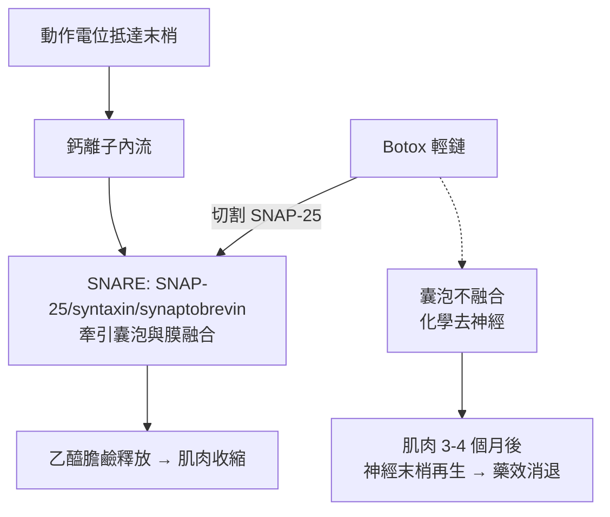

## 1989 - 肉毒桿菌素醫美化（從殺人毒素到全球銷量第一的美容針）

## 案件摘要

**本案的謎題：一種能癱瘓呼吸肌、致死量以奈克計的神經毒素，怎麼會成為二十一世紀最暢銷的美容治療？**

1989 年 12 月，美國 FDA 核准 **A 型肉毒桿菌毒素（onabotulinumtoxinA，Botox）**用於治療斜視與眼瞼痙攣——這是毒素正式進入臨床的時刻。它在皮膚科的意外收穫（注射眼瞼痙攣患者的眉間皺紋消失）被眼科醫師 **Carruthers 夫婦**系統性研究，2002 年 4 月 FDA 核准 Botox Cosmetic 用於**眉間紋**——肉毒桿菌素從此成為「微整形的鋼筆」，全球非手術醫美用量長期第一。

## 前因 -- 為什麼會有這個案子

- **毒素的科學解密**：1895 年比利時 van Ermengem 從火腿中毒事件分離出肉毒桿菌；20 世紀中葉闡明其機制——毒素切斷 SNARE 蛋白，阻斷乙醯膽鹼釋放。
- **戰爭與解毒劑的推手**：二戰與冷戰期間肉毒毒素被列為生物戰劑，美國政府因此累積了**純化與定量**技術（Ed Schantz 團隊），並催生解毒劑與疫苗研究——民用醫療用毒素直接繼承了這批技術資產。
- **Alan B. Scott 的眼科手術**：1970 年代，舊金山眼科醫師 Scott 為避免斜視手術反覆失敗，嘗試以小劑量毒素**化學去神經**眼外肌——把最毒的東西變成最精準的肌肉劑量計。Oculinum 公司（後被 Allergan 收購）誕生。
- **美容需求的接點**：皺紋的動態性質（表情肌反覆收縮摺出紋路）在當時只有手術拉皮可治。

## 線索與推理 -- 數學式、程式、理論

**線索一：神經肌肉接頭的作用機制。** 肉毒毒素是雙鏈蛋白：重鏈（H）結合神經末梢受體並介導內吞，輕鏈（L，鋅依賴性內肽酶）進入胞漿後**定點切割 SNARE 蛋白**：

$$ \text{A 型毒素} \rightarrow \text{切斷 SNAP-25} \;\Rightarrow\; \text{SNARE 複合體無法組裝} \;\Rightarrow\; \text{囊泡不融合} \;\Rightarrow\; \text{乙醯膽鹼釋放} \to 0 $$



關鍵細節：效果持續 3–4 個月，是因為被切斷的 SNAP-25 不可逆失活，但神經末梢會**軸突側支再生**（sprouting）並重建接頭——「可逆的化學去神經」正是它適合醫美的原因。

**線索二：劑量的恐怖與安全的數學。** Botox 一瓶 100 U 約含 0.3 ng 蛋白質；人體半數致死量約 2,500–3,000 U（靜脈/肌肉）。美容劑量眉間 20 U：

$$ \frac{\text{美容劑量}}{\text{致死劑量}} \approx \frac{20}{3000} \approx \frac{1}{150} $$

加上局部注射的局限分布，實際安全裕度更大。但**劑量單位（U）是生物檢定而非質量**——各品牌單位不可互換，換算錯誤曾造成嚴重全身性中毒（2004 年不當使用超純毒素 botulinum toxin A 的醫療事故）。

**線索三：發現的路徑是典型的「副作用偵探學」。** 1987 年，溫哥華眼科醫師 Jean 與 Alastair Carruthers 治療眼瞼痙攣時，患者抱怨/稱讚「眉間不皺了」。他們沒有把它當噪音，而是當成訊號：1992 年發表首篇美容用途研究。這是醫學上「**適應症從副作用中生長**」的又一例（同型案例：威而鋼、米諾地爾）。

```python
# 動態紋 vs 靜態紋: 為什麼肉毒只對一半的皺紋有效
wrinkles = {
    "抬頭紋":  {"類型": "動態", "表情肌": "額肌",   "肉毒有效": True},
    "眉間紋":  {"類型": "動態", "表情肌": "皺眉肌", "肉毒有效": True},
    "魚尾紋":  {"類型": "動態", "表情肌": "眼輪匝肌", "肉毒有效": True},
    "法令紋":  {"類型": "混合/靜態", "成因": "韌帶+容積流失", "肉毒有效": "部分"},
    "頸紋":    {"類型": "靜態", "成因": "真皮老化+體位", "肉毒有效": False},
}
# 治療邏輯: 動態紋→肉毒; 容積缺損→填充; 皮肤質地→雷射/換膚
```

關鍵推論：肉毒桿菌素把「皺紋」重新分類為**肌肉問題**——這是皺紋病因學的分水嶺。從此臉部老化被拆解為四軸：肌肉（肉毒）、容積（填充）、皮膚質地（雷射/換膚）、鬆弛（手術/拉提）。現代醫美的「聯合治療方案」邏輯由 1989–2002 年的肉毒時代確立。

## 結案 -- 後果與影響

- **微整形時代的開端**：無刀、15 分鐘、無恢復期——肉毒把醫美從「手術」重新定義為「門診程序」，普及率指數增長。
- **適應症持續擴張**：多汗症（2004）、偏頭痛（2010）、膀朓過動、斜頸——毒素成為跨科神經調節藥物。
- **黑色市場與稀釋災難**：合法產品的高價催生偽藥與「醫美團購針劑」，偽劣毒素中毒案例持續出現——生物製劑的供應鏈安全成為新議題。
- **「冷臉」美學辯論**：表情凍結引發關於自然美的文化爭論，並反過來推動「微劑量」（Baby Botox）技術。
- **一句話結案**：人類最強的毒素變成最常用的美容藥，靠的是劑量數學與作用機制的完全透明——毒物學的終點是工程學。

## 關鍵人物與文獻

- **Alan B. Scott**——美國眼科醫師，肉毒毒素醫療用途（Oculinum）的發明人。
- **Jean & Alastair Carruthers**——溫哥華皮膚科/眼科夫婦，肉毒美容用途的發現與研究者。
- **Ed Schantz**——美國軍方科學家，毒素純化與臨床級製備的奠基者。
- **Carruthers, J.D.A. & Carruthers, J.A.**, "Treatment of glabellar frown lines with C. botulinum-A exotoxin", *Journal of Dermatologic Surgery and Oncology* 18:17 (1992)。
- **FDA**——1989 年核准 Botox（斜視/眼瞼痙攣）；2002 年核准 Botox Cosmetic（眉間紋）。
- 延伸閱讀：`2002-肉毒桿菌素美容核准.md`、`1899-石蠟注射悲劇.md`
