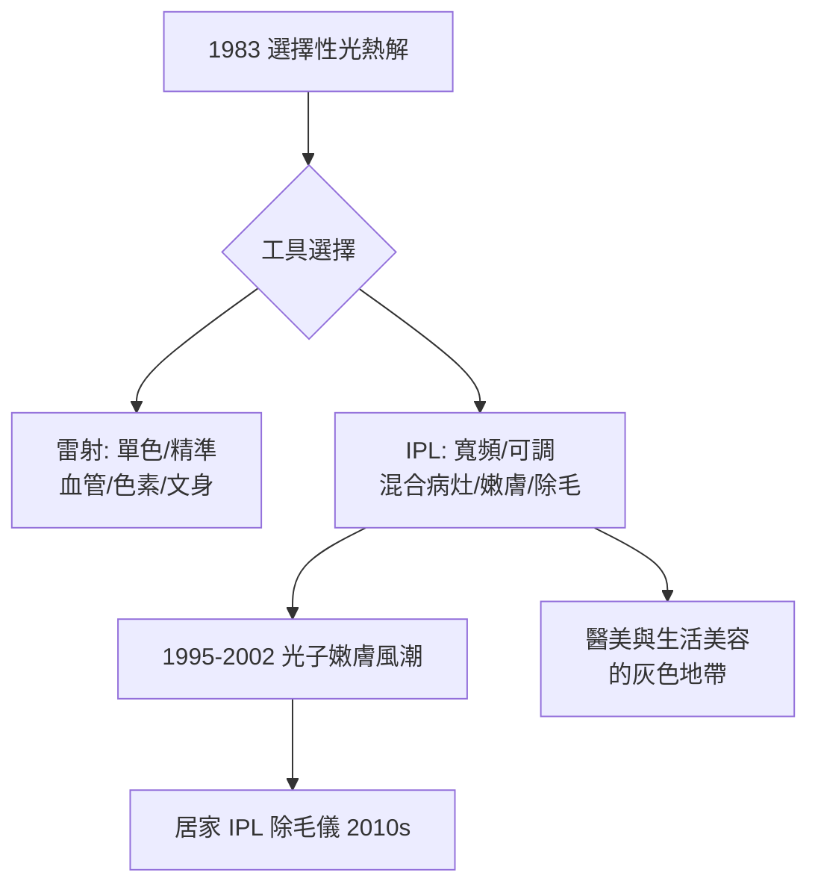

## 1993 - 脈衝光 IPL（不叫雷射的光：寬頻光源如何闖進醫學）

## 案件摘要

**本案的謎題：雷射的精確是它的美德，那麼「不精確的光」憑什麼也成為治療工具？**

1990 年代初，以色列 ESC Medical（後 Lumenis）工程師 **Shimon Eckhouse 與 Moshe Adler** 開發出**脈衝強光（Intense Pulsed Light, IPL）**裝置 PhotoDerm，並於 1993 年前後進入臨床：以氙氣閃光燈產生 500–1200 nm 的寬頻非相干光，用濾光片切出所需波段，治療血管病變與色素。IPL 不是雷射——單色性、相干性、方向性皆無——卻以「**可調濾波的寬頻**」與「**大光斑**」開創了低門檻的光療市場，並衍生出光子嫩膚（photorejuvenation）、居家除毛儀等巨大產業。

## 前因 -- 為什麼會有這個案子

- **選擇性光熱解的理論紅利**：1983 年理論（`1983-選擇性光熱解理論.md`）確立後，人人知道要「對準色基選波長」——但雷射機昂貴、單一雷射只有單一波長，一台機器只能治一種病。
- **氙氣閃光燈的工業成熟**：攝影閃光燈技術廉價、能量高、脈寬可調（毫秒級）——剛好落在血管與毛囊的熱弛豫時間範圍。
- **皮膚科醫師的痛點**：鮮紅斑痣、微血管擴張、色素斑常**混合存在**，需要多台雷射；一台可調光譜的機器是臨床經濟學的解。
- **監管的新問題**：非雷射的強光治療儀該怎麼管？美國 FDA 以「electronic product radiation」框架納管，各國陸續將 IPL 定位為醫療器材。

## 線索與推理 -- 數學式、程式、理論

**線索一：IPL 的光譜工程。** 氙燈原始光譜從紫外到紅外連續分布。治療血管時要 500–600 nm（血紅素吸收帶），需濾掉短波（燙傷表皮的風險）與長波（無效加熱）：

$$ E_{effective}(\lambda_{min}, \lambda_{max}) = \int_{\lambda_{min}}^{\lambda_{max}} I(\lambda) \, \mu_a^{target}(\lambda) \, d\lambda $$

```python
# IPL 濾光片選擇的邏輯 (簡化模型)
targets = {
    "血管":   {"band": (530, 650), "邏輯": "血紅素吸收峰"},
    "表淺色素": {"band": (560, 950), "邏輯": "黑色素寬吸收, 長波保表皮"},
    "除毛":   {"band": (650, 1200), "邏輯": "避開表皮黑色素, 深達毛囊"},
}
for t, p in targets.items():
    print(f"{t}: 濾片下限 {p['band'][0]} nm — 短波(<530)殺表皮, 故切除")
```

**線索二：寬頻的缺點與意外的優點。** 寬頻＝低選擇性：每個波長只有一部分落在吸收峰，效能低於雷射（需多次療程）；但**多重波長同時作用多種色基**，反而適合「混合病灶」與「全面改善」——1990 年代末 Bitter 發表的「photorejuvenation」（光子嫩膚）系列論文顯示 IPL 能同時改善色斑、微血管、毛孔與質地。**不精確成了全面性的來源**。

**線索三：熱弛豫時間同樣適用。** IPL 沒有逃脫 Anderson 方程——它的脈寬（2.5–100 ms 可調）與脈衝串技術（multi-pulsing：中間夾冷卻）正是為了控制在毛囊與血管的熱弛豫區間內、讓表皮降溫：



**線索四：監管灰色的代價。** IPL 相對低價、易操作，大量流入生活美容院甚至家庭——灼傷、反黑（PIH）、除毛不當案例成為皮膚科新病源。本案的結案註記：**技術的理論門檻降低時，操作者資質成為新的風險瓶頸**——雷射時代建立的「波長三參數」知識，在 IPL 上被壓縮成「按膚色選檔」，專業判斷被介面化，事故隨之而來。

關鍵推論：IPL 的歷史角色是把選擇性光熱解**從雷射專利戰場上解放出來**，以工程妥協換取普及。醫學光療自此分裂為「高階雷射」與「大眾 IPL」兩層市場——這個分層結構正是今日醫美產業的骨架之一。

## 結案 -- 後果與影響

- **光子嫩膚成為醫美入門級療程**：與果酸、肉毒並列「午餐時間醫美」三巨頭。
- **居家光療產業**：飛利浦 Lumea、博朗等家用 IPL 除毛儀成為消費電子新類目——醫療技術的家庭化首例。
- **強脈衝光監管明確化**：各國將醫用 IPL 列入醫療器材管理，家用版則以消費品安全標準另軌管理。
- **一句話結案**：IPL 證明治療效果的門檻不是「更精確的光」，而是「被正確使用的光」——而後者最難工程化。

## 關鍵人物與文獻

- **Shimon Eckhouse**——以色列工程師，PhotoDerm IPL 發明者，Lumenis 前身 ESC Medical 創辦人。
- **Patrick Bitter Jr.**——加州皮膚科醫師，2000 年前後發表 photorejuvenation（光子嫩膚）定義性研究。
- **Goldberg, D.J. & Cutler, K.B.**——IPL 臨床研究的早期系統評估者。
- **Bitter, P.H.**, "Noninvasive rejuvenation of photodamaged skin using serial, full-face intense pulsed light treatments", *Dermatologic Surgery* 26:835 (2000)。
- 延伸閱讀：`1983-選擇性光熱解理論.md`、`2004-飛梭雷射.md`
