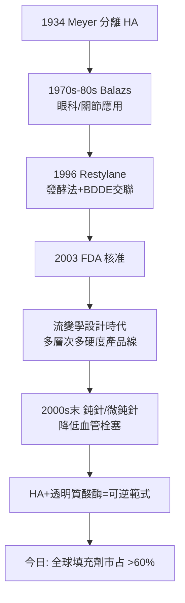

## 1996 - 玻尿酸填充登場（Restylane：從雞冠到細菌發酵，一種糖的勝利）

## 案件摘要

**本案的謎題：膠原蛋白花了二十年建立的填充帝國，為什麼被一種「本來就存在你皮膚裡的糖」在十年內推翻？**

1996 年，瑞典 Q-Med 公司推出 **Restylane**——以**鏈球菌發酵法**生產的非動物源**玻尿酸（hyaluronic acid, HA）**注射凝膠，獲歐盟 CE 認證並進入臨床；2003 年 12 月 FDA 核准 Restylane 用於鼻唇溝填充。玻尿酸以「免皮試、同種性、可酶解、可交聯調控」四項優勢，在十年內取代膠原蛋白成為全球市占率第一的填充劑，並開創了以**流變學**設計填充產品的新時代。

## 前因 -- 為什麼會有這個案子

- **玻尿酸的科學史**：1934 年 Karl Meyer 與 John Palmer 從牛眼玻璃體分離出此物，命名自「玻璃狀（hyaloid）＋尿酸（uronic）」。它是所有結締組織細胞外基質的成分，每個分子是重複的雙醣單位（葡萄糖醛酸 + N-乙醯葡萄糖胺）。
- **醫療應用的先行者**：1970–80 年代 Endre Balazs 開發雞冠來源玻尿酸用於眼科手術（黏彈性手術）與關節注射——安全性資料雄厚。
- **膠原蛋白的阿基里斯腱**：Zyderm 需皮試、有過敏風險、動物源頭（牛）在 1990 年代狂牛症恐慌中承壓（`1981-膠原蛋白填充劑Zyderm.md`）。
- **Q-Med 的工程選擇**：以非動物源發酵生產 + 交聯成凝膠（NASHA 技術），一次解決過敏、來源、維持時間三個問題。

## 線索與推理 -- 數學式、程式、理論

**線索一：玻尿酸的分子性質是它成功的全部密碼。**

| 性質 | 化學/生物基礎 | 臨床意義 |
|---|---|---|
| 同種性 | 所有脊椎動物的 HA 序列完全相同 | 無異種免疫 → 免皮試 |
| 親水膠體 | 每個雙醣結合大量水分子 | 天然「保水填充」 |
| 可酶解 | 透明質酸酶（hyaluronidase）快速降解 | **可急救/可逆** |
| 可化學修飾 | 羥基可被 BDDE 交聯 | 凝膠硬度/維持時間可設計 |

$$ \text{HA 注入後的命運}： t_{1/2}^{native} \approx 1{-}2 \ \text{天} \xrightarrow{\text{交聯}} t_{1/2}^{gel} \approx 6{-}18 \ \text{月} $$

天然玻尿酸在組織中的半衰期只有一兩天（被透明質酸酶與氧化途徑降解）；交聯是把「糖的流動」改造成「凝膠的形狀」。

**線索二：流變學成為填充劑的設計語言。** 2000 年代起，Pierre-Nicolas Stagni、Bertrand Kavouni 等推動以兩個參數描述填充劑：**儲存模量 $ G' $**（彈性，抵抗變形的能力）與**損耗模量 $ G'' $**（黏性，耗散能量的能力）：

```python
# 填充劑的流變學處方: 不同部位需要不同 G'
fillers = {
    "頰部支撐": {"G'": "高 (500-700 Pa)", "理由": "對抗深層壓力, 提供輪廓"},
    "唇部塑形": {"G'": "中, 且高內聚性", "理由": "柔軟自然, 不成硬塊"},
    "淺紋修飾": {"G'": "低", "理由": "順服皮膚運動, 不凸起"},
}
# G' 太高→摸得出硬塊; 太低→被壓扁無效
# 交聯度/濃度/顆粒大小 三參數共同決定 G'
```

這把填充劑從「一種產品」變成「一族可調參數的材料」——與選擇性光熱解（`1983-選擇性光熱解理論.md`）對雷射做的事完全同構：**把藝術變成工程**。

**線索三：可逆性作為安全範式。** 玻尿酸可被透明質酸酶數小時內溶解——這是填充劑史上第一次擁有「解毒劑」。血管栓塞（填充最可怕的併發症，可致皮膚壞死甚至失明）因此有了急救手段：



**線索四：膠原的敗因分析。** 膠原蛋白輸掉的三個回合：皮試（就診摩擦）、牛源恐慌（1996–2000 狂牛症）、以及玻尿酸的「可逆+多樣化」組合拳。但膠原留下了重要遺產——**交聯技術、過度矯正法則與監管路徑**全部被 HA 繼承。

關鍵推論：玻尿酸的勝利證明填充劑的終極設計目標不是「永久」，而是「**可控 + 可逆 + 可調**」——與 Zyderm 開啟的範式一脈相承，只是把可控性推到了極致。

## 結案 -- 後果與影響

- **填充劑成為全球第二大醫美治療**（僅次於肉毒）；玻尿酸占填充市場逾半。
- **解剖學黃金時代**：填充的血管栓塞風險推動了面部血管解剖的精細測繪（層次、危險區、鈍針技術）——美容需求反哺基礎解剖學。
- **可逆文化的雙面性**：透明質酸酶讓「後悔有藥醫」，但也讓治療門檻降低、過度填充（「填充臉」）氾濫。
- **中國與韓國市場的崛起**：發酵法生產門檻使中國（華熙、愛美客）成為玻尿酸原料大國——醫美產業的東亞重心由此奠定。
- **一句話結案**：最好的填充材料不是最像人體的異體組織，而是人體本來就有、只是放多一點的糖—— plus 一把隨時能收回來的鑰匙。

## 關鍵人物與文獻

- **Karl Meyer（1899–1990）**——哥倫比亞大學生物化學家，1934 年發現玻尿酸。
- **Endre A. Balazs（1920–2015）**——玻尿酸醫療應用之父，黏彈性手術（viscosurgery）概念提出者。
- **Q-Med AB（瑞典 Uppsala）**——Restylane 與 NASHA 技術開發商；2007 年被 Galderma 收購。
- **Pierre-Nicolas Stagni**——推動填充劑流變學標準化（G'、G''）的關鍵人物。
- **FDA**——2003 年 12 月核准 Restylane（第一個 FDA 核准的非動物源穩定 HA 填充劑）。
- 延伸閱讀：`1981-膠原蛋白填充劑Zyderm.md`、`1899-石蠟注射悲劇.md`、`2002-肉毒桿菌素美容核准.md`
