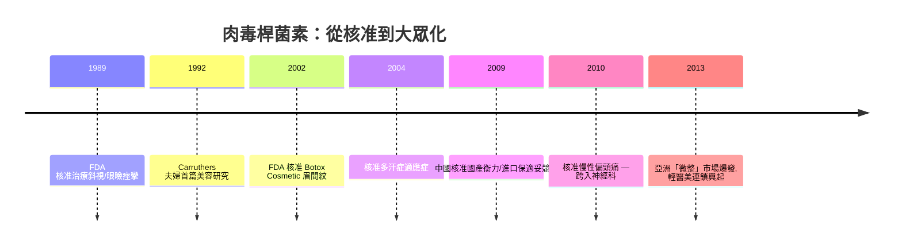

## 2002 - 肉毒桿菌素美容核准（一針 20 單位，把醫美推向大眾時代）

## 案件摘要

**本案的謎題：為什麼一張 2002 年 4 月的 FDA 核准函，改變的不只是一種藥的適應症，而是整個醫療行業的經營結構？**

2002 年 4 月 15 日，美國 FDA 正式核准 **Botox Cosmetic（onabotulinumtoxinA）**用於改善**眉間紋**——肉毒桿菌素的美容用途從「off-label 灰色地帶」轉為法定適應症。此前的 13 年（`1989-肉毒桿菌素醫美化.md`），毒素只能在治療名義下「順便」美容；此後，美容針成為可以廣告、可以量產、可以規模化的產品。Botox 迅速成為 Allergan 的印鈔機，並把「午餐時間美容」變成全球都市生活方式。

## 前因 -- 為什麼會有這個案子

- **十年的 off-label 事實**：1992 年 Carruthers 夫婦首篇美容研究後，全球皮膚科醫師以 off-label 方式大量使用——法規落後於臨床現實近十年。
- **III 期試驗的完成**：Allergan 完成多中心隨機雙盲試驗，證明眉間注射 20 U 的有效性與安全性——美容適應症第一次以藥物等級證據審查。
- **文化時刻**：1990 年代末好萊塢與電視台對「上鏡凍齡臉」的需求爆發；《Twin Peaks》等媒體已出現肉毒笑話——大眾文化先行為醫療產品鋪路。
- **經濟誘因**：皮膚科與家醫科診所需要高毛利、低風險、可快速操作的服務項目。

## 線索與推理 -- 數學式、程式、理論

**線索一：III 期試驗的設計偵查。** 眉間紋試驗的終點採用**醫師評分（4 分制皺紋嚴重度）＋受試者滿意度＋照片盲評**三重終點。值得注意的是：療效定義是「**最大皺眉時無或輕度皺紋**」——即治療目標不是「消除靜態紋」而是「抑制動態摺疊」，與肌肉機制（`1989-肉毒桿菌素醫美化.md`）精確對應。

**線索二：經濟學的重構。** 肉毒美容把醫療服務的單位經濟學改寫：

```python
# 手術 vs 肉毒的單位經濟學 (量級示意)
surgery = {"單次收費": 100_000, "醫師時間": 180, "恢復期": 14, "復購": "低", "風險": "全身麻醉級"}
botox   = {"單次收費": 12_000,  "醫師時間": 10,  "恢復期": 0,  "復購": "每3-4月", "風險": "極低"}
# LTV (顧客終身價值): 肉毒以復購取勝
ltv_botox = botox["單次收費"] * 3 * 10   # 每年3次 × 10年
ltv_surgery = surgery["單次收費"] * 2    # 十年約2次
print("肉毒十年LTV:", ltv_botox, "; 手術十年LTV:", ltv_surgery)
```

持續復購（每 3–4 個月）+ 低單價 + 免恢復期 = **醫療化的訂閱制**。診所的客戶關係從「一次交易」變成「長期綁定」，這是醫美連鎖化與輕醫美崛起的財務基礎。

**線索三：時間軸。**



**線索四：社會文化的解剖。** 核准後出現的現象：(1) 「肉毒派對」（Botox parties）模糊醫療與社交界線，隨即被監管單位警示；(2) 「凍結臉」引發自然美的文化反彈，推動微劑量策略；(3) 醫美廣告法規在各國分岔——美國允許直接對消費者廣告（DTCA），多數國家限制，造成市場形態的根本差異。

關鍵推論：2002 年核准的真正影響是**把醫學美容變成大眾消費品**。技術（1989）解決了「能不能」，核准（2002）解決了「可不可以公開賣」——後者對產業的形塑力大於前者。這與 1960 年避孕藥把醫療變成生活方式的歷史結構完全平行。

## 結案 -- 後果與影響

- **輕醫美（non-surgical）市場確立**：全球醫美市場中非手術治療的占比持續超過手術，肉毒+填充合計長期霸榜。
- **Allergan 的帝國與誘惑**：肉毒現金流支撐了 Allergan 的擴張與被收購史（AbbVie 2020 收購）——一款毒素支撐了一個製藥帝國。
- **針劑安全的新戰場**：肉毒需求外溢催生地下針劑市場（偽藥、稀釋不當、非醫師施打），中毒與毀容案例成為各國監管重點。
- **神經調節劑競賽**：Dysport、Xeomin、Jeuveau 等競品相繼上市，單位不可互換的問題長期存在（見 `1989-肉毒桿菌素醫美化.md`）。
- **一句話結案**：1989 年證明毒素可以救人臉，2002 年證明它可以養活一個產業——法規許可的瞬間，醫學商品化完成了最後一哩。

## 關鍵人物與文獻

- **Allergan, Inc.**——Botox 的商業化推手（後併入 AbbVie）。
- **Jean & Alastair Carruthers**——美容用途發現者；Carruthers, J. & Carruthers, A., "Treatment of glabellar frown lines with C. botulinum-A exotoxin", *J Dermatol Surg Oncol* 18:17 (1992)。
- **FDA CDER**——2002 年 4 月 15 日 Botox Cosmetic 眉間紋核准函（BLA 補充申請）。
- **Alastair Carruthers et al.**, "A randomized, double-blind, placebo-controlled study of the safety and efficacy of botulinum toxin type A for the treatment of glabellar lines"（III 期註冊試驗）。
- 延伸閱讀：`1989-肉毒桿菌素醫美化.md`、`1996-玻尿酸填充登場.md`、`2018-Snapchat畸形與社群媒體醫美.md`
